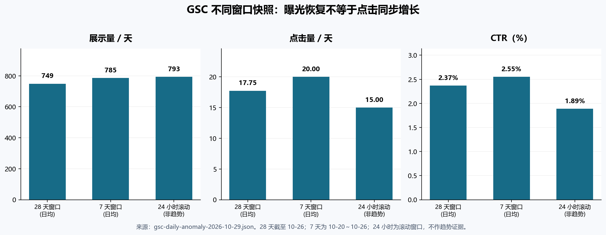

# ZprintPro SEO / AEO / GEO 战略评估与自动任务学习闭环升级报告

> 日期：2026-10-30（Asia/Shanghai）  
> 角色：ZprintPro 首席搜索数据分析与战略参谋  
> 范围：六份指定战略/执行文档、10 月 28—30 日运行证据、GSC 最新可用批次、zh-hk / en / ja 竞品官方页面、自动任务脚本与周/月复盘。  
> 本批边界：只修改 `scripts/` 与 `.hermes/` 观测、复盘和报告产物；未修改 `src/`，未 commit，未 push，未运行生产 wrapper 做测试，未改动调度时间、名片/贺卡资产或 301 映射。

## 执行摘要

**结论一：不是“所有自动任务几天完全没执行”，而是“部分车道已恢复执行，三条 Windows 自然调度仍故障，且业务队列没有可消费任务”。** 10 月 29 日 daily-content 与 GSC 有自然定时轮、真实报告和零退出码；10 月 30 日 weekly-meta 是手动 wrapper 路径成功，blog-deepfix 是 Harness 手动执行，均不能证明对应 Windows 任务恢复。weekly-meta、blog-deepfix、monthly-matrix 的 `LastTaskResult=2147946720（0x800710E0）` 仍是独立阻塞；k3-review 当天则被 weekly 持锁阻断。截图中的“已开启”只是 UI 状态，不是四方验收证据。[lane-status](kimi-cite://text?path=F%3A%5Czprintpro-nextjs%5C.hermes%5Clogs%5Clane-status.json&text=%22Result%22%3A%202147946720 "citation")

**结论二：搜索曝光已恢复，但不能把恢复系数当成业务增长。** 最新全国家口径的主方法为 `785.43 ÷ 714.71 = 109.9%`，第二方法为 107.2%；两者都支持“曝光恢复”，但都不是询盘、订单或收入增长率。28 天为 497 点击、20,977 展示、CTR 2.37%、平均位置 13.52；7 天为 140 点击、5,498 展示、CTR 2.55%、平均位置 14.17。带钱词首页仅 6/23，海报、コミケ、食品包装仍有高展示零点击，说明下一阶段应优先修复采购答案和词页匹配，而不是继续铺通用文章。[gsc-daily-anomaly-2026-10-29](kimi-cite://text?path=F%3A%5Czprintpro-nextjs%5C.hermes%5Clogs%5Cgsc-daily-anomaly-2026-10-29.json&text=%22method_1%22%3A%20%223mo%20file%20pre-cliff%20window "citation")

**结论三：六份文档的方向正确，但“战略/执行包完成”不等于“上线完成”，更不等于“SEO 结果完成”。** 当前队列五项核心商业任务全是 `WAITING_K3`：海报、包装批 1、en sticker、en catalog、ja C109；daily-content 合规 `NO_OP` 是门禁生效，不是执行层偷懒，也不是 SEO 交付。不得由执行层自行把这些任务改成 READY。[strategy-task-queue](kimi-cite://text?path=F%3A%5Czprintpro-nextjs%5C.hermes%5Clogs%5Cstrategy-task-queue.json&text=%22status%22%3A%20%22WAITING_K3%22 "citation")

**结论四：本批已把自动闭环从“会生成报告”推进到“能识别真实证据、记录复发、独立保留调度故障、幂等派发”。** 14 项隔离测试全部通过；真实周复盘记录 28 次运行、4 个当前异常，新增 1 条锁冲突恢复任务，并更新 3 条旧调度故障。第二次复跑新增任务为 0，复发计数保持 1，学习候选保持 0。周/月复盘已在 preflight 的 host 侧接入，不是孤立的分析脚本。[periodic-review-weekly-2026-10-30](kimi-cite://md-line?path=F%3A%5Czprintpro-nextjs%5C.hermes%5Clogs%5Cperiodic-review-weekly-2026-10-30.md&line=41&text=-%20New%20FIX%20task%20IDs%3A%20NONE%20%28or%20already%20present%29 "citation"), [lane-preflight](kimi-cite://text?path=F%3A%5Czprintpro-nextjs%5Cscripts%5Clane-preflight.py&text=review_period%20%3D%20%7B%22ZP-weekly-meta%22%3A%20%22weekly%22%2C%20%22ZP-monthly-matrix%22%3A%20%22monthly%22%7D.get%28args.lane%29 "citation")

## 1. 六份战略与执行文档评估

| 文档 | 保留的正确方向 | 本批校准后的判断 |
|---|---|---|
| dual-engine 深度战略 | 三市场不能使用同一内容清单；小批实验与复测优先 | 应继续作为市场分工依据，但每个“完成”必须拆成源码、线上、GSC、复测四层 |
| packaging 竞品战略 | 以采购决策、盒型、材质、样品和报价为核心，而非泛包装科普 | 真值门禁高于竞品写法；未拍板的价格、食品接触、认证、MOQ 不得上线 |
| seven-clusters 全球战略 | 七簇组织有利于 hub–spoke 与资源管理 | 当前不宜七簇齐头扩量；先海报、贴纸、C109，其余按证据排队 |
| data-driven 下一阶段战略 | 任务评分、准入、7/14/28 天验证、学习边界最完整 | 作为执行 SSoT 保留；其中 GA4/008/订单接入步骤已被 K3 §0.37 终局关闭，不再执行或请求 |
| three-strategy completion 报告 | 对既有交付和待办进行了集中盘点 | “completion”只代表审计与执行包完成，不能当作五项商业页已经上线 |
| automation runtime repair 报告 | 凭据、防假成功、周/月闭环的修复方向正确 | 10 月 28 日后的新证据表明：凭据已恢复过真实车道，三条调度器故障和观测误判仍需继续处理 |

总体上，战略不缺“集群、标题、FAQ、内链”这些框架，真正缺口是**从搜索机会到商业真值、从源码变更到线上复测、从失败证据到责任任务的连续链路**。因此，本批不再增加新的宏大内容集群，而是把既有战略接入可判定的任务状态机：没有 READY 就 NO_OP；没有完整基线就 HOLD；出现明确缺陷才 FIX；重复故障更新旧任务，不以新工单数量伪装工作成果。

## 2. 真实 SEO 结果：恢复、风险与不可知项



| 窗口 | 点击 | 展示 | CTR | 平均位置 | 日均点击 | 日均展示 | 可用结论 |
|---|---:|---:|---:|---:|---:|---:|---|
| 28 天，截至 10-26 | 497 | 20,977 | 2.37% | 13.52 | 17.75 | 749.18 | 中期基线 |
| 7 天，10-20～10-26 | 140 | 5,498 | 2.55% | 14.17 | 20.00 | 785.43 | 曝光日均高于 28 天均值，位置并未同步改善 |
| 24 小时滚动 | 15 | 793 | 1.89% | 13.11 | 15.00 | 793.00 | 仅为快照，不作趋势或长期恶化证据 |

这些数值来自同一批全国家站点汇总，不能与其他三国过滤口径直接拼接。`135.5%` 使用固定 585.2 分母，不应表述为本轮恢复跃升；weekly 报告中的 105.8%属于另一动态窗口，也不与 109.9% 主口径混用。24 小时 CTR 低于 7 天和 28 天值得观察，但样本只有 15 次点击，不能据此重写标题或判定算法惩罚。[gsc-daily-anomaly-2026-10-29](kimi-cite://text?path=F%3A%5Czprintpro-nextjs%5C.hermes%5Clogs%5Cgsc-daily-anomaly-2026-10-29.json&text=%22scope_discipline%22%3A%20%5B "citation")

### 2.1 最值得修复的词页机会

| 市场 / 查询 | 当前证据 | 战略动作 | 禁止动作 |
|---|---|---|---|
| zh-hk / 海報印刷 | 287 展示，位置 14.9，0 点击 | 先统一 A2/A1 价格、MOQ、生产与运输边界，再做主承接页采购答案 | 价格未拍板前写新价格表或无条件即日承诺 |
| ja / コミケ 印刷 | 177 展示，位置 18.9，0 点击 | 用 C109 倒排、部数/ページ/表紙/本文/入稿检查承接窗口需求 | 虚构本站官方截稿、日本直接搬入或活动价 |
| zh-hk / 食品包裝印刷 | 112 展示，位置 8.7，0 点击 | 首页已有曝光，优先核查意图、材质用途、打样与报价输入 | 未证实食品接触、FDA、FSC 等声明 |
| en / small batch sticker printing | 50 展示，位置 5.5，0 点击 | 首页近高位零点击，做 MOQ、proof/sample、材质和生产时间的小批实验 | 用全站曝光增长掩盖该页没有点击 |
| en / china catalog printing | 76 展示，位置 15.9，0 点击 | guide 做选型，PDP 做采购；统一币种和 MOQ | guide 与 PDP 互相复制、同时争抢同一主词 |
| zh-hk / 貼紙印刷 | 118 展示，位置 40.5，0 点击 | 作为明显倒退诊断，先查主 URL、意图和内容变化 | 未诊断就批量扩写所有贴纸页 |

上述机会都已有展示，不需要先证明“能不能被 Google 看见”。它们更需要回答采购者为什么点击、点击后能否相信、能否完成下一步。尤其是海报和 small-batch stickers：前者是最大单点零点击机会，后者已处于首页却仍未获得点击，两者都比再写一批通用印刷知识更接近可验证收益。[gsc-daily-anomaly-2026-10-29](kimi-cite://text?path=F%3A%5Czprintpro-nextjs%5C.hermes%5Clogs%5Cgsc-daily-anomaly-2026-10-29.json&text=%22zero_click_high_impression%22%3A%20%5B "citation")

### 2.2 当前不能声称的结果

- 没有统一在线询盘/订单落地页归因，因此没有 SEO 转化率、ROI 或收入增量结论；该接入任务已被 K3 §0.37 关闭，本报告不重新请求数据。
- 11 月 3 日固定 AI 探针尚未实测，因此没有 ChatGPT、Gemini、Perplexity 或 Google AI 面引用基线；普通 WebSearch 不能冒充生成式答案引用。
- GSC 展示量不是市场容量，平均位置不是每个国家、每个查询的固定名次，跨批次位置差只作方向性诊断。
- 内容任务的运行 OK 不等于采购页上线；采购页上线不等于 7/14/28 天结果已经成立。

## 3. 三市场竞品复核与可执行启示

竞品研究只采用本轮检索到的官方页面作功能基准，不照抄其价格、交期或未经本站验证的承诺。共同规律是：竞品把采购决策条件直接结构化，让用户可以比较数量、材质、打样、生产和交付，而不是只提供“高质量、专业、多年经验”的泛化文案。

| 市场 / 竞品 | 官方页面观察 | ZprintPro 应吸收的结构 | 不应复制的内容 |
|---|---|---|---|
| zh-hk / e-print | 海报页列出 A2/A1、纸质和 1 个工作天；数码贴纸强调低起印和急件 | 首屏直接给规格、数量档位、价格口径、确认稿后生产时间 | 对方价格、1 日/3 小时承诺和本地履约条件 |
| zh-hk / Bannershop | 首页以产品、展览、环保、设计、送货和特急 FAQ 组织采购路径 | 把海报与裱板、展览场景和附加费用边界放在一起回答 | 未经核实的即日、免运或本地工场表述 |
| en / Sticker Mule | custom stickers 明示 10 个起、免费在线 proof、4 天 turnaround、全球配送 | 用小批试单、proof、材质和清晰生产时间降低首次采购风险 | 对方的样品价格、评论数量、4 天履约 |
| en / UPrinting | 配置器、免费 PDF proof、人工文件检查，并区分生产与运输时间 | 把 proof 何时开始、生产何时起算、运输另计写清楚 | 对方截止时点、生产天数和美国物流承诺 |
| en / Packhelp | 3D 编辑器、单件原型、30 件起、5000+ 刀模配置、确认前可见交期 | 包装页优先提供盒型/刀模/原型/数量选择等独特决策资产 | 没有本站能力证据的 3D、单件原型或欧洲生产表述 |
| ja / Raksul、Printpac | 冊子按中綴じ/無線綴じ、オンデマンド/オフセット、部数/ページ和价格例组织 | 使用日本采购术语和规格表，活动页与冊子 PDP 双向分工 | 直接搬入、日本交期、价格例和库存承诺 |

官方依据：[e-print 海报](kimi-cite://web?url=https%3A%2F%2Fwww.e-print.com.hk%2Fproducts_poster_printing%3Fsrsltid%3DAfmBOoq4i8H4aOYJMQ_3Gs3UcgeRjnlI0kiIaor0Py7lW7A2gqwGw2H9 "citation"), [Sticker Mule](kimi-cite://web?url=https%3A%2F%2Fwww.stickermule.com%2Fcustom-stickers "citation"), [UPrinting](kimi-cite://web?url=https%3A%2F%2Fwww.uprinting.com%2Fcustom-printing.html "citation"), [Packhelp](kimi-cite://web?url=https%3A%2F%2Fpackhelp.com%2Fdesign-packaging-online%2F%3Fsrsltid%3DAU7gw4U3w7blS5_Ql79LXSoMsq_uSpIpML88G8nPxlPrn-jX5ju8eHtL "citation"), [Raksul](kimi-cite://web?url=https%3A%2F%2Fraksul.com%2Fprint%2Fbooklet%2F "citation"), [Printpac](kimi-cite://web?url=https%3A%2F%2Fwww.printpac.co.jp%2Fcontents%2Flineup%2Fdoujin_lp%2F "citation")。

C109 的举办窗口为 2026-12-29 至 12-31，适合现在建立倒排采购资产，但活动日期不等于本站截稿日。任何“安全入稿日”都必须由本站真实生产、文件检查、国际运输和缓冲时间推导并获批，不能直接抄竞品或直接搬入时间表。[Circle.ms C109](kimi-cite://web?url=https%3A%2F%2Fentry4.circle.ms%2FCEntry%2FComiket "citation")

## 4. AEO / GEO：从“可提取”升级为“可信且不可替代”

Google 官方说明，AI Overviews / AI Mode 沿用基础 SEO 要求，没有额外的特殊 schema、AI 文本文件或专门技术门槛；页面必须可索引、可有摘要，重要内容应为文本，内链、页面体验和结构化数据与可见正文一致仍然重要。因此，现有 FAQ、12 段骨架和 hub–spoke 应保留为理解框架，但不能被 KPI 化为“FAQ 数”或“schema 数”。[Google AI features](kimi-cite://web?url=https%3A%2F%2Fdevelopers.google.com%2Fsearch%2Fdocs%2Fappearance%2Fai-features "citation")

下一阶段每个采购页至少需要一种**不可轻易替代的资产**：真实数量/价格计算口径、盒型或装订选择器、活动倒排工具、文件检查清单、打样流程、可核验的案例或真实生产边界。直接答案让引擎容易提取，独特证据让用户和引擎没有等量替代品；只有前者没有后者，会形成大量可替换的通用内容。

Google 于 2026-10-01 更新的生成式 AI 内容指南明确要求人工核查准确性与可信度，范围包括正文、title、meta description、结构化数据和图片替代文本。自动化可以生成草稿、汇总证据和派发任务，但不能自动批准商业真值，也不能把未复核的批量内容直接视为可发布资产。[Google generative AI guidance](kimi-cite://web?url=https%3A%2F%2Fdevelopers.google.com%2Fsearch%2Fdocs%2Ffundamentals%2Fusing-gen-ai-content "citation")

## 5. 自动任务根因：四层问题必须分开

| 层 | 实测状态 | 根因/判断 | 当前是否解除 |
|---|---|---|---|
| DeepSeek 凭据与模型 | 10 月 28 日 Machine 凭据恢复后，受控 smoke 与真实 GSC 车道成功 | 旧 `MISSING_CREDENTIAL` 是此前停跑原因；有效路由为 deepseek-official / flash | 对已验证车道解除，不等于三条调度器任务解除 |
| Windows Task Scheduler | weekly、blog、monthly 均为 2147946720 | `0x800710E0`，管理员/操作者拒绝；任务 XML 可导出，不能谎称 XML 损坏 | **未解除，需管理员** |
| 锁与并发 | 10 月 30 日 k3-review 被 weekly 持锁 8.5 分钟阻断 | 锁互斥生效，但相邻任务存在冲突窗口 | 未改调度时间；已派恢复任务 |
| 业务队列 | 五项核心任务 WAITING_K3，daily 无商业 READY | 真值/拍板门禁，不是模型或网络故障 | 未解除，执行层不得自行批准 |
| 观测与学习 | 真实 OK 可被误判、BLOCKED 被计为重复消费、复发不落账 | 脚本解析和反馈逻辑缺陷 | **本批已修复并测试** |

因此，“几天没执行”的准确表述应是：daily/GSC 已有真实成功，weekly/blog 有手动或其他入口产物，但三条 Windows 自然调度没有恢复；同时，即使 daily 正常运行，队列 WAITING_K3 也会让它合法地没有业务改动。把这两种情况合并成“DeepSeek 又坏了”会导致错误修凭据、错误重跑和重复工单。

## 6. 本批已落地的自动闭环修复

| 缺陷 | 修复 | 防回归证据 |
|---|---|---|
| 正文提及 AUTO-FILL 就把真实报告判为占位 | 只识别失败 VERDICT 值后的机器占位标记 | 真实 OK 行含历史事故说明仍通过 |
| `VERDICT: OK**（…` 不被接受 | OK 后允许全角/半角括号、冒号与破折号 | Python 与 Node 两侧同口径测试 |
| 后生成占位报告压过真实 OK | 候选优先 `contractOk && !autoFilled`，再看命名、日期、mtime | 同日长名占位、短名真实 OK，最终选择真实 OK |
| 新失败证据占用正式车道文件名 | 新兜底写为 `.failure.md`，不覆盖正式报告 | 失败仍写 STALE/FAILED，不伪造 OK |
| BLOCKED 重试被当成重复消费 | preflight 写 `key_consumed:false`；只对实际 OK/completed 的重复键告警 | 同键两次 BLOCKED 无 DUPLICATE 警告 |
| 手动 OK 掩盖 Windows 调度失败 | 复盘独立生成 `SCHEDULER_FAILED`，保留 lane 的 OK 业务证据 | weekly OK + scheduler 非零仍进入恢复派发 |
| 复发故障静默去重，像“没有派发” | 更新旧任务 `last_seen / recurrence_count / next_check / evidence / result` | 同 target 与 same-lane 不同措辞均合并 |
| 重复周/月复盘增加复发计数 | `period + review_date + proposed_task_id` 作为观察键 | 隔离复跑与真实复跑均不重复计数 |
| “学习”被当成自由改写能力 | 学习候选仍需 baseline/change/online_verify/retest，PROPOSE_ONLY | 当前学习候选 0；禁止自动改 prompt、扩权、改 src |

本批没有把 STALE 状态下的 src 提交政策擅自放宽，也没有为了消除锁冲突自行调整 weekly 时间。前者涉及 K3 的提交红线，后者涉及调度拍板；把观测修复与权限扩张捆绑会破坏可审计性。

## 7. 验证结果与真实周/月闭环状态

- 隔离测试：**14/14 PASS**。覆盖报告契约、候选排序、全角标点、历史事故正文、BLOCKED 幂等、复发合并、重复复盘、手动 OK＋调度失败、学习候选不伪造。
- `py_compile`：PASS；`node --check scripts/lane-status.mjs`：PASS；目标脚本 `git diff --check`：PASS。
- 真实 `lane-status` 刷新：返回 ATTENTION 是预期结果，因为三条调度器故障和 k3-review 锁冲突仍真实存在；没有把该非零退出伪装成测试失败或系统全坏。
- 真实周窗：28 次运行，校正后 `OK=16、FAILED=6、BLOCKED=2、STALE=4`。这些数字包含历史事故，不能当作本周业务成功率或 SEO 成功率。
- 首次真实周复盘：3 条旧调度故障记录复发，新增 `FIX-WEEKLY-2026-10-30-ZP-k3-review-ca005d9b`；第二次复跑新增 0，三条 `recurrence_count` 均为 1。
- 周/月自动执行入口：`lane-preflight.py` 在 weekly/monthly 调用 dsh 前运行 `strategy-feedback.py --write-queue`；脚本失败会阻断车道，不允许手编“完整复盘”冒充成功。
- 学习候选：**0**。这不是功能失效，而是当前没有同一任务完整记录四段证据；禁止为了满足“自进化”措辞制造样本。

## 8. 下一阶段战略：先兑现已有展示，再复制有效模式

### 8.1 P0：恢复执行与解除真值阻塞

管理员先处理 weekly/blog/monthly 三条任务，K3 再对五项商业任务分别拍板真实价格、MOQ、币种、急件和交付边界。没有这两项，继续增加自动分析频次只会生产更多“已识别但未上线”的报告。日常车道保持 WAITING_K3 不消费，恢复任务可以 READY，但不得借恢复任务修改业务页面。

### 8.2 P1：三个市场各做一个最小页面级实验

| 实验 | 基线 | 最小改动 | 7/14/28 天验收 |
|---|---|---|---|
| zh-hk 海报主承接页 | 海報印刷 287 展示 @14.9，0 点击；A2/A1 价格口径冲突 | 拍板后统一首屏答案、规格/价格表、生产与运输边界、相关内链 | 7 天验线上真值和抓取；14 天看同词同页方向；28 天才 SCALE/HOLD/FIX/STOP |
| en small-batch stickers | small batch sticker printing 50 展示 @5.5，0 点击 | MOQ、proof/sample、材质、生产时间、guide/PDP 分工 | 首页高位优先看 CTR 与点击，不用全站增长替代 |
| ja C109＋冊子分工 | コミケ 印刷 177 展示 @18.9，0 点击 | 活动倒排、入稿检查、部数/ページ/表紙/本文规格、交付边界 | 11 月持续更新窗口；小样本只作方向判断，不虚构活动转化 |

包装批 1 和 catalog 在真值拍板后跟进，不与三个 P1 实验同时大面积改标题。貼紙印刷和教科書印刷属于倒退诊断，先查原因再决定修复，不把“排名下降”直接等同于“内容不够长”。

### 8.3 P2：让周/月复盘真正改变资源分配

每周回答四个问题：哪些任务真实执行、哪些产物真实上线、哪些词页同口径改善、哪些故障复发。每月再做三市场/七簇资源重分配：有完整证据且可重复改善的模式才扩到下一小批；证据不足保留；明确缺陷生成 FIX；连续恶化或真值无法证明停止扩张并交 K3。STOP 不等于自动删页或 noindex。

学习闭环固定为：

`OBSERVE（GSC/总线/线上） → BASELINE（同词同页同窗口） → CHANGE（最小 diff） → ONLINE_VERIFY（线上验收） → RETEST（到期复测） → PROPOSE（学习候选） → REVIEW（共享规则复核）`

只有完整走完这条链，才允许把单页经验提议为共享实践。自动任务可以学习“什么证据支持什么决定”，不能自主学习“如何绕过审批、扩大写权限或改写自己的规则”。

## 9. 仍需管理员与 K3 完成的事项

### 9.1 管理员：恢复三条 Windows 自然调度

当前会话非提升权限，不能声称已完成。请管理员审查生成器后在提升权限的 PowerShell 执行：

```powershell
powershell -NoProfile -ExecutionPolicy Bypass -File "F:\zprintpro-nextjs\scripts\register-cron-tasks.ps1"
```

重注册不是恢复结论。随后必须等待自然触发并做四方验收：① Task Scheduler `LastTaskResult=0`；② wrapper 真实 `dsh exit=0` 与收尾退出；③ 当日 exact 报告四字段且 VERDICT=OK；④ `lane-runs.jsonl` 与报告/调度一致。内容任务还需线上探针，数据任务还需真实数据产物。不得用再次手动 wrapper 或 Harness 运行替代自然调度验收。

### 9.2 K3：五项商业真值拍板

- 海报：A2/A1 价格、MOQ、急件范围和生产/运输边界。
- 包装批 1：盒型、材质、打样、价格/数量、认证与食品接触声明。
- en sticker：单位、MOQ、proof/sample、价格与交期。
- en catalog：MOQ、币种、guide/PDP 采购分工。
- ja C109：价格币种、入稿倒排、国际运输及直接搬入能力边界。

### 9.3 两项政策问题，不在本批擅自决定

- weekly 与 GSC/daily/k3-review 的锁重叠是否通过改到 22:22 等错峰窗口解决；本批只保留诚实 BLOCKED 和恢复任务。
- STALE 时 src 已改但禁止 commit 的悬挂交付政策是否调整；本批不擅自放开 STALE commit/push。

## 10. SOP-10 五问自检

1. **架构差异**：已核对 Windows Task Scheduler → wrapper → preflight → dsh → host finalize → lane-status/strategy-feedback 调用链；没有把 Harness UI 当成 Windows 真触发层。
2. **约束适用范围**：本批只动脚本和日志；未把恢复权限解释成可改 src、调度时间、WAITING_K3、名片/贺卡资产或 301。
3. **原数据/拍板来源**：所有现状数字来自 GSC JSON、lane-status、队列和真实复盘；竞品事实来自本轮官方页面；无估算 baseline、无 MOCK 转化、无 AI 引用伪造。
4. **字段值策略**：未触碰 certNo、validUntil、issuer 或任何商业认证字段；未自行填写价格、MOQ、交期。
5. **Markdown 渲染**：未修改 user-facing src 文本，因此没有新增需要 `parseInlineLinks()` 的页面字段；报告链接仅用于证据定位。

## 数据来源

- 六份指定文档：三份 2026-10-26 战略、2026-10-28 data-driven 战略、three-strategy completion 报告、automation runtime repair 报告。
- GSC：`.hermes/logs/gsc-daily-anomaly-2026-10-29.json` 及其登记的 2026-10-29 K3 导出文件；最新 28 天数据截至 2026-10-26。
- 运行证据：`.hermes/logs/lane-runs.jsonl`、`lane-status.json`、六条 wrapper 日志、10 月 29—30 日车道报告。
- 队列与学习：`.hermes/logs/strategy-task-queue.json`、`periodic-review-weekly-2026-10-30.json/.md`、`learning-candidates.jsonl`。
- 代码与测试：`scripts/lane-git-commit.py`、`lane-preflight.py`、`lane-status.mjs`、`strategy-feedback.py`、`scripts/tests/test-lane-runtime.py` 的 14 项隔离测试及语法检查。
- 竞品与规则：本轮 WebSearch/FetchURL 返回的 e-print、Bannershop、Sticker Mule、UPrinting、Packhelp、Raksul、Printpac、Circle.ms、Google Search Central 页面。
