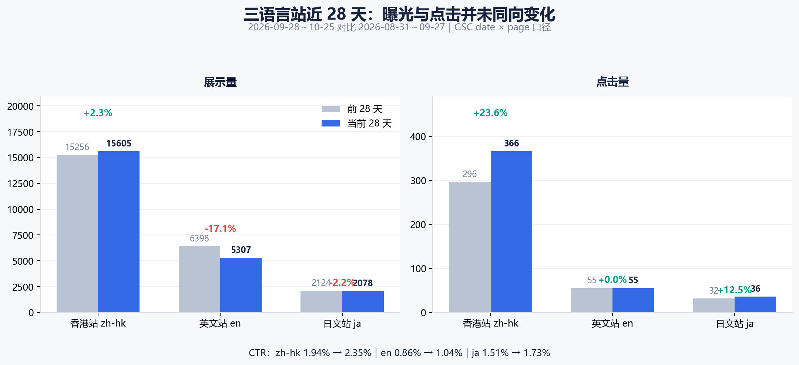
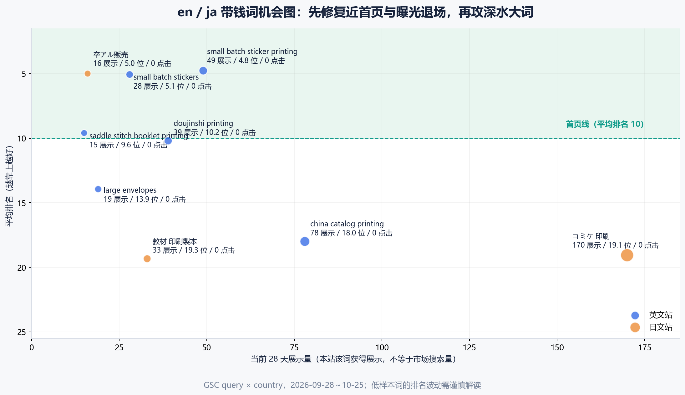
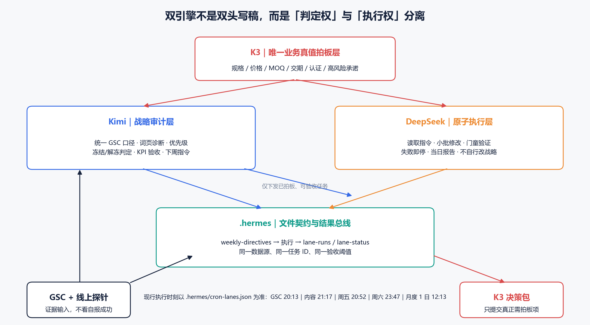

# ZprintPro 三站点 SEO / AEO / GEO 深度盘点与双引擎 30 天作战方案

> 日期：2026-10-26  
> 角色：ZprintPro 首席搜索数据分析与战略参谋  
> 数据窗口：当前 28 天 **2026-09-28～2026-10-25**，对比前 28 天 **2026-08-31～2026-09-27**  
> 适用范围：zh-hk / en / ja；首页攻坚、商业词承接、内容与实体可信度、双引擎执行治理  
> 本轮交付性质：战略、优先级、验收指标与 DeepSeek 原子执行契约；**未擅自修改线上页面、未创建或修改定时任务**。

## 数据来源

- Google Search Console API：`date × page`、`query × country`、`query × page × country`、前后各 28 天，分析结果见 `.hermes/logs/gsc-deep-analysis-2026-10-26.json`；原始 CSV 与复跑脚本见 `.kimi-work/`。[gsc-deep-analysis-2026-10-26](kimi-cite://text?path=F%3A%5Czprintpro-nextjs%5C.hermes%5Clogs%5Cgsc-deep-analysis-2026-10-26.json&text=Full-property%20date%2Fpage%20metrics%20and%20query-only%20metrics%20are%20separate%20GSC%20aggregation%20scopes%3B%20never%20mix%20them. "citation")
- 线上页面探针：2026-10-26 抓取 robots、sitemap、en/ja 重点页状态、title、H1、canonical 与 robots meta。[page-probe-2026-10-26](kimi-cite://text?path=F%3A%5Czprintpro-nextjs%5C.hermes%5Clogs%5Cpage-probe-2026-10-26.json&text=%22path%22%3A%20%22%2Frobots.txt%22 "citation")
- 项目 SSoT：`zprintpro-sku-seo-data.csv`、`src/data/category-seo-content.ts`、`src/app/[locale]/nengajo-2027/page.tsx`、`.hermes/cron-lanes.json`、`.hermes/logs/lane-status.md`。
- 前序方案与执行记录：10/06 en/ja SKU 扩展方案、10/25 价格真值报告、10/26 title 与 C4 分析、10/23 GEO 搜索面代理基线。[2026-10-06-en-ja-sku-keywords-expansion-plan](kimi-cite://md-line?path=F%3A%5Czprintpro-nextjs%5Cdocs%5C2026-10-06-en-ja-sku-keywords-expansion-plan.md&line=42&text=##%20%E4%BA%8C%E3%80%81GSC%2010%2F05%20en%2Fja%20%E5%AE%9E%E8%AF%81%E6%96%B0%E4%BF%A1%E5%8F%B7%EF%BC%88%E6%9C%AC%E6%89%B9%E8%AF%8D%E8%A1%A8%E7%9A%84%E4%BA%8B%E5%AE%9E%E9%94%9A%EF%BC%89 "citation"), [2026-10-25-price-truth-and-usa-exit-words](kimi-cite://md-line?path=F%3A%5Czprintpro-nextjs%5Cdocs%5C2026-10-25-price-truth-and-usa-exit-words.md&line=46&text=##%20%E4%BA%8C%E3%80%81USA%20query%C3%97country%20%E9%80%80%E5%9C%BA%E8%AF%8D%E5%AE%9A%E4%BD%8D%20(28d%2C%20%E5%86%85%E9%83%A8%E6%95%B0%E6%8D%AE) "citation"), [2026-10-26-seo-exit-attack-and-c4-analysis](kimi-cite://md-line?path=F%3A%5Czprintpro-nextjs%5Cdocs%5C2026-10-26-seo-exit-attack-and-c4-analysis.md&line=16&text=###%201.%20%E9%80%80%E5%9C%BA%E8%AF%8D%20title%20%E4%BF%AE%E5%A4%8D%EF%BC%88GSC%20%E9%9B%B6%E7%82%B9%E5%87%BB%E8%AF%8D%2C%20pos%201.0%EF%BC%89 "citation")
- 搜索规则与市场事实：Google Search Central、日本郵便、ラクスル，引用见对应章节。
- 商业转化基线：本轮未接入 GA4、WhatsApp 有效询盘或订单收入，因此下文“带钱词”指**采购意图分类**，不等于已证明收入；转化目标均需以 008 询盘表 / GA4 后续校准。

---

## 一、执行摘要：未来 30 天不再以“发更多文章”为第一增长杠杆

### 1.1 一句话判断

**zh-hk 是增长引擎，en 是曝光收缩与商业词 CTR 断裂，ja 是局部增长但季节大词尚未形成有效承接；全站下一阶段的瓶颈是“真值一致性 + 主 URL 承接 + 可验证采购答案 + 执行可靠性”，不是内容数量。**

### 1.2 关键结论

1. **全站点击增长是真实的，但展示略降。** 展示 23,794 → 23,014（-3.3%），点击 384 → 461（+20.1%），CTR 1.61% → 2.00%。因此不能用“全站上涨”掩盖 en 曝光退场，也不能把 en 展示下降误判成全站失速。
2. **zh-hk 贡献主要增量。** 点击 296 → 366（+23.6%），应保节奏、修内耗与 CTR，而不是大规模重写已经有效的页面。
3. **en 的核心问题是曝光收缩，且近首页商业词零点击。** en 展示 6,398 → 5,307（-17.1%），点击 55 → 55；`small batch sticker printing` 已在 4.8 位仍 0 点击，`saddle stitch booklet printing` 展示 94 → 15、排名 3.46 → 9.6，是恢复优先级最高的退场簇之一。
4. **ja 不是全面横盘。** 点击 32 → 36（+12.5%）；同人誌、A2、卒アル、教材页面有增长，但 `コミケ 印刷` 仍 170 展示 / 19.1 位 / 0 点击，季节页年賀状反而存在规格与报价真值风险。
5. **年賀状 0 展示不是“没建页”。** `/ja/nengajo-2027/` 已 200、index/follow、自指 canonical；当前主规格为 127×178mm，而日本郵便一般年賀はがき为 100×148mm。若工厂不能提供合适规格，继续扩充“年賀状”词面是在放大错误承诺。[page-probe-2026-10-26](kimi-cite://text?path=F%3A%5Czprintpro-nextjs%5C.hermes%5Clogs%5Cpage-probe-2026-10-26.json&text=%22path%22%3A%20%22%2Fja%2Fnengajo-2027%2F%22 "citation"), [日本郵便](kimi-cite://web?url=https%3A%2F%2Fprint.shop.post.japanpost.jp%2Ffeature-nenga%2Farticle70&text=%E4%B8%80%E8%88%AC%E7%9A%84%E3%81%AA%E5%B9%B4%E8%B3%80%E7%8A%B6%E3%81%AE%E3%82%B5%E3%82%A4%E3%82%BA%E3%81%AF%E3%80%8C%E6%A8%AA100mm%C3%97%E7%B8%A6148mm%E3%80%8D "citation")
6. **AEO/GEO 不存在绕过 SEO 的“特殊标记捷径”。** Google 明确说明普通 SEO 最佳实践仍适用，无额外 AI schema、专用 AI 文件或特别技术要求；页面必须可索引、可显示 snippet，重要内容用文本，结构化数据与可见内容一致。[Google AI features](kimi-cite://web?url=https%3A%2F%2Fdevelopers.google.com%2Fsearch%2Fdocs%2Fappearance%2Fai-features "citation")
7. **执行层当前不能承载稳定的自动增长飞轮。** 10/26 07:30 总体验收为 `ATTENTION`，GSC 与 blog 车道存在 MISSING / STALE，多个 wrapper `dsh_exit=1`。这不是“DeepSeek 不适合定时任务”的证据，而是触发、wrapper、报告归属和验收链需先修复。[lane-status](kimi-cite://md-line?path=F%3A%5Czprintpro-nextjs%5C.hermes%5Clogs%5Clane-status.md&line=6&text=%3E%20**verdict%3A%20ATTENTION** "citation")

### 1.3 锁定优先级

| 优先级 | 工作包 | 为什么现在做 | 30 天成功定义 |
|---|---|---|---|
| **P0** | 年賀状规格 / 早割 / 宛名真值；robots 404；saddle / exercise MOQ-H1；en greeting 价格与承诺 | 错误承诺和抓取问题会抵消全部内容投资 | 真值闭环；robots 200；页面与结构化数据一致 |
| **P1-en** | small batch 守位争首击；saddle / exercise 曝光恢复；doujinshi 冲首页；catalog 主承接 | 已有排名或历史展示，恢复概率高于开新词 | 有效展示恢复、近首页词获得非品牌点击 |
| **P1-ja** | コミケ C109 收口；卒アル守位；教材印刷製本 hub；年賀状条件式推进 | C109 与年賀状有时间窗，卒アル已有 5 位小样本信号 | コミケ努力进入 12–16；卒アル守 ≤8；年賀状先真值后 0→有展示 |
| **P2-zh** | 海報 / 貼紙 / 食品 / 月曆词页分工与 CTR | 保护增长、减少 blog 与商业页互相稀释 | 商业词主 URL 展示份额提升，点击不回落 |
| **P2-AEO/GEO** | BLUF 采购答案、可验证事实、AI 面探针 | 让答案可提取、可引用、可核验 | 建立真实引用基线，不用 FAQ 数量冒充成果 |
| **治理 P0** | 五车道可靠性、结果总线、锁、失败停止 | 自动执行不稳定时，扩产只会放大返工 | 应跑任务有完整四方证据，失败可恢复、不空报 OK |



---

## 二、数据口径：本报告如何避免“看似精确、实际混算”

### 2.1 三种聚合各回答一个问题

| 数据范围 | 用途 | 不能用来做什么 |
|---|---|---|
| `date × page` | 全站 / locale 展示、点击、CTR、页面进退场 | 不与 query 数据拼成同一总数 |
| `query × country` | 行业大词、带钱词的排名、展示、点击 | 国家不等于语言站；JPN 数据不等于 ja 全站 |
| `query × page × country` | 同一词由哪些 URL 承接、内耗份额 | 不把多 URL 展示当作独立市场需求相加 |

GSC 展示只代表本站实际获得的搜索曝光，**不等于市场搜索量**；平均排名会受查询与页面组合变化影响，排名上升但展示下降并不矛盾。低展示词的排名和 CTR 均为高方差信号，不作单周因果断言。

### 2.2 三站点总览（`date × page`）

| 站点 | 展示：前期 → 当前 | 展示变化 | 点击：前期 → 当前 | 点击变化 | CTR：前期 → 当前 | 平均排名：前期 → 当前 |
|---|---:|---:|---:|---:|---:|---:|
| 全站 | 23,794 → 23,014 | -3.3% | 384 → 461 | **+20.1%** | 1.61% → 2.00% | 17.22 → 16.44 |
| zh-hk | 15,256 → 15,605 | +2.3% | 296 → 366 | **+23.6%** | 1.94% → 2.35% | 17.66 → 17.46 |
| en | 6,398 → 5,307 | **-17.1%** | 55 → 55 | 0% | 0.86% → 1.04% | 16.46 → 13.36 |
| ja | 2,124 → 2,078 | -2.2% | 32 → 36 | **+12.5%** | 1.51% → 1.73% | 16.45 → 16.72 |

以上数字来自同一全站页面聚合范围。[gsc-deep-analysis-2026-10-26](kimi-cite://text?path=F%3A%5Czprintpro-nextjs%5C.hermes%5Clogs%5Cgsc-deep-analysis-2026-10-26.json&text=%22full_locale%22 "citation")

### 2.3 国家视角只用于市场诊断

`query × country` 中，USA 展示 1,650 → 1,157（-29.9%）、点击 10 → 7；JPN 展示 794 → 847、点击 2 → 2；HKG 展示 5,341 → 4,852、点击 46 → 51。**这些数字不能替代 en / ja / zh-hk 站点总数**，只说明对应国家内查询曝光的方向。[gsc-deep-analysis-2026-10-26](kimi-cite://text?path=F%3A%5Czprintpro-nextjs%5C.hermes%5Clogs%5Cgsc-deep-analysis-2026-10-26.json&text=%22query_market%22 "citation")

---

## 三、行业大词与带钱词：按“可恢复性 × 时间窗 × 商业意图”分配资源

### 3.1 en：不是全面排名下降，而是“曝光退场 + 首页 CTR 断裂”

| 词 / 簇 | 当前展示 | 当前排名 | 当前点击 | 前期对照 | 判断 | 主承接 URL |
|---|---:|---:|---:|---|---|---|
| small batch sticker printing | 49 | **4.8** | 0 | 62 / 6.1 / 0 | 首页守位、先解决点击 | `/en/product/small-batch-stickers/` |
| small batch stickers | 28 | **5.1** | 0 | 43 / 5.5 / 0 | 同簇，不再新建页 | 同上 |
| doujinshi printing | 39 | **10.2** | 0 | 56 / 14.2 / 1 | 首页边缘，最适合冲刺 | `/en/product/doujinshi-printing/` + 指南支持 |
| saddle stitch booklet printing | 15 | **9.6** | 0 | **94 / 3.46 / 2** | 明显退场，先修一致性与恢复展示 | `/en/product/saddle-stitch-booklets/` |
| china catalog printing | 78 | 18.0 | 0 | 102 / 18.7 / 0 | 中程权威与承接问题，不承诺短期首页 | `/en/product/catalog-printing/` |
| large envelopes | 19 | 13.9 | 0 | 7 / 18.3 / 0 | 展示增长、可轻量助推 | `/en/product/large-envelopes/` |
| a2 poster | 44 | 11.9 | 0 | 21 / 34.4 / 0 | 排名改善，观察 10/26 后改动 | `/en/product/a2-posters/` |
| corporate holiday cards | 0 | — | 0 | — | 有页面、无查询关联；先修真值 | `/en/category/greeting-cards/` |

词级数字采用 en 相关市场的 `query × country` 口径；0 展示表示当前数据集中没有可用展示记录，不等于页面未上线。[gsc-deep-analysis-2026-10-26](kimi-cite://text?path=F%3A%5Czprintpro-nextjs%5C.hermes%5Clogs%5Cgsc-deep-analysis-2026-10-26.json&text=%22locale_opportunities%22 "citation")

**en 资源判断：**

- `small batch` 已经是 4.8 / 5.1 位，继续加关键词或再写一篇“small batch stickers guide”不是首选。应改善采购答案、价格与数量阶梯、材质选择、可见交付条件和主页面内链，目标是**守住 ≤6 位并获得首个非品牌点击**。
- `saddle` 的主词展示下降 79、排名后退 6.14 位；同时 title 为 10 MOQ，H1 却写 100+。先统一 MOQ 与装订方式，再判断内容或权威缺口，不在真值冲突上继续扩写。[page-probe-2026-10-26](kimi-cite://text?path=F%3A%5Czprintpro-nextjs%5C.hermes%5Clogs%5Cpage-probe-2026-10-26.json&text=Saddle%20Stitch%20Booklets%20100%2B%20%7C%20ZprintPro "citation")
- `china catalog printing` 当前商业页与 supplier guide 都有展示，商业页占 55/78（70.5%）。正确方向是 PDP 接交易意图、guide 接供应商筛选与风险控制，不是 canonical 一刀切或 301 合并。[gsc-deep-analysis-2026-10-26](kimi-cite://text?path=F%3A%5Czprintpro-nextjs%5C.hermes%5Clogs%5Cgsc-deep-analysis-2026-10-26.json&text=%22china%20catalog%20printing%22 "citation")

### 3.2 ja：同人、卒アル、教材是实证战场；年賀状必须先过产品真值门

| 词 / 簇 | 当前展示 | 当前排名 | 当前点击 | 前期对照 | 判断 | 主承接 URL |
|---|---:|---:|---:|---|---|---|
| コミケ 印刷 | 170 | **19.1** | 0 | 175 / 25.2 / 0 | 展示大、排名改善但未进首页 | `/ja/comiket-c109/` + 同人誌 PDP |
| 卒アル販売 | 16 | **5.0** | 0 | 1 / 2.0 / 0 | 小样本高方差，守位争首击 | `/ja/product/graduation-yearbook/` |
| 教材 印刷製本 | 33 | 19.3 | 0 | 6 / 11.0 / 0 | 展示增长但排名后退 | 教材指南 hub + 对应 PDP |
| 教材 印刷 製本 | 17 | 17.4 | 0 | 4 / 11.0 / 0 | 与上词同簇收口 | 同上 |
| pvc シール | 19 | 19.0 | 0 | 23 / 20.4 / 0 | 中程培育，非本周主攻 | 对应贴纸 PDP / category |
| 年賀状印刷 | 0 | — | 0 | — | 最高时间窗风险，也是最高真值风险 | `/ja/nengajo-2027/`（条件式） |

词级数字采用 ja 相关市场的 `query × country` 口径。[gsc-deep-analysis-2026-10-26](kimi-cite://text?path=F%3A%5Czprintpro-nextjs%5C.hermes%5Clogs%5Cgsc-deep-analysis-2026-10-26.json&text=%22%E3%82%B3%E3%83%9F%E3%82%B1%20%E5%8D%B0%E5%88%B7%22 "citation")

**ja 资源判断：**

- C109 页面已存在且线上 200，因此任务不是“再建一个 C109 页”，而是把漫展采购的页数、装订、纸张、入稿检查、生产与国际配送时差组织成一套可执行方案，并把通用同人誌 PDP 与 C109 活动页分工明确。[page-probe-2026-10-26](kimi-cite://text?path=F%3A%5Czprintpro-nextjs%5C.hermes%5Clogs%5Cpage-probe-2026-10-26.json&text=%E3%82%B3%E3%83%9F%E3%82%B1%20C109%20%E5%90%8C%E4%BA%BA%E8%AA%8C%E5%8D%B0%E5%88%B7 "citation")
- 卒アル当前 16 展示 / 5 位 / 0 点击，样本很小。目标是守住 ≤8 位、提升有效展示与首击，不宣布“已稳定首页”。
- 教材两个变体展示增加但排名下滑，说明不能只靠关键词覆盖。应统一“印刷 + 製本 + 学校采购”的主 hub， PDP 负责报价，指南负责页数、装订、纸张和入稿。
- 年賀状的购买决策不仅是卡片单价。日本市场已有宛名印刷、投函代行与早割服务，ZprintPro 不应复制竞品承诺，而应先回答自己能否提供标准规格、宛名和明确交期。[ラクスル](kimi-cite://web?url=https%3A%2F%2Fraksul.com%2Fnews%2F812%2F&text=%E3%83%A9%E3%82%AF%E3%82%B9%E3%83%AB%E3%81%AE%E5%B9%B4%E8%B3%80%E7%8A%B6%E5%8D%B0%E5%88%B7%E3%81%A7%E3%81%AF%E3%80%81%E5%AE%9B%E5%90%8D%E5%8D%B0%E5%88%B7%E3%83%BB%E6%8A%95%E5%87%BD%E4%BB%A3%E8%A1%8C%E3%81%8C%E7%84%A1%E6%96%99%E3%81%A8%E3%81%AA%E3%82%8A%E3%81%BE%E3%81%99%E3%80%82 "citation")

### 3.3 zh-hk：保增长，重点处理商业词多 URL 承接

| 词 | 当前展示 / 排名 / 点击（query 口径） | 当前内耗证据 | 最优动作 |
|---|---|---|---|
| 海報印刷 | 278 / 15.0 / 0 | 8 页、516 展示；最大页仅 38.6% | category 主接商业词，A2/A1 PDP 接规格与数量，blog 分化信息意图 |
| 印海報 | 124 / 12.7 / 1 | 9 页、350 展示；最大页 27.4% | 与海報印刷同一意图图，不新增近似文章 |
| 食品包裝印刷 | 104 / 9.1 / 0 | blog 103 / food-boxes 56 / packaging 45 | food-boxes 接采购，blog 接合规、材质与选型，强化商业锚 |
| 貼紙印刷 | — | 8 页、215 展示；最大页 35.7% | category 主接，两篇 sticker 指南明确不同任务 |
| 月曆印刷 | — | category 97 / custom-calendars 80 / blog 24 | category 做品类比较，PDP 做报价，blog 做时间表 |
| 小冊子印刷 | 61 / 10.3 / 0 | 书刊词多页承接 | category / saddle PDP 分工，减少指南对交易词的泛化覆盖 |
| 紙袋印刷 | 62 / 13.1 / 0 | 8 页、147 展示；最大页 29.9% | category 主接，handle-bags 等 PDP 接具体袋型 |
| 騎馬釘印刷 | 51 / 11.6 / 0 | 指南 41 / category 38 / PDP 35 | 三者按“工艺学习 / 品类比较 / 立即报价”分层 |
| 即日印刷 | 52 / 6.9 / 1 | rush guide / same-day PDP / service / 首页 | 保持首击，明确急件条件，避免无来源时效承诺 |

zh 单词表与 query×page 表是不同聚合范围，因此**展示数不可横向相加**。内耗处理目标是主承接份额与点击改善，不是机械追求“每词只能有一页”。[gsc-opportunities-2026-10-26](kimi-cite://xlsx-cell?path=F%3A%5Czprintpro-nextjs%5C.hermes%5Clogs%5Cgsc-opportunities-2026-10-26.csv&cell=A2%3AO12 "citation"), [gsc-deep-analysis-2026-10-26](kimi-cite://text?path=F%3A%5Czprintpro-nextjs%5C.hermes%5Clogs%5Cgsc-deep-analysis-2026-10-26.json&text=%22cannibalization%22 "citation")



---

## 四、P0 技术与真值修复：先于任何扩词、扩文和内链放量

### P0-1　年賀状：页面已上线，但三项真值未闭环

**现状证据**

- `/ja/nengajo-2027/` 已上线，`NENGAJO_LIVE=true`，title / H1 写“早割受付中”。
- 页面主推 127×178mm；早割率与正式截止仍为“确定后更新”，宛名印刷仍为“确认中”。[page.tsx](kimi-cite://text?path=F%3A%5Czprintpro-nextjs%5Csrc%5Capp%5C%5Blocale%5D%5Cnengajo-2027%5Cpage.tsx&text=const%20NENGAJO_LIVE%20%3D%20true%3B "citation")
- 日本郵便资料：一般年賀はがき为 **100×148mm**；2027 年用年賀はがき于 **2026-11-02** 开售，年賀状引受从 **2026-12-20** 开始，元日送达建议 **12-27** 前投函。[日本郵便尺寸](kimi-cite://web?url=https%3A%2F%2Fprint.shop.post.japanpost.jp%2Ffeature-nenga%2Farticle70&text=%E4%B8%80%E8%88%AC%E7%9A%84%E3%81%AA%E5%B9%B4%E8%B3%80%E7%8A%B6%E3%81%AE%E3%82%B5%E3%82%A4%E3%82%BA%E3%81%AF%E3%80%8C%E6%A8%AA100mm%C3%97%E7%B8%A6148mm%E3%80%8D "citation"), [日本郵便日期](kimi-cite://web?url=https%3A%2F%2Fprint.shop.post.japanpost.jp%2Ffeature-nenga%2Farticle59&text=2027%EF%BC%88%E4%BB%A4%E5%92%8C9%EF%BC%89%E5%B9%B4%E7%94%A8%E5%B9%B4%E8%B3%80%E3%81%AF%E3%81%8C%E3%81%8D%E3%81%AF2026%E5%B9%B411%E6%9C%882%E6%97%A5%EF%BC%88%E6%9C%88%EF%BC%89%E3%81%8B%E3%82%89%E8%B2%A9%E5%A3%B2%E9%96%8B%E5%A7%8B%E3%81%A7%E3%81%99%E3%80%82 "citation")

**K3 必须先确认**

1. 工厂是否能稳定生产 **100×148mm**，纸张、厚度、印刷面和日本邮寄要求如何对应；127×178mm 是否只是另一款 greeting card。
2. 年賀状实际价格阶梯、早割率、正式截止、生产与配送承诺。
3. 宛名印刷是否提供、支持哪些数据格式、是否收费；投函代行不得默认提供。

**执行分支**

- **A 分支：能提供合适规格。** K3 拍板后统一 title、H1、正文、FAQ、价格表、Service/Offer、WhatsApp 预填与内链；补上 100×148、宛名边界、官方日期来源，再扩大年賀状内链。
- **B 分支：不能提供。** 停止“年賀状印刷 / 早割”扩张，将页面重新定位为「オリジナルはがき・グリーティングカード」，明确 127×178mm，不把它包装成日本标准年賀はがき；保留真实贺卡能力，不伪造年賀状能力。
- **未拍板前。** 撤下或暂停“早割受付中”可见扩张，不用模型补折扣率或截止日期；当前 10 月末窗口已极紧迫，不能为了抢季节词越过真值门。

**验证**：线上 200、规格一致、价格一致、FAQ 与 schema 一致、WhatsApp 预填一致；真值闭环后 7–14 天观察 `年賀状印刷` 是否 0→有展示。没有展示时先查 URL Inspection 的抓取 / 收录与查询关联，不重复加词。

### P0-2　robots：线上 404 + 仓库双源冲突

线上 `/robots.txt` 当前为 **404**，`/sitemap.xml` 为 200；仓库却同时存在 `public/robots.txt` 和 `src/app/robots.ts`，所以这是发布 / 路由重复问题，不是“没有写文件”。public 版本还包含 `Disallow: /_next/`，若生效可能妨碍渲染资源抓取；app 版本没有这个阻断，但只声明主 sitemap。[page-probe-2026-10-26](kimi-cite://text?path=F%3A%5Czprintpro-nextjs%5C.hermes%5Clogs%5Cpage-probe-2026-10-26.json&text=%22path%22%3A%20%22%2Frobots.txt%22%2C%0A%20%20%20%20%22status%22%3A%20404 "citation"), [robots](kimi-cite://text?path=F%3A%5Czprintpro-nextjs%5Cpublic%5Crobots.txt&text=Disallow%3A%20%2F_next%2F "citation"), [robots](kimi-cite://text?path=F%3A%5Czprintpro-nextjs%5Csrc%5Capp%5Crobots.ts&text=disallow%3A%20%5B'%2Fadmin%2F'%2C%20'%2Fapi%2F'%2C%20'%2Fcdn-cgi%2F'%5D "citation")

**原子修复方案**

1. 建议以 `src/app/robots.ts` 为唯一 SSoT，合并所需 sitemap 声明与 crawler 规则，移除 public 重复源；实际改动前先确认构建路由。
2. 不阻断 `/_next/` 静态资源；保留必要的 admin / api / cdn-cgi 限制。
3. 本地构建后检查 `.next` 输出与路由；部署后同时验证 `https://zprintpro.com/robots.txt` 200、正文无 404 HTML、sitemap URL 可访问。
4. 若源码正确而线上仍 404，再查 Cloudflare edge / Pages 发布，不以反复改内容代替根因排查。

### P0-3　saddle / exercise：不是只改 H1，而是统一 MOQ 与装订真值

| 页面 | title | H1 | 风险 |
|---|---|---|---|
| `/en/product/saddle-stitch-booklets/` | 10 MOQ、$1.84 | Saddle Stitch Booklets **100+** | MOQ 不一致；CSV 描述与 FAQ 也须复核 |
| `/en/product/exercise-books/` | Saddle-Stitched、10 MOQ | **100+ / Perfect Bound** | MOQ 与装订方式双重不一致 |

线上探针与 CSV 源头均已定位。[page-probe-2026-10-26](kimi-cite://text?path=F%3A%5Czprintpro-nextjs%5C.hermes%5Clogs%5Cpage-probe-2026-10-26.json&text=Exercise%20Books%20100%2B%20%7C%20Perfect%20Bound%20%7C%20ZprintPro "citation"), [zprintpro-sku-seo-data](kimi-cite://text?path=F%3A%5Czprintpro-nextjs%5Czprintpro-sku-seo-data.csv&text=Saddle%20Stitch%20Booklets%20100%2B%20%7C%20ZprintPro "citation")

**执行纪律**：只改 `zprintpro-sku-seo-data.csv` 源头，再跑 `node scripts/csv-to-sku-seo.mjs`；禁止手搓 `src/data/sku-seo-data.ts`。以 `products.ts` 的真实 MOQ、装订和价格为准，同时核对描述、FAQ、Product schema 与可见报价，而不是机械把 100 改成 10 就结束。

### P0-4　en greeting-cards：先修互相冲突的价格和承诺

- 线上 title 为 `from $0.50`，正文却写 `from US$0.13`；H1 同时堆叠 Free Shipping、10 MOQ、Foil UV、Christmas Wedding、Same Day 24h Rush USA。
- 正文还含 `guaranteed pre-Christmas delivery`、customer repurchase +30%、TikTok GMV 案例、20% premium 等主张；在来源未核验前，不应用于加强转化或 GEO。[page-probe-2026-10-26](kimi-cite://text?path=F%3A%5Czprintpro-nextjs%5C.hermes%5Clogs%5Cpage-probe-2026-10-26.json&text=Business%20%26%20Holiday%20Card%20Printing%20from%20%240.50 "citation"), [category-seo-content](kimi-cite://text?path=F%3A%5Czprintpro-nextjs%5Csrc%5Cdata%5Ccategory-seo-content.ts&text=For%20corporate%20buyers%2C%20holiday%20cards%20are%20a%20deadline%20business%3A "citation")

**动作顺序**：K3 确认价格显示口径 → 核实 MOQ / 免费打样 / 配送门槛 / rush 能力 → 删除或证据化无法确认的案例和百分比 → 再写 corporate holiday cards BLUF 段与 FAQ。当前不应直接粘贴一段带价格的新文案，否则可能把冲突固化。

---

## 五、en / ja 首页攻坚：逐页动作、目标与停止规则

### 5.1 en 作战清单

| 顺序 | 页面与动作 | 目标词 | 30 天努力目标 / 验证阈值 | 停止或回滚条件 |
|---|---|---|---|---|
| E1 | `small-batch-stickers`：保持 title 冻结；在 PDP 首屏后补真实 MOQ、数量阶梯、材质 / 防水 / 裁切选择、生产与配送边界；从 sticker category 与唯一最相关指南各加 1 条自然商业锚 | small batch sticker printing / small batch stickers | 守平均排名 ≤6；当前 0 点击→出现首个非品牌点击；28d 展示不以 >30% 幅度继续收缩 | 7d 排名连续明显跌出首页或页面点击恶化，先查改稿与查询组合，不继续加文 |
| E2 | `saddle-stitch-booklets`：先完成 P0-3；补页数 / 装订 / 纸张 / 跨页限制的可采购信息，内链从 books category 与 saddle 指南指向 PDP | saddle stitch booklet printing | 主词展示 15→30–50 为恢复观察阈值；排名先稳回首页，不保证前期 3.46 | 真值未统一前禁止内容扩张；展示继续归零则 URL Inspection + 变更史 |
| E3 | `exercise-books`：统一 MOQ / 装订；学校采购段与教材指南互链，区分 exercise books / textbooks | school exercise book printing / exercise book printing | 页面展示 69 停止下滑；争取主词非品牌首击 | 不以单日排名判断；若查询转向无关用途，收窄文案而非追词 |
| E4 | `doujinshi-printing`：PDP 接报价，Comiket / zine 指南接入稿与活动排期；补真实页数、装订、纸张、文件检查与国际交期 | doujinshi printing / doujin printing | `doujinshi printing` 10.2→8–10 为努力目标；保持 `doujin printing` 已有点击 | 不用活动名称堆砌无关 SKU；点击下降则保留原指南结构 |
| E5 | `catalog-printing` + supplier guide：PDP 主接交易；guide 主接 supplier selection / 打样 / 色差 / 贸易与交付风险，双向自然内链 | china catalog printing / catalogue printing china | 先提升商业页展示份额与有效点击；当前 18 位，不设 30 天首页硬承诺 | 禁止为归并而 canonical / 301；若 PDP 份额下降，检查意图错配 |
| E6 | `eco-paper-bag-gsm`：先查 URL Inspection、近 4–8 周变更史、内链与收录，不盲改 | eco paper bag gsm | 解释 103→0 的展示退场原因后再定修复 | 200 + index/follow + 自指 canonical 不能证明已被索引；禁止直接重写 |

`eco-paper-bag-gsm` 线上仍 200、index/follow、自指 canonical，因此“展示归零”需要通过 GSC URL Inspection 和变更史继续诊断。[page-probe-2026-10-26](kimi-cite://text?path=F%3A%5Czprintpro-nextjs%5C.hermes%5Clogs%5Cpage-probe-2026-10-26.json&text=%22path%22%3A%20%22%2Fen%2Fblog%2Feco-paper-bag-gsm%2F%22 "citation")

### 5.2 en 页面退场：不要只按展示跌幅排序

| 页面 | 展示：前期 → 当前 | 点击：前期 → 当前 | 判读 |
|---|---:|---:|---|
| `/en/product/exercise-books/` | 235 → 69 | 2 → 0 | P1 恢复；先修真值与查询承接 |
| `/en/product/saddle-stitch-booklets/` | 251 → 96 | 3 → 0 | P1 恢复；主词同步退场 |
| `/en/blog/eco-paper-bag-gsm/` | 103 → 0 | 0 → 0 | P1 诊断，不盲改 |
| `/en/blog/catalog-printing-china-supplier-guide/` | 203 → 103 | 0 → 1 | 展示降但已获点击，保留并强化信息意图 |
| `/en/blog/flyer-sizes-compared/` | 222 → 124 | 0 → 0 | 信息页 CTR / 查询组合诊断，次优先 |
| `/en/product/small-batch-stickers/` | 341 → 258 | **1 → 2** | 不按失败处理；点击与排名改善，守位优化 |

这些页面指标来自同一 `date × page` 口径。[gsc-deep-analysis-2026-10-26](kimi-cite://text?path=F%3A%5Czprintpro-nextjs%5C.hermes%5Clogs%5Cgsc-deep-analysis-2026-10-26.json&text=%22en_page_declines%22 "citation")

### 5.3 ja 作战清单

| 顺序 | 页面与动作 | 目标词 | 30 天努力目标 / 验证阈值 | 停止或回滚条件 |
|---|---|---|---|---|
| J1 | C109 活动页接展会排期，同人誌 PDP 接正式报价；补印刷规格、页数 / 装订选择、入稿检查、生产 + DHL 时间逆算，活动页与 PDP 双向内链 | コミケ 印刷 / 同人誌印刷 | 19.1→12–16 为努力目标；先获得非品牌点击 | 不新增第二个 C109 承接页；活动日期或特急承诺无来源即停 |
| J2 | 卒アル PDP：明确 1 冊起的真实条件、3 种装订差异、学校 / クラス / 同窓会用途、制作流程与文件要求 | 卒アル販売 / 卒業アルバム 印刷 | 守平均排名 ≤8；展示继续增长并争首击 | 16 展示为高方差小样本，不因一周回落重写 title |
| J3 | 教材指南 hub：统一教材 / 教科書 / ワークブック意图；PDP 接报价，指南接页数、装订、纸张与学校采购清单 | 教材 印刷製本 / 教材 印刷 製本 | 止住排名后退，恢复有效展示并争首击 | 不把 exercise / textbooks 多页机械合并；先看 query×page |
| J4 | 年賀状按 P0-1 A/B 分支推进；只有 A 分支才扩大年賀状内链 | 年賀状印刷 / 年賀状 早割 | 真值闭环后 0→有展示；不承诺首页 | 无标准规格或无早割真值时转 B 分支 |
| J5 | クラフト紙包装与月历只做中期培育，复用现有 PDP / category，不开新近似文章 | クラフト紙 パッケージ / カレンダー印刷 | 保持展示、改善主 URL 份额 | 不进入本月首页硬目标 |

### 5.4 zh-hk 词页分工与内链规则

| 词簇 | 商业主承接 | 信息支持页 | 本周只做的事 |
|---|---|---|---|
| 海報印刷 / 印海報 | `/zh-hk/category/posters/`；规格词由 A2/A1 PDP | poster-printing-guide、price guide、retail guide | 保留 10/26 新 title 观察；指南正文用自然锚指向 category / PDP，信息段避免重复“立即报价”模板 |
| 食品包裝印刷 | `/zh-hk/product/food-boxes/` + `/zh-hk/category/packaging/` | food-packaging-printing-guide | blog 聚焦食品接触、材质、结构、打样；采购段链 food-boxes |
| 貼紙印刷 | `/zh-hk/category/stickers/` | sticker-guide / sticker-buying-guide | 两篇指南明确“材质知识”与“采购决策”差异，减少同词重复段落 |
| 月曆印刷 | `/zh-hk/category/calendars/` + custom-calendars PDP | 2027 timetable / complete guide | category 比较类型，PDP 报价，blog 负责排期；不新建 2027 近似文章 |
| 騎馬釘印刷 | `/zh-hk/category/books/` + saddle PDP | saddle 指南 | 工艺 / 页数 / 跨页知识留 blog，价格与 MOQ 到 PDP |

**内链落位统一规则**：放在源页与目标词语义一致的 H2 下第一个采购或总结段末；每源页每个目标仅 1 条，锚文本自然精确但不批量复制同一句；不加 footer 链接块，不用 canonical 代替内链，不为了“归并”随意 301。具体段序由执行时读取当前源码确定，避免在报告里虚构段落编号。

---

## 六、SEO / AEO / GEO 分层：一个真值底座，三种搜索面收益

### 6.1 SEO：主 URL、可抓取、可索引、可满足意图

本月 SEO 不是“所有词都进首页”，而是：

1. 修复 robots 与页面真值，让搜索引擎能稳定抓取、理解并信任页面。
2. 每个商业词簇指定一个主商业 URL，blog 保留明确的信息任务。
3. 已进首页的词优先解决 CTR 与询盘承接；10–20 位词做内容与内链冲刺；20 位以后按权威和独特资产中期培育。
4. 10/26 已上线的 5 个 title 至少观察 2–4 周，不在本方案中再次改动。[2026-10-26-seo-exit-attack-and-c4-analysis](kimi-cite://md-line?path=F%3A%5Czprintpro-nextjs%5Cdocs%5C2026-10-26-seo-exit-attack-and-c4-analysis.md&line=52&text=5.%20%E9%80%80%E5%9C%BA%E8%AF%8D%E4%BF%AE%E5%A4%8D%E6%95%88%E6%9E%9C%204%20%E5%91%A8%E5%90%8E%20GSC%20%E5%A4%8D%E6%B5%8B "citation")

### 6.2 AEO：可见采购答案，而非 FAQ 富摘要幻想

Google 已宣布 FAQ 富摘要自 **2026-05-07** 起不再展示，并在 **2026-06-15** 移除对应文档。因此：

- FAQ 仍可用于回答 MOQ、价格、材质、交期、文件格式、打样、配送和售后问题。
- **FAQPage 数量、FAQ 富摘要展示量不得再作为 KPI**；schema 只标记真实可见内容，不为“富摘要”批量灌水。[Google Search updates](kimi-cite://web?url=https%3A%2F%2Fdevelopers.google.com%2Fsearch%2Fupdates "citation")

**每个重点商业页的答案骨架**

1. **BLUF 第一句**：直接回答“这款产品适合谁、从多少数量 / 价格起、标准交期是什么”。
2. **采购决策表**：规格、纸张、工艺、MOQ、数量阶梯、生产时间、配送边界。
3. **限制条件**：何时不适用、哪些承诺需报价确认、旺季与跨境时效如何计算。
4. **2–4 个可见 FAQ**：只回答真实采购问题，避免重复正文。
5. **证据与更新时间**：价格 SSoT、官方尺寸 / 截止日期、真实案例证据、最近复核日。

Product structured data 可承载价格、库存、配送、退货等信息，但 Google 不保证增强展示；标记必须与真实可见产品信息一致。[Google Product structured data](kimi-cite://web?url=https%3A%2F%2Fdevelopers.google.com%2Fsearch%2Fdocs%2Fappearance%2Fstructured-data%2Fproduct "citation")

### 6.3 GEO：建立“可被模型引用的事实”，不是制造 GEO 指标

Google 对 AI features 的官方要求仍回到基础 SEO、文本内容、内链和一致的结构化数据，无特殊 AI schema 或专用 AI 文件要求。[Google AI features](kimi-cite://web?url=https%3A%2F%2Fdevelopers.google.com%2Fsearch%2Fdocs%2Fappearance%2Fai-features "citation")

**本月可引用资产优先级**

1. **真实规格库**：尺寸、纸张、装订、页数限制、文件分辨率、 bleed / 色彩要求，附复核日期。
2. **真实价格与交期锚点**：明确数量、规格、币种、适用范围与有效期，不把 modelled 价格冒充实报价。
3. **真实生产证据**：工厂与设备能力、打样 / 质检流程、可公开照片或案例；无法公开的细节不写。
4. **采购工具**：C109 入稿逆算表、学校印刷清单、食品包装选型表、年賀状官方时间表。
5. **真实实体一致性**：深圳主实体、香港服务节点、品牌与联系方式跨页面一致；不编 sameAs、认证、客户数量、复购率或 GMV。

**GEO 测量边界**

10/23 文件的“4/4 词簇命中”只是 **web_search 搜索面代理基线**，不是 AI Overview、ChatGPT 或 Perplexity 的实际引用率，不能写成“GEO 引用率 100%”。[geo_citation_baseline-2026-10-23](kimi-cite://md-line?path=F%3A%5Czprintpro-nextjs%5C.hermes%5Cgeo%5Cgeo_citation_baseline-2026-10-23.md&line=3&text=%3E%20%E6%96%B9%E6%B3%95%3A%20%E6%90%9C%E7%B4%A2%E9%9D%A2%E4%BB%A3%E7%90%86%E5%9F%BA%E7%BA%BF%EF%BC%88web_search%EF%BC%8C4%20%E8%AF%8D%E7%B0%87%EF%BC%89%E3%80%82 "citation")

**11 月人工 AI 面探针**：固定模型 / 产品、prompt、语言、地区、账号状态、日期；保存答案原文、引用 URL、截图与是否提及品牌。词簇为原 4 个 + ja 同人誌 + 食品パッケージ + 年賀状；同一 prompt 至少复测两次，记录波动，不把单次答案当稳定事实。

`z-printpro.com` 与 `hkprint58.com` 当前只能标记为**归属待核**。K3 确认权属前，不公开定性仿冒，不发起错误投诉。[geo_citation_baseline-2026-10-23](kimi-cite://md-line?path=F%3A%5Czprintpro-nextjs%5C.hermes%5Cgeo%5Cgeo_citation_baseline-2026-10-23.md&line=20&text=##%20%E2%9A%A0%EF%B8%8F%20%E5%93%81%E7%89%8C%E5%BC%82%E5%B8%B8%EF%BC%88%E7%A7%BB%E4%BA%A4%20K3%20%E6%A0%B8%E5%AE%9E%EF%BC%89 "citation")

### 6.4 内容生产红线：日更车道从“篇数 KPI”改为“机会闭环 KPI”

Google 将大量以操纵排名为目的、低原创低价值内容列为 scaled content abuse，并强调 people-first、原创信息与明确创作目的。因此每日内容车道不再以“1×7w 篇数”作为成果；没有合格机会、真值或独特信息时，允许输出 `NO_OP + 原因 + 下一验证点`。[Google spam policies](kimi-cite://web?url=https%3A%2F%2Fdevelopers.google.com%2Fsearch%2Fdocs%2Fessentials%2Fspam-policies "citation"), [Google people-first content](kimi-cite://web?url=https%3A%2F%2Fdevelopers.google.com%2Fsearch%2Fdocs%2Ffundamentals%2Fcreating-helpful-content "citation")

每篇内容必须至少带来一种独特价值：真实价格档、真实规格 / 样品、真实采购流程、独有数据、可下载清单或明确的问题解决；仅改写竞品文章、替换语言或扩写关键词不算交付。

---

## 七、30 天执行路线图（2026-10-26～2026-11-24）

### 第 1 周｜10/26–11/01：真值、抓取与退场诊断

| 工作 | 责任 | 具体产物 | 验收 |
|---|---|---|---|
| 年賀状三真值拍板 | K3；Kimi 出对照 | 100×148 可否、价格 / 早割、宛名 / 投函边界；A/B 分支决定 | 无拍板不扩张；页面承诺不超出真实能力 |
| robots 单源化 | DeepSeek 原子批 | 一个 robots SSoT + 构建与线上探针 | `/robots.txt` 200、非 HTML 404、`/_next/` 未阻断 |
| saddle / exercise MOQ | DeepSeek；Kimi 审核 | CSV 源头修改 + 生成器派生 + 页面 / FAQ / schema 对照 | title、H1、正文、FAQ、Offer 真值一致 |
| en greeting 价格与承诺 | K3 + DeepSeek | 价格口径决定；无来源案例与保证性交付清理清单 | title / 正文 / FAQ / schema 同价；承诺有证据 |
| eco-paper-bag-gsm 诊断 | DeepSeek 数据批 | URL Inspection 结果、变更史、内链与查询清单 | 有根因假设与证据，不直接盲改 |
| 五车道可靠性 | K3 管理员 + DeepSeek | 10/24–10/26 缺口根因、wrapper 错误、修复记录 | 不用补跑制造“历史成功”；新触发通过四方验收 |

**周末闸门**：P0 未完成时，下周只做诊断和无风险内链，不启动大规模内容生产。

### 第 2 周｜11/02–11/08：近首页 CTR、主承接与内链

- en：small batch、saddle、doujinshi 三组；catalog 明确 PDP / guide 分工。
- ja：C109 + 同人誌 PDP；卒アル PDP；教材 hub。
- zh：海報、食品、貼紙、月曆四簇的词页分工与自然商业锚。
- AEO：每个目标页先补 BLUF + 采购表 + 限制条件，再决定是否需要 FAQ；不批量添加 schema。
- GEO：发布 1–2 个可验证采购资产，优先 C109 逆算表与学校印刷清单；年賀状仅在 A 分支下使用官方时间表。

**验收**：线上探针通过；记录每个目标 URL 的修改日期；7d 只看方向，28d 看展示 / 点击；禁止一天内反复改同一页。

### 第 3 周｜11/09–11/15：只扩已验证词簇

**扩量条件**：目标页已收录、真值一致、近 7–14 天展示未继续大幅退场，并且现有页面不能完整回答一个真实采购问题。

可扩候选：

- en：short-run booklet 的页数 / 装订 / 跨页指南；doujinshi 文件检查清单；catalog supplier 打样与色差控制。
- ja：教材製本选择、卒アル制作流程、C109 入稿检查；不新写第二个“コミケ印刷とは”泛文。
- zh：食品包装材质 / 结构选型、海报尺寸与纸张选择；与现有指南重复则改原页，不新建。

**禁止**：为日更凑篇数、把同一文章翻译成三语充当独特价值、没有真值的价格文、无证据案例文。

### 第 4 周｜11/16–11/24：复测、冻结有效页、重分配资源

1. 用同口径拉取 7d / 28d GSC，区分查询组合变化与页面真实进退场。
2. 对有效页冻结 2–4 周；对无效页先判断抓取、意图、真值、CTR、权威哪一层失败。
3. 复测 AI 面 7 个词簇，保存答案与引用证据，不用 web_search 命中替代 AI 引用。
4. 形成下月资源表：`SCALE`（有效扩量）、`HOLD`（继续观察）、`FIX`（指定根因修复）、`STOP`（停止投资）。
5. 复核询盘：将非品牌点击与 WhatsApp / 报价 / 有效询盘按 URL 对齐；当前无基线的指标标“待校准”，不估算收入。

---

## 八、双引擎战略—执行分离：K3 拍板、Kimi 审计、DeepSeek 原子执行



### 8.1 治理边界

| 层 | 该做 | 不该做 |
|---|---|---|
| **K3 / 主脑** | 产品能力、价格、MOQ、交期、认证、市场与风险拍板；处理管理员与账号权限 | 不让执行层猜商业真值 |
| **Kimi / 战略审计** | 读 GSC 与线上证据、定义优先级、拆原子任务、复核 diff 与 KPI、提出停止 / 扩张 | 不绕过锁和攒批纪律，不用宏观战略代替验收 |
| **DeepSeek / 执行层** | 读取上下文、按指定文件小批修改、跑门禁、写当日报告、记录失败与下一步 | 不自行改变战略、不补数字、不跨车道抢文件、不把 wrapper exit 0 当成功 |

附件中的战略—执行分离原则保留，但旧时间、旧路径和旧基线不直接灌回：当前以 `.hermes/cron-lanes.json`、`.hermes/logs/`、`lane-status` 和本报告为 SSoT。

### 8.2 当前调度事实与可靠性结论

当前五执行车道为：GSC 每日 **20:13**、内容每日 **21:17**、周五 **20:52**、周六 **23:47**、月度 1 日 **12:13**；另有 K3 review 07:10 与 watchdog 06:43。[cron-lanes](kimi-cite://text?path=F%3A%5Czprintpro-nextjs%5C.hermes%5Ccron-lanes.json&text=%22task%22%3A%20%22ZP-gsc-feedback%22 "citation")

10/26 07:30 的状态显示：GSC 10/25 MISSING、blog-deepfix 10/24 MISSING，weekly / monthly 有异常 LastTaskResult，多个 wrapper `dsh_exit=1`。因此：

- **不能断言 DeepSeek 4.1 Flash 不适合定时任务。** 缺跑发生在模型生成之前或 wrapper 阶段时，模型质量不是已证根因。
- **也不能把 harness 手工成功记录当成自动调度健康。** 必须分别验收调度器、wrapper、模型和页面产物。
- 周五 GSC 20:13 与 weekly 20:52 仅差 39 分钟，而 GSC 超时上限 3600 秒且锁没有队列；存在 weekly 被 BLOCKED 的结构性风险。建议 K3 批准后将 weekly 调整到 **22:22**，避开 daily-content 21:17 的一小时上限；本报告不擅自改调度。[cron-lanes](kimi-cite://text?path=F%3A%5Czprintpro-nextjs%5C.hermes%5Ccron-lanes.json&text=OVERLAP%20WATCH "citation")

### 8.3 五车道新职责：从“内容流水线”改为“证据闭环”

| 车道 | 30 天职责 | 禁止 | 成功证据 |
|---|---|---|---|
| GSC feedback | 每日拉取并检测异常；按本报告口径生成机会 / 退场 / 内耗队列；只提供任务，不直接改页面 | 混算聚合范围；把 0 展示写成没建页 | 当日数据文件 + 当日报告 + 异常分类 + 下一验证点 |
| Daily content | 从已拍板队列选择 1 个最高价值小批；无合格任务可 `NO_OP` | 以篇数 / 词数交差；无来源数字；跨车道改文件 | 具体 URL diff + 真值对照 + 线上探针或明确的未推送原因 |
| Weekly meta | 只处理已解冻且有证据的 title / description；检查 CTR 与真值 | 碰 10/26 冻结批次；为塞词破坏自然语言 | title 窗口检查 + 当量检查 + 修改前后词页证据 |
| Blog deepfix | 修旧文价格、意图、内链和独特资产；优先已有点击 / 展示页 | 批量重写全部 blog；为 12 段骨架而 12 段 | 单篇问题—修复—证据闭环；无新增缺陷 |
| Monthly matrix | 月度词页矩阵、资源重分配、GEO 探针、转化校准 | 把展示当市场量；把代理搜索当 AI 引用 | SCALE / HOLD / FIX / STOP 清单与下月拍板项 |

K3 review 与 watchdog 继续作为治理层，不计入五个执行车道。

### 8.4 每个原子任务的标准输入包

```text
TASK_ID: <lane>-<date>-<target>-<sequence>
INTENT: 修复什么已证实问题
APPROVED_BY: K3 拍板记录 / 不需要拍板的既有规则
TARGET_QUERY_OR_URL: 唯一主目标
INPUT_EVIDENCE: GSC 行、线上探针、真值源、前序报告
WRITE_SCOPE: 允许修改的最小文件集合
DO_NOT_TOUCH: 冻结 title、其他车道文件、派生文件、301、名片/贺卡资产等
TRUTH_SOURCE: products.ts / price-tables / 官方来源 / K3 拍板
ACTION: 1 个小批动作，不夹带第二战略
GATES: 锁、备份、计数/形状断言、encoding、tsc、品牌、JSON、相关 smoke
ONLINE_VERIFY: 状态、title/H1、canonical、正文真值、schema、目标 URL
REPORT: .hermes/logs/<YYYY-MM-DD>-<lane>.md
STOP_IF: 缺真值、锁冲突、门禁失败、根因前提不成立
NEXT_CHECK: 具体日期 + 指标 + 成功/失败阈值
```

**派生文件铁律**：SKU SEO 只改 `zprintpro-sku-seo-data.csv` 后运行 `scripts/csv-to-sku-seo.mjs`；不得手改 `src/data/sku-seo-data.ts`，冲突时回源头重新生成，不用 `--ours/--theirs` 手选。

### 8.5 成功判定：四方证据 + 线上结果

一次自动任务只有同时满足以下条件才算 `OK`：

1. `lane-runs.jsonl` 有本次 run 记录；
2. wrapper 日志有真实 `dsh exit` / `run end exit`，且结果符合预期；
3. 存在目标日期的本车道报告，内容含 `VERDICT / CONSUMED / DELIVERED / NEXT`；
4. 调度器记录与本次触发一致；
5. 若任务声称上线，必须有对应线上探针；若只是数据任务，必须有对应数据产物。

文件 mtime、自我播报、`wrapper_exit=0` 或一篇其他车道报告均不能单独证明成功。历史缺口可以补诊断，但不得通过补跑把历史 MISSING 改写成“当时成功”。

---

## 九、KPI、验证节奏与停止规则

### 9.1 三层 KPI

| 层 | 指标 | 频率 | 说明 |
|---|---|---|---|
| 技术 / 真值 | robots 200；index/follow；canonical；H1 / MOQ / 价格 / schema 一致 | 每次上线后 | 硬门槛，失败即不进入排名观察 |
| 搜索领先指标 | 目标 URL 展示、查询覆盖、主 URL 展示份额、平均排名、非品牌点击 | 7d 方向 / 28d 结论 | 低样本标高方差；不以单日排名做决策 |
| 商业结果 | WhatsApp 点击、报价提交、有效询盘、订单与收入 | 周 / 月 | 需 GA4 + 008 + 订单数据校准，GSC 本身不提供 |

### 9.2 本周期目标均为努力目标或验证阈值，不是排名保证

| 目标 | 当前基线 | 11/24 前观察标准 |
|---|---|---|
| robots | 线上 404 | 200 且规则正确，sitemap 可用 |
| saddle / exercise | H1 与 title / MOQ 不一致 | 全页面与结构化数据真值一致 |
| 年賀状 | 当前词级 0 展示；规格与早割未定 | 先完成 A/B 分支；仅 A 分支要求 0→有展示 |
| small batch sticker printing | 49 展示 / 4.8 位 / 0 点击 | 守 ≤6 位并出现首个非品牌点击 |
| saddle stitch booklet printing | 15 展示 / 9.6 位 / 0 点击 | 展示恢复至 30–50 为观察阈值；点击优先于虚假排名承诺 |
| doujinshi printing | 39 展示 / 10.2 位 / 0 点击 | 努力进入 8–10 位，并获得非品牌点击 |
| コミケ 印刷 | 170 展示 / 19.1 位 / 0 点击 | 努力进入 12–16 位；先形成有效点击 |
| 卒アル販売 | 16 展示 / 5.0 位 / 0 点击 | 守 ≤8 位并争首击；标注小样本 |
| en greeting | 0 展示且价格 / 承诺冲突 | 真值统一后再观察 corporate holiday cards 查询关联 |
| zh 商业词 | 多 URL 分散承接 | 主商业 URL 展示份额提升、点击不回落；不设机械份额 100% |

### 9.3 停止规则

- **真值缺失即停**：价格、MOQ、规格、折扣、交期、认证、案例无来源，不生成客户可见承诺。
- **前提被证伪即停**：例如 robots 修复后仍 404，应转 Cloudflare / 发布排查，不重复改同一文件。
- **门禁失败即停**：保留失败报告和恢复分类，不强行 push。
- **锁冲突即停**：不删除他方 staged 变更，不抢写 blog JSON 或派生文件。
- **搜索信号恶化即冻结**：目标页 7d 展示 / 点击显著恶化时先回查变更，不继续叠改。
- **无独特价值即 NO_OP**：宁可不交新文章，也不生产 scaled content。

---

## 十、需要 K3 拍板的决策清单

按阻塞程度排序：

1. **年賀状产品分支**：100×148mm 可否；127×178mm 是否保留为普通贺卡；早割率与截止；宛名 / 投函能力。
2. **en greeting 价格口径**：title 的 $0.50 与正文的 $0.13 哪个代表什么规格 / 数量；MOQ、free shipping、4-hour proof、same-day / 24h rush 的真实边界。
3. **saddle / exercise 真值**：以 products.ts 为准统一 MOQ 与装订；关联 FAQ 中的 50 / 100 等历史口径同步校准。
4. **C4 价格架构**：A/B/C 方案选择；本方案不替 K3 决定全球统价或多市场价。
5. **周五车道错时**：是否批准 weekly-meta 20:52→22:22，消除 GSC / 锁 / daily-content 的潜在冲突。
6. **管理员恢复**：weekly / monthly / blog 的调度异常与 GSC wrapper `dsh_exit=1` 根因处理。
7. **异常域归属**：`z-printpro.com`、`hkprint58.com` 是否自有 / 授权；确认前只做内部核查。
8. **转化数据接入**：允许将 GA4、008 询盘与订单按 landing page 对齐，建立真正的带钱词收入视图。

---

## 十一、最终战略判断

9 月的深度 blog、FAQ、标题与 hub-spoke 动作为站点建立了覆盖基础，但 10/26 数据已经表明：**继续以覆盖数量为中心，会把真值冲突、页面内耗和低价值内容一并规模化。**

未来 30 天最优解是：

1. **先修可信度**：年賀状、robots、MOQ、价格与交付承诺。
2. **再恢复已有资产**：saddle、exercise、eco-paper-bag-gsm，而不是从零开新站外战场。
3. **集中近首页胜率**：en small batch / doujinshi，ja C109 / 卒アル / 教材，zh 海報 / 食品 / 貼紙 / 月曆主承接。
4. **把 AEO 做成采购答案，把 GEO 做成可验证事实**，不追逐不存在的特殊 schema 或虚假引用率。
5. **让双引擎先可靠再自动扩产**：K3 管真值，Kimi 管证据与验收，DeepSeek 管小批执行；日更从篇数驱动改为机会驱动。

这套方案的“首页目标”不是一句排名口号，而是一个可审计闭环：**正确页面 → 可抓取与收录 → 真实且可提取的答案 → 主词展示与非品牌点击 → 报价与有效询盘 → 复测后扩量或停止。**
