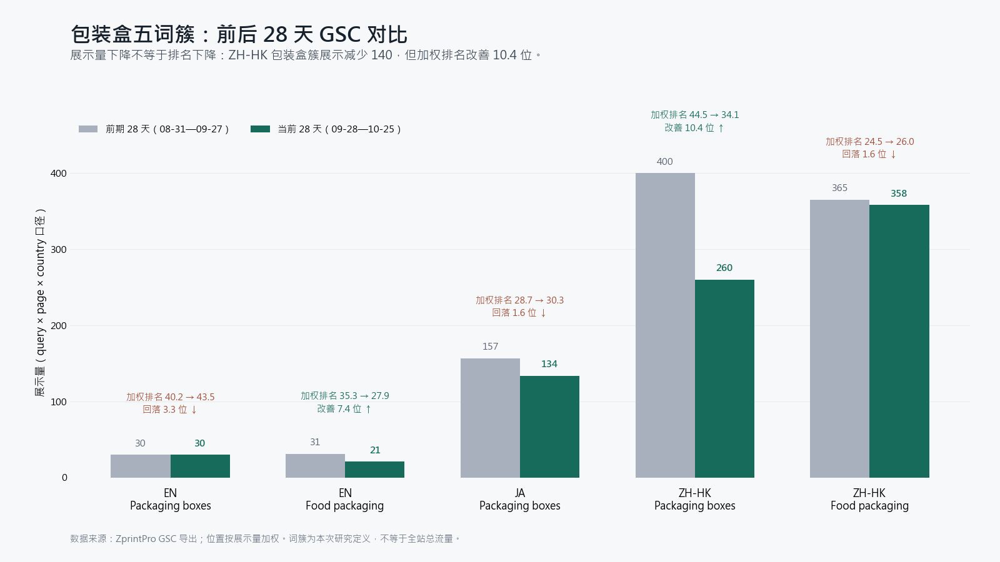
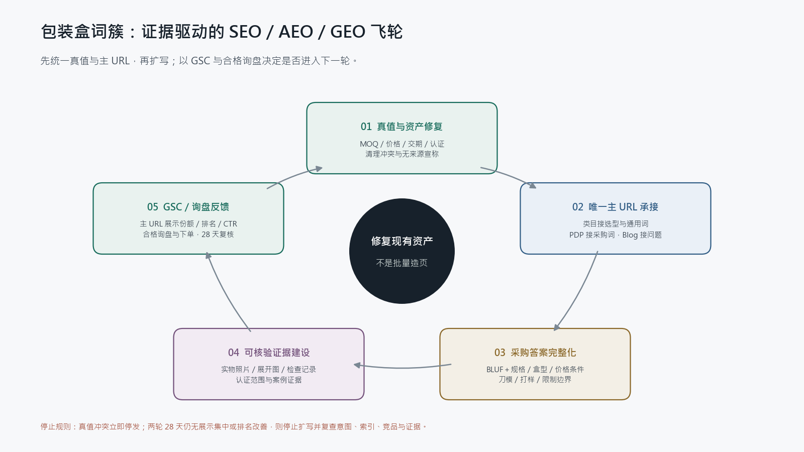

# ZprintPro 三站点包装盒词簇 SEO／AEO／GEO 深度战略与 30 天执行方案

> 日期：2026-10-26  
> 角色：K3／首席搜索数据分析与战略参谋  
> 范围：zh-hk、en、ja 三站点；包装盒、食品包装及高意图供应采购词簇  
> 数据基线：GSC 当前 28 天 2026-09-28—10-25，对比前期 2026-08-31—09-27  
> 本版交付：研究、裁决、执行设计与验收规则；**未修改 `src/`、线上页面、定时任务，未 commit／push**。

---

## 一、执行摘要：最终战略裁决

### 1.1 一句话结论

**包装盒不是“从零建页”的新赛道，而是“已有资产失修、搜索意图分流、采购证据不足”的修复工程。** 最优路径是先统一商业真值、确定唯一主 URL、修复内容与内链，再用真实刀模／试作／规格／质检证据建立 SEO／AEO／GEO 的复利；不按关键词变体批量造页。

### 1.2 六项董事会级裁决

1. **包装升级为重要组合，但不接管全站资源。** 年賀状等季节窗口、技术索引问题及既有近首页词仍按全站优先级运行；包装任务进入同一资源池，不以“唯一增长赛道”为由挤掉其他 P0／P1。
2. **不采纳新建 `custom-packaging-boxes`、`custom-boxes`、`gift-boxes` 等近义页面的建议。** 三语 `/category/packaging/` 与多个 PDP 已是 200、可索引；`gift-boxes` 还已有历史合并治理。保留并强化现有资产。[middleware](kimi-cite://md-line?path=F%3A%5Czprintpro-nextjs%5Csrc%5Cmiddleware.ts&line=42&text=%2F%2F%202026-07-22%20v6%3A%20gift-boxes%20%E5%90%88%E5%B9%B6%E8%BF%9B%20rigid-boxes "citation")
3. **P0 是商业真值与声明治理，不是继续扩写。** en rigid 页面 title 写 100 MOQ、H1 写 250+，价格表却写 50 MOQ／7–10 天；这类冲突未拍板前，执行层不得任选一个数字“统一”。[packaging-page-probes](kimi-cite://text?path=F%3A%5Czprintpro-nextjs%5C.kimi-work%5Cpackaging-research-20261026%5Cpackaging-page-probes.json&text=Rigid%20Boxes%20250%2B%20%7C%20Magnetic%20Closure%20%7C%20ZprintPro "citation"), [rigid-boxes](kimi-cite://md-line?path=F%3A%5Czprintpro-nextjs%5Csrc%5Cdata%5Cprice-tables%5Cen%5Crigid-boxes.json&line=6&text=50%20MOQ%2C%207-10%20day%20turnaround "citation")
4. **近期突破点不是三语通用大词同时冲首页。** ja 牛皮纸包装、en supplier 词、zh-hk「食品包裝訂製」更接近可验证的短期改善区；通用 30–40 位大词先做词权集中和向前 20–30 位靠拢。
5. **AEO／GEO 不做特殊标记竞赛。** 采用 BLUF 采购答案、清晰规格表、真实限制条件和可核验证据；FAQ 为用户与答案清晰性服务，不把 FAQ 数量或富摘要当 KPI。Google 已说明生成式搜索仍以核心搜索排名与质量系统为基础，也不需要另造 llms.txt、特殊 schema 或人为碎块化内容。[Google Search Central](kimi-cite://web?url=https%3A%2F%2Fdevelopers.google.com%2Fsearch%2Fdocs%2Ffundamentals%2Fai-optimization-guide&text=The%20best%20practices%20for%20SEO%20continue%20to%20be%20relevant%20because%20our%20generative%20AI%20features%20on%20Google%20Search%20are%20rooted%20in%20our%20core%20Search%20ranking%20and%20quality%20systems. "citation")
6. **30 天是可复核实验周期，不是排名承诺。** 以主 URL 展示份额、加权排名、有效点击和合格询盘判定；两轮 28 天无改善即停止扩写并重新诊断。

---

## 二、数据口径与真正信号

### 2.1 口径先行

本次从 GSC 的 `query × page × country` 行筛选包装词，词簇与页面聚合均按展示量加权位置；不能与 `query × country`、`date × page` 或旧报告中的其他窗口直接混算。[packaging-local-evidence](kimi-cite://text?path=F%3A%5Czprintpro-nextjs%5C.kimi-work%5Cpackaging-research-20261026%5Cpackaging-local-evidence.json&text=Packaging%20rows%20filtered%20from%20query%C3%97page%C3%97country "citation")

限制：

- GSC 平均位置不是固定名次，也不等于每个国家、设备或用户的实际 SERP。
- 低展示词的名次与 CTR 波动很大；5–9 展示的“首页词”只能当假设验证点，不能外推市场规模。
- 本报告竞品调研比较的是**可观察采购资产**，不把搜索样本写成稳定排名、流量、DA 或市场份额。
- 询盘与订单若无可追踪来源，不进入本报告基线。

### 2.2 五个词簇的前后 28 天对比

下表全部由同一份本地分析数据生成；“排名变化”负值代表位置数值下降，即排名改善。[packaging-local-evidence](kimi-cite://text?path=F%3A%5Czprintpro-nextjs%5C.kimi-work%5Cpackaging-research-20261026%5Cpackaging-local-evidence.json&text=%22clusters%22 "citation")

| locale／词簇 | 当前展示 | 前期展示 | 展示变化 | 当前加权位置 | 前期加权位置 | 位置变化 | 当前点击 |
|---|---:|---:|---:|---:|---:|---:|---:|
| en packaging boxes | 30 | 30 | 0 | 43.53 | 40.23 | −3.30 位（回落） | 0 |
| en food packaging | 21 | 31 | −10 | 27.86 | 35.29 | +7.43 位（改善） | 0 |
| ja packaging boxes | 134 | 157 | −23 | 30.31 | 28.72 | −1.59 位（回落） | 0 |
| zh-hk packaging boxes | 260 | 400 | −140 | 34.09 | 44.50 | +10.41 位（改善） | 1 |
| zh-hk food packaging | 358 | 365 | −7 | 26.05 | 24.46 | −1.59 位（回落） | 0 |

**正确判读：**

- zh-hk 包装簇是“曝光收窄但位置改善”，不是全面衰退；后续目标是让保留的曝光更集中到正确 URL，而不是用更多近义页面把曝光重新摊薄。
- en food packaging 同属展示下降、排名改善；不能仅按展示量把它降级。
- ja 包装簇展示与位置均小幅回落，但 kraft 两个高展示变体仍有明确承接基础，适合优先修复。
- 五簇当前合计仅 1 次点击，说明“有点击”不是当前可依赖的优化反馈；先看主 URL、展示与位置，再看点击和询盘。

### 2.3 带钱词与行业大词：分层而不是混打

| 市场 | 近期可攻词 | 当前实证 | 战略角色 | 首月合理观察目标* |
|---|---|---|---|---|
| ja | `クラフト紙 パッケージ印刷` | 48 展示／27.00 位 | kraft PDP 采购承接 | 20–25 位观察区 |
| ja | `クラフト紙 パッケージ 印刷` | 46 展示／28.04 位 | 与上词共用一个主 URL | 20–25 位观察区 |
| en | `electronics packaging supplier` | 5 展示／14.40 位 | 高意图供应商词 | 10–15 位观察区 |
| en | `food packaging supplier` | 5 展示／16.40 位 | 高意图供应商词 | 10–15 位观察区 |
| zh-hk | `食品包裝訂製` | 60 展示／18.44 位 | food PDP 采购承接 | 10–15 位观察区 |
| zh-hk | `包裝盒訂製` | 44 展示／30.28 位；前期 87／41.16 | category 通用采购承接 | 25–30 位观察区 |
| zh-hk | `包裝盒印刷` | 69 展示／35.41 位 | category 通用印刷承接 | 25–30 位观察区 |
| en | `custom mailer boxes` | 9 展示／40.22 位；前期 3／62.67 | mailer PDP 品类词 | 展示集中、向 30–40 位靠拢 |
| en | `mailer box no minimum order` | 7 展示／78.71 位 | 仅在实际无 MOQ 方案存在时承接 | 无真实方案则不优化 |
| zh-hk | `牛皮紙盒` | 9 展示／2.33 位／1 点击 | 小样本验证点 | 稳定展示与有效询盘，不追 CTR 假象 |

\* 均为**观察目标，不是保证值**；低样本词必须结合展示量、页面与国家分布复核。[packaging-local-evidence](kimi-cite://text?path=F%3A%5Czprintpro-nextjs%5C.kimi-work%5Cpackaging-research-20261026%5Cpackaging-local-evidence.json&text=%22top_queries%22 "citation")

### 2.4 自相蚕食：先分意图，再谈“主 URL 占比”

| 查询 | 当前展示 | 页面分布 | 判定与动作 |
|---|---:|---|---|
| zh `食品包裝印刷` | 204 | blog 103／food PDP 56／category 45 | blog 可继续主接信息与材质合规；PDP 接采购，category 不重复写同篇指南 |
| zh `包裝盒印刷` | 69 | category 46／kraft 18／white-card 3 | category 主接通用词；PDP 只在材质／盒型语境出现 |
| zh `紙盒印刷` | 67 | category 39／kraft 22／corrugated 6 | 同上；category 主 URL 份额需提高 |
| zh `食品包裝訂製` | 60 | food PDP 31／category 27（另有其他页样本） | food PDP 主接采购，category 用选型链接而非复制采购长文 |
| ja `クラフト紙 パッケージ印刷` | 48 | kraft 32／category 16 | kraft 主接；category 降为比较与导航 |
| ja `クラフト紙 パッケージ 印刷` | 46 | kraft 35／category 11 | 与上词共用同一修复，不另建拼写变体页 |

这些分布说明当前问题不是简单“页面数量不够”，而是**同一查询下多个页面说了相似的话**。[packaging-local-evidence](kimi-cite://text?path=F%3A%5Czprintpro-nextjs%5C.kimi-work%5Cpackaging-research-20261026%5Cpackaging-local-evidence.json&text=%22cannibalization%22 "citation")

---

## 三、对两份千问方案的逐项裁决

两份输入报告本身存在事实冲突：一份称包装“零起步”并要求新建 `/en/product/custom-packaging-boxes/`，另一份却列 `/en/custom-boxes` 为待修页面；因此只能把其中建议当假设，不能当执行事实。[qwen-report-1](kimi-cite://md-line?path=F%3A%5Czprintpro-nextjs%5C.kimi-work%5Cpackaging-research-20261026%5Cqwen-report-1.txt&line=77&text=ZprintPro%20%E5%9C%A8%E8%BF%99%E4%B8%AA%E8%B5%9B%E9%81%93%E4%B8%8A%E6%98%AF%E9%9B%B6%E8%B5%B7%E6%AD%A5 "citation"), [qwen-report-2](kimi-cite://md-line?path=F%3A%5Czprintpro-nextjs%5C.kimi-work%5Cpackaging-research-20261026%5Cqwen-report-2.txt&line=114&text=%2Fen%2Fcustom-boxes "citation")

| 千问建议／假设 | 裁决 | 实证原因 | 替代方案 |
|---|---|---|---|
| 包装是零起步 | **否决** | 三语 category 与多 PDP 已 200、自 canonical、index,follow | 建“现有资产台账”，先修旧页 |
| 新建通用 custom 页面 | **否决** | `/en/product/custom-boxes/` 与 `/en/product/custom-packaging-boxes/` 当前均 404；但通用意图已有 category | `/en/category/packaging/` 主接通用词 |
| 再建 gift-boxes | **禁止** | 历史已合并到 rigid-boxes，原因即互相抢词 | 保留现有映射，强化 rigid PDP |
| 批量建 15 个盒型／行业页 | **暂缓** | 已有 rigid、mailer、food、kraft、cosmetic、corrugated、electronics 等 | 先证明现有页能集中展示，再按真实增量需求扩页 |
| 包装应吸收绝大部分 SEO 资源 | **否决** | 输入未提供全站机会成本或订单证明 | 与全站 P0／P1 共用优先级，按影响×可达成性×时效排程 |
| 30 天把通用大词送上首页 | **不设此 KPI** | en 通用簇 43.53 位，其他多簇也在 26–34 位；小样本不支持线性外推 | 首月看集中、位置区间与询盘；60–90 天再评审首页可行性 |
| 食品／FSC／交期等营销声明直接写入 | **禁止自动执行** | 当前站点已有冲突和广泛绝对化声明 | K3 真值表＋证据范围先行 |
| FAQ、GEO 原子越多越好 | **否决数量导向** | Google 无特殊 GEO schema 要求；FAQ 富摘要已退役 | 只保留真实采购问题与可见一致答案 |
| 竞品有 10 个盒型独立页，所以照抄 | **证据不足** | e-print 可确认盒型与采购规则，不等于已证实其信息架构 | 学采购资产，不复制未验证页面结构 |
| 市场规模、65%／60% 趋势、客户与订单数字 | **不入战略基线** | 输入未给可复核原始数据 | 只用 GSC、线上真值、可核验竞品与官方文档 |

**保留千问方案中有价值的部分：** 盒型矩阵、价格因素、FAQ、内链 hub-spoke、按周复盘都可以保留，但必须绑定现有主 URL、真实证据和停止规则。

---

## 四、现有页面与技术事实：真正缺口在哪里

### 4.1 页面不是不存在，而是承接不清

实测 `/en/category/packaging/`、`/ja/category/packaging/`、`/zh-hk/category/packaging/` 以及 mailer、rigid、kraft、food、cosmetic 等 PDP 均为 200；两个拟新建 custom URL 则均为 404、noindex。[packaging-page-probes](kimi-cite://text?path=F%3A%5Czprintpro-nextjs%5C.kimi-work%5Cpackaging-research-20261026%5Cpackaging-page-probes.json&text=%22status%22%3A%20200 "citation")

| 页面 | 当前问题 | 优先级 |
|---|---|---|
| en `/product/rigid-boxes/` | title 100 MOQ、H1 250+、价格表 50 MOQ；商业真值冲突 | **P0 阻断** |
| 三语 packaging category | 泛词、材质词、采购词混写；大量声明跨 SKU 泛化 | **P0／P1** |
| en packaging category | H1 同时强调 `Made for USA` 与食品类，收窄通用包装意图 | P1 |
| ja rigid | title 用不自然「上製本箱」，H1 是泛企业文案，缺「貼り箱」产品承接 | P1 |
| ja kraft | H1 直接写「エコ FSC認証」；认证范围未核验，且与 category 分流 | **P0／P1** |
| zh food | H1 直接写「FDA 食品级」，食品接触边界与证据需核验 | **P0** |
| 包装 pricing blogs | `packaging-box-pricing-2026` 与 `packaging-box-price-2026` 意图近似 | P2 审计归并 |
| 包装 blogs | 大量趋势、认证、订单数、绝对化性能及交期声明 | **P0 清毒，P2 重建** |

en H1 的源头位于 `src/app/[locale]/category/[slug]/page.tsx`；ja／zh 的许多包装正文还涉及 `zprintpro-sku-seo-data.csv` → 生成器 → `src/data/sku-seo-data.ts` 的派生链，执行时不得只手改派生文件。[page](kimi-cite://md-line?path=F%3A%5Czprintpro-nextjs%5Csrc%5Capp%5C%5Blocale%5D%5Ccategory%5C%5Bslug%5D%5Cpage.tsx&line=119&text=Custom%20Packaging%20Boxes%20Made%20for%20USA "citation")

### 4.2 P0 声明清理范围

`src/data/category-seo-content.ts` 当前可见：竞品刀模费推断、免费打样／刀模、3–5 天出货、FSC 全盒型可选、FDA／SGS、ISTA、80–200kg 抗压等声明。它们并非都必然错误，但**没有对应证据索引就不能由执行层当作已证实事实继续复制**。[category-seo-content](kimi-cite://md-line?path=F%3A%5Czprintpro-nextjs%5Csrc%5Cdata%5Ccategory-seo-content.ts&line=168&text=%E5%B0%8D%E6%A8%99%20e-print%2010%20%E5%80%8B%E7%9B%92%E5%9E%8B%E7%8D%A8%E7%AB%8B%E9%A0%81 "citation")

处理分三类：

- **立即暂停发布：** 无证据的认证、食品直接接触、安全、耐重、无塑化剂、可降解、清关、绝对交期、免费服务与竞品价格对比。
- **可改成条件式但需真值：** “可按订单确认”“仅适用于指定材料／结构”“以报价与打样确认为准”；条件式文案不能用来掩盖没有产能的事实。
- **可保留的可观察事实：** 页面真实存在的盒型、材质选项、文件格式、报价流程、深圳主体与已确认服务范围。

FSC 官方 2026 商标标准要求证书持有方具备有效许可／认证，只宣传认证范围内的产品，并在相关宣传中使用 license code；包装与内容物也属于不同认证对象。故“使用 FSC 纸”不能自动升级为整站、整盒或所有 SKU 的认证结论。[FSC](kimi-cite://web?url=https%3A%2F%2Fconnect.fsc.org%2Fdocument-centre%2Fdocuments%2Fretrieve%2F91dcb478-3115-4b3d-9541-c24154e79ced&text=The%20Organization%20shall%20only%20label%20and%20promote%20products%20that%20are%20included%20in%20its%20certification%20scope "citation")

---

## 五、全球竞品：学什么，不学什么

### 5.1 可观察采购资产矩阵

| 市场／竞品 | 可观察能力 | 对 ZprintPro 的可迁移差距 | 不应照搬 |
|---|---|---|---|
| Packlane（en） | 可下载定制刀模；2D AI／PDF 工作流；CMYK、字体转曲、图片嵌入、出血与安全区；3D 工具 | 把“我会印”升级为“客户能正确准备文件并降低打样失败” | 不在未开发前宣称同等 3D 功能。[Packlane](kimi-cite://web?url=https%3A%2F%2Fpacklane.com%2Fsupport%2Fdesign-setup-and-orientation-on-a-dieline&text=You%20can%20download%20a%20free%20custom%20dieline%20template%20for%20creating%20your%20artwork "citation") |
| noissue（en） | mailer SKU 明确 E Flute、32 ECT、30% 再生纤维、印刷方式、颜色与不可用边界 | PDP 规格颗粒度与限制条件不足；需真实参数表 | 不复制其环保或处置结论到本店材料。[noissue](kimi-cite://web?url=https%3A%2F%2Fhelp.noissue.co%2Fhc%2Fen-us%2Farticles%2F52096539595801-noissue-Custom-Mailer-Boxes&text=Material%20Stock%20Flute "citation") |
| e-print（香港） | 10 个起、最快 3 个工作天、公开阶梯价、盒型与刀模／加工规则 | 小批量决策信息与价格条件需更清楚 | 不把竞品承诺当自己交期，不断言其页面架构。[e-print](kimi-cite://web?url=https%3A%2F%2Fwww.e-print.com.hk%2Fproducts_personalized-packaging-boxes "citation") |
| ラクスル（ja） | 原创尺寸／定型／试作分层；Illustrator 模板；量产与试作交期分开；明确食品直接接触与高卫生要求边界 | 需把“量产”“无地试作”“适用边界”拆开回答 | 不照抄其不接范围，ZprintPro 应以自身真实能力界定。[ラクスル](kimi-cite://web?url=https%3A%2F%2Flp.raksul.com%2Foriginal-package%2F&text=%E9%A3%9F%E5%93%81%E7%AD%89%E3%81%8C%E7%9B%B4%E6%8E%A5%E3%83%91%E3%83%83%E3%82%B1%E3%83%BC%E3%82%B8%E3%81%AB%E8%A7%A6%E3%82%8C%E3%82%8B%E4%BB%95%E6%A7%98 "citation") |
| 山元紙包装社（ja） | セミオーダー／フルオーダー；A式／B式／C式、キャラメル式、貼り箱、木型、中ゲス、無地サンプル；实例含规格、数量与交期 | ja 术语与实例证据需要本地化，不是英文直译 | 不引用对方成立年数、订单量或案例为自己背书。[山元紙包装社](kimi-cite://web?url=https%3A%2F%2Fwww.yamagen-net.com%2Fkamibako%2F&text=%E3%82%BB%E3%83%9F%E3%82%AA%E3%83%BC%E3%83%80%E3%83%BC%E7%B4%99%E7%AE%B1%E3%81%8B%E3%82%89%E3%80%81%E3%82%B5%E3%82%A4%E3%82%BA%E3%83%BB%E5%BD%A2%E7%8A%B6%E3%83%BB%E6%9D%90%E8%B3%AA%E3%83%BB%E5%8D%B0%E5%88%B7%E7%AF%84%E5%9B%B2%E3%83%BB%E4%BB%95%E5%88%87%E3%82%8A%E3%82%84%E4%B8%AD%E3%82%B2%E3%82%B9%E3%81%BE%E3%81%A7%E6%8C%87%E5%AE%9A%E3%81%A7%E3%81%8D%E3%82%8B%E3%83%95%E3%83%AB%E3%82%AA%E3%83%BC%E3%83%80%E3%83%BC%E7%B4%99%E7%AE%B1%E3%81%BE%E3%81%A7%E5%AF%BE%E5%BF%9C "citation") |
| デジタ（ja） | 尺寸输入自动生成展开图；1 枚无地试作；定型通常 50 枚；盒型选择 | 试作 CTA 与尺寸／展开图是强采购资产 | 未具备自动生成能力前，先做可下载模板与人工流程。[デジタ](kimi-cite://web?url=https%3A%2F%2Fwww.digitaprint.jp%2Fpackage.php&text=%E3%82%B5%E3%82%A4%E3%82%BA%E5%85%A5%E5%8A%9B%E3%81%A0%E3%81%91%E3%81%A7%E5%B1%95%E9%96%8B%E5%9B%B3%E3%82%92%E8%87%AA%E5%8B%95%E7%94%9F%E6%88%90 "citation") |

### 5.2 竞争力结论

ZprintPro 当前最短板的不是“文章长度”，而是以下四种**非同质化资产**：

1. **可下载：** 真实盒型刀模、AI／PDF 模板、印前检查清单。
2. **可比较：** 盒型 × 内尺寸 × 材质 × 数量 × 工艺 × 适用／不适用场景。
3. **可试作：** 无地样、结构样、数码样分别是什么、多少钱、多久、能验证什么。
4. **可核验：** 实物照片、展开图、测量方式、检查记录、认证适用范围、真实订单案例。

这正是 Google 生成式搜索指南所强调的非同质化、第一手经验与高质量图像／视频方向，而不是再生成一批常识性“十大技巧”。[Google Search Central](kimi-cite://web?url=https%3A%2F%2Fdevelopers.google.com%2Fsearch%2Fdocs%2Ffundamentals%2Fai-optimization-guide&text=Creating%20non-commodity%20content%20that%27s%20helpful%2C%20reliable%2C%20and%20people-first "citation")

---

## 六、三语主 URL 与搜索意图分工

### 6.1 唯一主承接表

| locale | 查询意图 | 唯一主 URL | 页面职责 | 其他页面角色 |
|---|---|---|---|---|
| zh-hk | 包裝盒訂製／包裝盒印刷／紙盒訂製／紙盒印刷 | `/zh-hk/category/packaging/` | 盒型选型、价格因素、打样流程、采购入口 | PDP 只接各自材质／盒型，不复制通用长文 |
| zh-hk | 食品包裝訂製／食品包裝盒 | `/zh-hk/product/food-boxes/` | 真实材质、接触边界、结构、报价与打样 | category 链入；blog 做教育 |
| zh-hk | 食品包裝印刷／食品包裝材質 | `/zh-hk/blog/food-packaging-printing-guide/` | 信息与合规指南，所有法规／检测声明可核验 | 以场景锚链 food PDP，避免全文销售化 |
| zh-hk | 牛皮紙盒／牛皮紙包裝 | `/zh-hk/product/kraft-paper-packaging-box/` | 牛皮纸材质、适用盒型、颜色与打样 | kraft 对比 blog 支援 |
| en | custom packaging boxes／custom printed boxes | `/en/category/packaging/` | 全球采购选型、盒型、规格、MOQ／交期真值 | 不另建 custom PDP |
| en | custom mailer boxes | `/en/product/mailer-boxes/` | 结构、flute、内外印刷、运输与试作 | category 与 mailer 指南支援 |
| en | food packaging supplier | `/en/product/food-boxes/` | 供应商采购资格、材料、边界、打样、交付 | blog 不复制供应商页 |
| en | electronics packaging supplier | `/en/product/electronics-packaging-box/` | 内托、尺寸、防护验证、ESD 是否适用需真实说明 | 不未经证实宣称防静电或跌落测试 |
| ja | クラフト紙 パッケージ 印刷 | `/ja/product/kraft-paper-packaging-box/` | クラフト紙の箱、印刷適性、箱型、無地サンプル | category 仅做比较与链接 |
| ja | パッケージ印刷／箱 製作 | `/ja/category/packaging/` | 箱型・用紙・加工の選び方 | 不与 kraft PDP 抢同一材质词 |
| ja | 貼り箱／リジッドボックス | `/ja/product/rigid-boxes/` | 貼り箱の構造、材質、箔押し、中ゲス、試作 | 保留 URL；不使用「上製本箱」作产品名 |
| ja | 食品パッケージ 製作 | `/ja/product/food-boxes/` | 食品用途、直接／間接接触边界、耐油与试作真值 | blog 接法规与选材问题 |

### 6.2 内链原则

- 从 category 到 PDP：使用**自然、描述性**锚文本，如「牛皮紙盒的材質與印刷」、`custom mailer boxes`、`クラフト紙のパッケージ印刷`。
- 从 PDP 回 category：使用“比较全部盒型／材质”的导航意图，避免所有页面重复同一精确锚。
- 从 blog 到 PDP：在读者完成选材后给采购下一步；从 PDP 到 blog：在打样或规格疑惑处给解释。
- 每段只承担一个主要跳转目的；不以精确锚数量作为机械 KPI。
- 不新增 gift／custom 近义页，不用 blog 再承接同一采购词。

---

## 七、SEO／AEO／GEO 三层打法

### 7.1 SEO：相关性、索引与词权集中

1. 保持 200、自 canonical、可抓取、可索引、可出 snippet；变更后检查线上 HTML，而非只看源码。
2. 通用词由 category 承接，采购词由 PDP 承接，问题词由 blog 承接；不为空格、单复数、语序变体造页。
3. 首屏回答产品是什么、适合谁、如何报价、下一步是什么；标题调整须服从项目标题 SSoT 与冻结期，不在本方案中批量预写新 title。
4. 内链按意图连接，sitemap／IndexNow 只用于变更后发现，不把 ping 当排名动作。
5. 两条 pricing blog 先审计查询、内容差异与外链，再决定保留一条为主、重写分工或 301；不得直接按 slug 相似度删除。

### 7.2 AEO：让采购答案可被直接理解

每个主页面以下来源相同的可见答案块组织，而不是机械堆 FAQ：

- **BLUF：** 第一句回答“该产品适合什么、如何选择、如何获得准确报价”。
- **采购表：** 盒型／内尺寸／材质／数量／印刷／工艺／样品／生产／运输／限制。
- **条件化价格：** 价格对应规格、数量、币种、有效期；不把“起”字价格当普遍成交价。
- **交期拆解：** 文件确认、打样、量产、运输分别计时；说明何时起算。
- **真实 FAQ：** 只回答 MOQ、刀模、打样、食品接触、文件、配送等真实问题；答案与表格、结构化数据完全一致。

Google 的 AI 功能要求页面已收录并可出 snippet，且结构化数据要与可见文本一致。[Google AI features](kimi-cite://web?url=https%3A%2F%2Fdevelopers.google.com%2Fsearch%2Fdocs%2Fappearance%2Fai-features "citation") FAQ rich result 已自 2026-05-07 起不再出现在 Google 结果中，因此 FAQ 不作为富摘要 KPI。[Google documentation updates](kimi-cite://web?url=https%3A%2F%2Fdevelopers.google.com%2Fsearch%2Fupdates "citation")

### 7.3 GEO：让答案有证据可引用

- 第一方事实：真实 SKU 参数、刀模、实物图、印前检查、试作流程、质检与包装交付记录。
- 证据邻近：声明旁边给规格、日期、适用范围与来源，不在页尾堆一串无法对应的“权威链接”。
- 外部证据：真实客户评价、可公开案例、供应材料文件、第三方行业资源；不购买或伪造提及。
- 企业实体：深圳主体、香港服务节点与跨境履约保持一致，不制造日本／美国本地工厂印象。
- 测量：若 GSC 账户提供 Generative AI performance report，则按官方能力观察；否则不编造“AI 引用率”。[Google Search Central](kimi-cite://web?url=https%3A%2F%2Fdevelopers.google.com%2Fsearch%2Fdocs%2Ffundamentals%2Fai-optimization-guide&text=Measure%20visibility%20in%20generative%20AI%20features%20with%20Search%20Console "citation")

---

## 八、30 天最优执行路线图（2026-10-27—11-25）

### 8.1 排程原则

顺序固定为：**真值 → 主 URL → 内容／内链 → 证据 → 复核**。任何 P0 真值未决项都不得由 DeepSeek 自行补值；未决内容以“待确认”留在内部任务，不写成公开营销事实。

### 第 1 周｜10-27—11-02：止损与最快承接

| 时间 | 动作 | 目标 | 验收 |
|---|---|---|---|
| D1｜10-27 | 导出包装页所有 MOQ／价格／交期／打样／刀模／认证声明，建立真值冲突台账 | P0 全貌 | 每个声明有 URL、源码、现值、证据、负责人、状态 |
| D2｜10-28 | K3 拍板 rigid 与三语包装公共真值；执行层只做盘点，不猜值 | 解除阻断 | K3 决策记录；未决项保持 blocked |
| D3｜10-29 | 三语包装声明清理方案与主 URL 映射复核 | 防止新扩写带毒 | 无新增 unsupported claim；不改 gift 301 |
| D4–D5｜10-30—31 | ja kraft PDP 内容修复：自然日语、规格、用途、限制、打样；category 改为比较并链入 | 两个 27–28 位词 | 页面可见答案一致；主 PDP 为唯一采购承接 |
| D6–D7｜11-01—02 | zh category 与 food PDP 分工；food blog 保留信息角色并修内链 | 包裝盒訂製／食品包裝訂製 | 不复制通用长文；采购锚指向 food PDP |

### 第 2 周｜11-03—11-09：en 近首页与 ja 术语

| 时间 | 动作 | 目标 | 验收 |
|---|---|---|---|
| D8–D9｜11-03—04 | en electronics PDP：真实内托、防护、尺寸、材料与打样；不虚构 ESD／跌落测试 | `electronics packaging supplier` | 供应商问题有明确答案与边界 |
| D10｜11-05 | en food PDP：供应商采购、接触边界、报价与打样；清理泛化 FDA 声明 | `food packaging supplier` | 所有声明可追溯到真值表 |
| D11–D12｜11-06—07 | ja rigid：保留 URL，以「貼り箱（リジッドボックス）」重写产品承接；补中ゲス／木型／試作术语 | 貼り箱词簇 | title／H1／正文／schema 一致；title 变更过项目门检 |
| D13｜11-08 | en category 去除过窄首屏意图，建立盒型选型与 PDP 分流 | custom packaging boxes | 通用意图完整；mailer／food／electronics 分工清晰 |
| D14｜11-09 | 第一批技术验收与线上 probe | 防回归 | 200／canonical／robots／H1／可见文本／schema 全检；只攒批 push |

### 第 3 周｜11-10—11-16：非同质化证据资产

| 时间 | 动作 | 目标 | 验收 |
|---|---|---|---|
| D15–D17｜11-10—12 | 由业务提供真实刀模、尺寸图、无地样、实物与质检材料；设计发布结构 | 竞品核心差距 | 每项资产有来源、日期、适用 SKU、授权 |
| D18–D19｜11-13—14 | 在 kraft／mailer／food 先上线最小可行证据组 | 可引用性 | 至少包含真实规格＋下载／图片＋限制，而非占位图 |
| D20–D21｜11-15—16 | 清理包装 blog 的无来源趋势、客户数、认证与绝对化宣称 | 数据诚信 | 严格品牌／编造 lint；无来源数字不发布 |

### 第 4 周｜11-17—11-25：归并与首轮裁决

| 时间 | 动作 | 目标 | 验收 |
|---|---|---|---|
| D22–D23｜11-17—18 | 两条 pricing blog 做查询／内容／外链审计；选择保留、分工或合并方案 | 避免近义竞争 | 有 GSC 与内容证据，不仅凭 slug 决策 |
| D24–D25｜11-19—20 | 补齐 category ↔ PDP ↔ blog 的双向内链与报价 CTA | 词权与采购路径 | 无断链、无不相关精确锚、无重复 CTA 堆叠 |
| D26–D27｜11-21—22 | 复核新导出 GSC；若窗口不足则只作早期信号，不下终局结论 | 反馈环 | 同口径导出；记录 query×page×country |
| D28｜11-23 | 首轮 28 天评分：主 URL 份额、位置、展示、点击、询盘 | 决策 | 每词标 continue／modify／stop／needs-data |
| D29–D30｜11-24—25 | K3 复盘并决定下一轮；未达标不自动扩写 | 资源纪律 | 形成下一周期原子任务与停止项 |

---

## 九、DeepSeek 执行层原子任务包

> 通用前置：读 `SESSION_LOCK.md` 与 lane lock；检查上一轮结果；只改指定源头；派生文件必须回源生成；不得为方便单独 push；执行前跑项目要求的幂等与门禁检查。  
> 通用禁止：不新建近义包装页；不改 `gift-boxes` 合并映射；不自行填 MOQ／价格／认证／交期；不伪造竞品、客户、订单、检测或案例；不修改与本任务无关的既有变更。

### PKG-P0-01｜包装商业真值台账与冲突冻结

- **目标词：** 不直接优化词；解除全包装发布阻断。
- **主 URL：** 三语 packaging category 与所有包装 PDP。
- **源头：** `src/data/products.ts`、`src/data/price-tables/**`、`zprintpro-sku-seo-data.csv`、`src/data/category-seo-content.ts`、线上 probe。
- **允许改动：** 本阶段只生成台账；K3 拍板后才修改被点名源头。
- **禁止：** 从 title、H1 或价格表中任选一个数字当作正确值。
- **验收：** rigid 50／100／250 冲突有明确裁决；所有公共声明有证据状态。
- **复核：** K3 拍板当日；上线后同日 probe。
- **回滚：** 任一 title／H1／价格／schema 不一致即停止整批，不继续扩写。

### PKG-P0-02｜三语包装声明清毒

- **目标词：** 全包装词簇的质量护栏。
- **主 URL：** category、food、kraft、rigid 与包装 blogs。
- **源头：** `src/data/category-seo-content.ts`、博客源头数据及 SKU CSV；不直接手改派生 TS。
- **允许改动：** 删除／限制无证据声明，保留可观察规格与真实服务边界。
- **禁止：** 用“国际认证”“食品级”“环保”换同义说法绕过审核。
- **验收：** 编造 lint、品牌 lint、JSON 严格解析、tsc、encoding、内容门童全过。
- **复核：** 每次发布前；线上文本再扫一次。
- **回滚：** 若删除造成答案不完整，退回补真实证据，而非恢复原夸大文案。

### PKG-P1-JA-01｜kraft 最短突破

- **目标词：** `クラフト紙 パッケージ印刷`、`クラフト紙 パッケージ 印刷`。
- **唯一主 URL：** `/ja/product/kraft-paper-packaging-box/`。
- **源头：** ja SKU 源数据、对应 price table、`src/data/category-seo-content.ts`。
- **允许改动：** 自然日语 BLUF、材质／箱型／印刷／寸法／試作／制約、category 比较段与内链。
- **禁止：** 新建空格变体页；未证实 FSC、エコ、無料、短納期；英文直译。
- **验收：** 两变体均由 kraft PDP 主接；title／H1／正文／schema 真值一致。
- **GSC 复核：** 11-23 与 12-21；基准 94 展示、约 27–28 位。
- **回滚／停止：** 两轮仍分流或位置无改善，停止扩写并复查搜索意图与竞品；不是再建页。

### PKG-P1-ZH-01｜通用包装与食品采购分工

- **目标词：** `包裝盒訂製`、`包裝盒印刷`、`紙盒印刷`、`食品包裝訂製`。
- **唯一主 URL：** 通用词 `/zh-hk/category/packaging/`；食品采购 `/zh-hk/product/food-boxes/`。
- **源头：** category H1 map、`category-seo-content.ts`、food SKU 源数据、food blog 源数据。
- **允许改动：** category 选型与采购入口、food PDP 采购答案、blog 信息型内链。
- **禁止：** 把 food blog 改成第二个销售 PDP；未证实 FDA／FSC／耐重／免费打样。
- **验收：** `包裝盒印刷` category 份额由 66.7% 作为基线；`食品包裝訂製` food PDP 份额由 53.4% 作为基线，下一轮均观察提升。
- **GSC 复核：** 11-23、12-21；食品采购词观察 10–15 位区间。
- **回滚：** 主 URL 份额连续下降或错误页面成为主承接时，撤回新增重复段并重建链接分工。

### PKG-P1-EN-01｜supplier 近首页冲刺

- **目标词：** `electronics packaging supplier`、`food packaging supplier`。
- **唯一主 URL：** 对应 electronics／food PDP。
- **源头：** en SKU 源数据、price tables、category content。
- **允许改动：** 供应商采购表、材料与结构、打样、质检、交期起算、限制和报价所需信息。
- **禁止：** 虚构 ESD、ISTA、FDA、FSC、跌落、耐重、美国本地交付能力。
- **验收：** 每个 supplier 声明后有可核验规格；采购 CTA 不要求客户重复提供页面已给信息。
- **GSC 复核：** 11-23；两者各 5 展示，必须同时看展示量，避免只看平均位置。
- **回滚：** 展示接近零或查询意图明显变化时停止 title／内容反复改写，重新做 SERP 意图审计。

### PKG-P1-JA-02｜rigid 自然术语修复

- **目标词：** `貼り箱`、`リジッドボックス`、相关采购长尾。
- **唯一主 URL：** `/ja/product/rigid-boxes/`。
- **源头：** ja SKU 源数据与 price table。
- **允许改动：** 保留 slug，以「貼り箱（リジッドボックス）」为产品名；补 C式、かぶせ式、中ゲス、木型、無地サンプル等真实适用术语。
- **禁止：** 「上製本箱」作为包装产品名；泛企业 H1；不确定的 MOQ／交期。
- **验收：** 首屏明确产品与采购下一步；无「本の製本」语义混入。
- **GSC 复核：** 11-23 起建立词基线，当前数据不足时标 `needs-data`。
- **回滚：** 若新词无展示且原有展示显著流失，回查 title／H1／搜索意图，不立即再次改写。

### PKG-P1-LINK-01｜三语意图内链

- **目标词：** 本报告所有主词。
- **主 URL：** 仅第六章节指定 URL。
- **源头：** category、buying guides、相关包装 blogs；逐帖定位后修改。
- **允许改动：** category→PDP、PDP→category、信息 blog→采购 PDP 的自然语境链接。
- **禁止：** 全站机械精确锚、无关帖强行插入、每段多 CTA、改 gift 重定向。
- **验收：** 链接 200、锚文与目标意图一致、无断链、移动端可见。
- **复核：** 上线时与下个 28 天窗。
- **回滚：** 主 URL 份额下降时优先撤重复链接段，不增加锚文密度。

### PKG-P2-ASSET-01｜真实刀模／试作／质检证据

- **目标词：** 提升全簇非同质化与采购转化，不另造关键词页。
- **主 URL：** 先 kraft、mailer、food，再扩展。
- **源头：** 业务真实文件与图片；页面源数据；资产放项目指定 public 路径。
- **允许改动：** 下载模板、尺寸图、实物图、印前清单、试作与质检说明。
- **禁止：** AI 生成冒充实物、竞品图、无授权客户图、虚构检测编号。
- **验收：** 每项资产有日期、SKU、作者／来源、适用范围；图片 alt 描述实物而非堆词。
- **复核：** 资产上线后 28 天；同时看合格询盘。
- **回滚：** 无法证明真实性的资产不发布。

### PKG-P2-CONSOL-01｜pricing blog 审计归并

- **目标词：** 包装价格与成本问题。
- **候选 URL：** `packaging-box-pricing-2026`、`packaging-box-price-2026`。
- **源头：** `src/data/blog-posts.ts`、三语博客源数据、GSC 查询／页面、外链与内链清单。
- **允许改动：** 先审计；再按 K3 选择保留一篇价格主文、明确分工或 301 合并。
- **禁止：** 未看数据直接删除；批量改 URL；继续生产第三篇价格指南。
- **验收：** 一篇一个明确意图；旧内链不残留错误落点；若 301 则全 locale 与 sitemap 一致。
- **复核：** 归并后 28／56 天。
- **回滚：** 出现有效流量或收录异常即暂停后续合并，保留证据再裁决。

### PKG-P2-MEASURE-01｜同口径反馈环

- **目标词：** 本报告词簇与主 URL。
- **源头：** GSC 新导出、询盘来源台账、本报告基线 JSON。
- **动作：** 固定 28 天窗口、固定 `query×page×country`、固定词簇版本；保存原始数据与脚本。
- **禁止：** 换口径制造改善；只报最佳词；把平均位置当实际 SERP 截图。
- **验收：** 每词有展示、点击、加权位置、主 URL 份额、样本限制、next action。
- **复核：** 11-23、12-21；业务询盘按周记录。
- **停止：** 两轮无改善触发诊断，不由执行层自动加页或加字数。

---

## 十、KPI、验证与停止规则

### 10.1 三层指标

**护栏指标（发布前必须为 0）**

- 未拍板 MOQ／价格／交期冲突：0。
- 无证据食品接触、FSC、FDA、检测、耐重、客户与订单声明新增：0。
- 近义 custom／gift 新页面：0。
- title／H1／正文／价格／schema 不一致：0。
- tsc、encoding、JSON、品牌与内容门禁新增错误：0。

**搜索领先指标（28 天同口径）**

- 主 URL 展示份额：目标词曝光是否向指定页面集中。
- 展示加权位置：与当前基线比较，同时展示样本量。
- 有效展示与点击：低样本不做百分比夸大。
- 页面覆盖：主词、采购词、问题词是否各由正确页面获得展示。

**业务结果指标**

- 包装合格询盘：有尺寸／盒型／数量／材质／交期等基本采购信息。
- 报价率、打样请求、订单与毛利：只有业务台账可追踪时才报。
- 不用“AI 引用量”替代询盘；没有官方或可复核测量时标 `needs-data`。

### 10.2 首月观察矩阵

| 对象 | 当前基线 | D30 观察 | 失败定义 |
|---|---|---|---|
| ja kraft 两变体 | 合计 94 展示；27–28 位 | 位置向 20–25 靠拢，kraft 主 URL 份额提升 | 两轮仍分流且无位置改善 |
| en supplier 两词 | 各 5 展示；14.4／16.4 位 | 向 10–15 靠拢且展示不消失 | 只剩平均位置、展示归零或意图错配 |
| zh 食品包裝訂製 | 60 展示；18.44 位 | 向 10–15 靠拢，food PDP 份额提升 | category／其他页继续主接且 PDP 无改善 |
| zh 通用包装 | 260 展示；34.09 位 | 主 URL 集中，向 25–30 靠拢 | 用新增页面换展示、主 URL 更分散 |
| en 通用包装 | 30 展示；43.53 位 | 先恢复有效展示并向 30–40 靠拢 | 以低样本承诺首页或反复改 title |
| ja 通用包装 | 134 展示；30.31 位 | kraft 分流下降，通用词向 25–30 靠拢 | category 与 PDP 继续互抢 |

### 10.3 强制停止与 Plan B

- **真值冲突：** 立即停止发布；由 K3 拍板，不用更多内容掩盖。
- **新页未收录：** 本策略原则上无新页；若既有页失去 snippet／index，先查 robots、canonical、渲染与抓取，不新建替代页。
- **查询仍分流：** 检查是否意图不同；若是，明确页面角色而不是强行 301。若同意图，删重复段、重做内链、强化主 URL。
- **内容增加但展示不增：** 停止扩写，复查竞品采购资产、页面证据、国家／设备和索引。
- **平均位置改善但展示大幅下降：** 不宣布胜利；检查是否低质量曝光消失、需求变化或页面覆盖缩窄。
- **两轮 28 天无改善：** 暂停该词簇内容投入，重新做意图／技术／证据审计；60–90 天才评估通用大词首页可行性。

---

## 十一、K3 必须拍板的真值清单

以下不是 SEO 文案选择，而是商业与合规事实；DeepSeek 无权补值。

| 项目 | 需要拍板的内容 | 当前阻断证据 |
|---|---|---|
| MOQ | 每个包装 SKU 的真实最小数量；定型／异形／试作是否不同 | en rigid 同时存在 50／100／250 |
| 价格 | 对应规格、数量、币种、是否含刀模／打样／运输、有效期 | category、PDP、price table 与 blogs 多套口径 |
| 生产交期 | 数码／ offset、盒型、数量、工艺；从何时起算 | 3 天、3–5 天、5–7 天、7–10 天并存 |
| 运输交期 | 香港、日本、美国及其他地区；是否与生产分开 | 全球 2–4 天等泛化表述需确认边界 |
| 打样 | 数码样／无地样／结构样／实物样；费用、时间、可验证内容 | “免费当日／2 小时／5 天”等声明并存 |
| 刀模 | 免费范围、现成刀模、定制木型、文件格式与费用 | 竞品对比与免费刀模声明需证实 |
| 认证 | 证书主体、license code、适用 SKU／材料／订单、可否公开 | 当前全盒型／全站泛化风险 |
| 食品接触 | 直接／间接接触、材质／油墨／淋膜、检测文件、适用食品与温度 | FDA／SGS／迁移量声明需逐条证据 |
| 性能 | 耐重、抗压、防水、耐油、可降解、无塑化剂、ISTA／跌落 | 无测试条件不得公开绝对值 |
| 服务边界 | 胶袋／真空袋、塑料、特殊食品、高卫生要求、ESD 等是否承接 | 应学竞品明确“不做什么” |

---

## 十二、最终建议

包装盒首月不应追求“页面数量”和“所有大词首页”，而应完成三个可验证转变：

1. **从相互矛盾到单一真值：** 客户、搜索引擎与生成式答案看到同一套规格、价格条件和边界。
2. **从多页抢词到主 URL 承接：** category 管选型、PDP 管采购、blog 管问题。
3. **从通用营销文案到可核验采购资产：** 刀模、试作、实物、测量、质检与真实案例成为内容主体。

这套顺序同时服务 SEO、AEO 与 GEO，也能让 DeepSeek 4.1 Flash 在明确边界内执行：**它负责盘点、按包修改、跑门禁、回报证据；K3 负责真值、资源与停止裁决。**

---

### 数据来源

- ZprintPro GSC 导出：当前 2026-09-28—10-25，前期 2026-08-31—09-27；本地脚本按 `query×page×country` 过滤与展示加权。[packaging-gsc-queries](kimi-cite://xlsx-cell?path=F%3A%5Czprintpro-nextjs%5C.kimi-work%5Cpackaging-research-20261026%5Cpackaging-gsc-queries.csv&text=query "citation"), [packaging-gsc-pages](kimi-cite://xlsx-cell?path=F%3A%5Czprintpro-nextjs%5C.kimi-work%5Cpackaging-research-20261026%5Cpackaging-gsc-pages.csv&text=page "citation")
- 页面实测：2026-10-26 本轮 HTTP probe，200／404、title、H1、canonical、robots。[packaging-page-probes](kimi-cite://text?path=F%3A%5Czprintpro-nextjs%5C.kimi-work%5Cpackaging-research-20261026%5Cpackaging-page-probes.json&text=%22robots%22%3A%20%22index%2C%20follow%22 "citation")
- 源码：本轮读取 `src/middleware.ts`、`src/data/price-tables/en/rigid-boxes.json`、`src/app/[locale]/category/[slug]/page.tsx`、`src/data/category-seo-content.ts`、`src/data/blog-posts.ts` 与三语博客数据。
- 千问输入：仅作待验证建议，不作事实来源。[qwen-report-1](kimi-cite://text?path=F%3A%5Czprintpro-nextjs%5C.kimi-work%5Cpackaging-research-20261026%5Cqwen-report-1.txt&text=ZprintPro%20%E5%8C%85%E8%A3%85%E7%9B%92%E8%AF%8D%E7%B0%87%E9%A6%96%E9%A1%B5%E9%A3%9E%E8%BD%AE%E6%94%BB%E5%9D%9A "citation"), [qwen-report-2](kimi-cite://text?path=F%3A%5Czprintpro-nextjs%5C.kimi-work%5Cpackaging-research-20261026%5Cqwen-report-2.txt&text=ZprintPro%20%E5%8C%85%E8%A3%85%E7%9B%92%E6%A0%B8%E5%BF%83%E8%AF%8D%E7%B0%87%E9%A6%96%E9%A1%B5%E9%A3%9E%E8%BD%AE%E6%94%BB%E5%9D%9A%E6%96%B9%E6%A1%88 "citation")
- 竞品与官方：Packlane、noissue、e-print、ラクスル、山元紙包装社、デジタ、Google Search Central、FSC；引用仅支持本报告明确写出的可观察事实。
