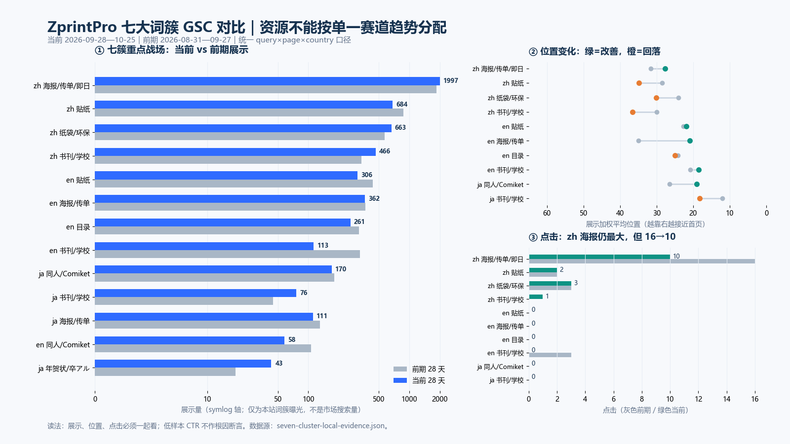
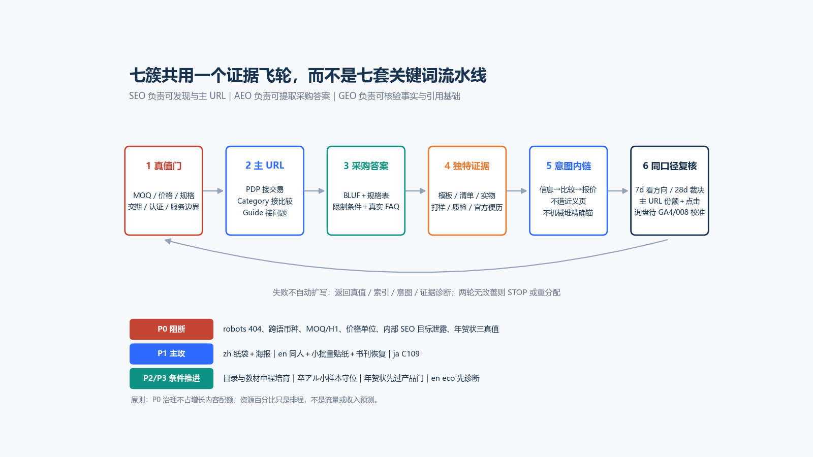

# ZprintPro 七大词簇 SEO／AEO／GEO 全球竞争战略与 30 天执行包

> 日期：2026-10-26  
> 角色：K3／ZprintPro 首席搜索数据分析与战略参谋  
> 范围：zh-hk、en、ja；贴纸、同人誌／コミケ、书刊／学校、目录、海报／传单／即日、年賀状／卒アル、纸袋／环保七簇  
> 数据基线：GSC 当前 28 天 2026-09-28—10-25，对比前期 2026-08-31—09-27  
> 输入说明：千问附件标注日期为 2026-10-27；本报告按当前会话日期与 10-26 可复核数据重审，不把附件结论当事实。  
> 交付性质：研究、裁决、优先级、执行契约与验收；**本轮未修改 `src/`、线上页面或定时任务，未 commit／push。**

---

## 数据来源

- **GSC 原始数据：** `.hermes/logs/gsc-query-page-country-2026-10-26.csv` 与对应 previous-28d 文件；本报告统一筛选 `query × page × country`，位置按展示加权。分析脚本、逐词与逐页结果保存在 `.kimi-work/seven-clusters-20261026/`。[seven-cluster-local-evidence](kimi-cite://text?path=F%3A%5Czprintpro-nextjs%5C.kimi-work%5Cseven-clusters-20261026%5Cseven-cluster-local-evidence.json&text=Filtered%20query%C3%97page%C3%97country%20rows%2C%20classified%20by%20the%20first%20matching%20cluster%20in%20the%20fixed%20CLUSTERS%20order. "citation")
- **全站基线：** 展示 23,794→23,014，点击 384→461；zh-hk／en／ja 当前点击分别为 366／55／36。该全站数字来自 `date × page`，不与本报告词簇曝光相加。[dual-engine-strategy](kimi-cite://md-line?path=F%3A%5Czprintpro-nextjs%5Cdocs%5C2026-10-26-dual-engine-seo-aeo-geo-deep-strategy.md&line=28&text=1.%20**%E5%85%A8%E7%AB%99%E7%82%B9%E5%87%BB%E5%A2%9E%E9%95%BF%E6%98%AF%E7%9C%9F%E5%AE%9E%E7%9A%84%EF%BC%8C%E4%BD%86%E5%B1%95%E7%A4%BA%E7%95%A5%E9%99%8D%E3%80%82** "citation")
- **线上实测：** 2026-10-26 对 robots 与 22 个重点页面做 HTTP、title、description、H1、canonical、robots meta 与风险文本探针。200＋自 canonical 不等于已收录。[page-probe](kimi-cite://text?path=F%3A%5Czprintpro-nextjs%5C.kimi-work%5Cseven-clusters-20261026%5Cpage-probe.json&text=HTTP%20200%20and%20self-canonical%20do%20not%20prove%20Google%20indexing. "citation")
- **竞品与规则：** Google Search Central、Sticker Mule、ラクスル、Mixam、Comiket 官方、QinPrinting、日本郵便、ラボネットワーク、富士、バッグファクトリー、清水化学等官方页面；只比较可观察采购资产，不声称稳定 SERP 名次、流量或市场份额。
- **变更史：** 本地 `git log --follow` 仅用于定位可能变更，不构成展示退场的因果证明；索引、Manual Actions 与抓取状态仍需 GSC 后台 URL Inspection 确认。
- **并发工作区提醒：** 最终复核发现 `src/app/robots.ts` 与 `src/data/sku-seo-data.ts` 已有非本轮产生的未提交修改；本轮未触碰或回滚。执行 CORE-P0-01 前必须先读现有 diff 与 SESSION_LOCK，避免重复修复或覆盖并行产物。
- **商业转化：** 本轮未接入 GA4、008 有效询盘与订单收入。“带钱词”仅指采购意图，不代表已经证明收入；相关目标均标“待校准”。

---

## 一、执行摘要：最终裁决

### 1.1 一句话战略

**七簇不能再按“赛道涨跌＋关键词数量”各自扩写，而要共用一个真值与证据底座：先止损，再把交易、比较、信息、活动四种意图分配给现有主 URL，以近首页恢复和高曝光商业词承接为 30 天主轴。**

### 1.2 八项核心结论

1. **千问的 20／25／18／12／5／10／10% 资源表不采用。** 它把未经验证的行业趋势、竞品名次和我方履约能力计入优先级，并低估 zh 纸袋与海报。新顺序按“时间窗 × 可恢复性 × 采购意图 × 证据完整度”排列，赛道趋势不再占权重。[qwen-seven-clusters](kimi-cite://md-line?path=F%3A%5Czprintpro-nextjs%5C.kimi-work%5Cseven-clusters-20261026%5Cqwen-seven-clusters.txt&line=789&text=%E4%BC%98%E5%85%88%E7%BA%A7%09%E8%AF%8D%E7%B0%87%09%E8%B5%84%E6%BA%90%E5%8D%A0%E6%AF%94%09%E6%A0%B8%E5%BF%83%E7%90%86%E7%94%B1 "citation")
2. **P0 真值治理单列，先于增长内容。** robots 404、同人誌价格／币种／MOQ、四个 en PDP 的 10 vs 100 H1、ja 港币残留、catalog 内部排名目标泄露、年賀状规格／早割／宛名未决，均不能被新文案掩盖。
3. **zh-hk 不是“守位低投”。** 海报／传单／即日簇当前 1,997 展示、10 点击；纸袋／环保簇 663 展示、3 点击且展示增长 93。它们分别承担“保点击与商业词集中”和“主 URL＋采购答案突破”。[seven-cluster-summary](kimi-cite://xlsx-cell?path=F%3A%5Czprintpro-nextjs%5C.kimi-work%5Cseven-clusters-20261026%5Cseven-cluster-summary.csv&cell=A1%3AM22 "citation")
4. **en 最高价值不是单纯争排名。** small batch 两个首页词仍 0 点击；doujinshi 已 10.21 位但价格／币种存在 P0；saddle 主词展示 94→15、位置 3.46→9.60，是典型恢复任务。
5. **ja C109 的时间窗真实，但当前主曝光在同人誌 PDP。** `コミケ 印刷` 为 170 展示／19.06 位；逐页数据中 `/ja/product/doujinshi-printing/` 获 162 展示／17.41 位，活动页应承担排期与入稿意图，交易交给 PDP，而不是强行让活动页取代 PDP。[seven-cluster-pages](kimi-cite://text?path=F%3A%5Czprintpro-nextjs%5C.kimi-work%5Cseven-clusters-20261026%5Cseven-cluster-pages.csv&text=%2Fja%2Fproduct%2Fdoujinshi-printing%2F "citation")
6. **年賀状与卒アル必须拆开。** 年賀状受产品真值门约束；卒アル的 `卒アル販売` 是 16 展示／5 位的小样本，而 `卒業アルバム 印刷` 为 14 展示／80.57 位，不能把前者外推成整个簇“已经首页”。
7. **AEO／GEO 不靠 FAQ 数量或特殊标记。** Google 官方说明普通 SEO 最佳实践仍适用，无额外 AI 技术、专用 AI 文件或 schema 要求；重点是 indexed＋snippet eligible、重要内容文本化、结构化数据与可见内容一致。[Google AI features](kimi-cite://web?url=https%3A%2F%2Fdevelopers.google.com%2Fsearch%2Fdocs%2Fappearance%2Fai-features&text=There%20are%20no%20additional%20requirements%20to%20appear%20in%20AI%20Overviews%20or%20AI%20Mode%2C%20nor%20other%20special%20optimizations%20necessary. "citation")
8. **30 天目标是实验与恢复，不是首页承诺。** 近首页词设努力区间，20 位以后先看主 URL、展示和位置改善；两连同口径 28 天无改善即停止扩写，重查技术、意图、证据与权威。



---

## 二、数据口径与七簇真实态势

### 2.1 口径边界

- 七簇表均由同一 `query × page × country` 范围计算；同一查询可由多个 URL、国家行产生曝光，簇展示是**该范围内曝光**，不是去重全站展示，更不是市场搜索量。
- 平均位置按展示加权，负的“位置变化”代表数值下降、排名改善；不能解释成每个用户都看到固定名次。
- 不与旧报告的 `query × country`、`date × page` 数字混算。例如 zh `海報印刷` 本报告 qpc 多 URL 为 516 展示／32.68 位，不能与旧单词口径的 278 展示／15 位直接判为退步。
- 低展示词的 CTR 和排名高方差。49＋28 展示的 small batch 两词仍只能定义“首击待验证”，不能凭 0 点击断言唯一根因。
- 分类按固定关键词顺序首匹配；`magazine` 不误匹配 `zine`。任何后续改词表必须版本化并重跑两窗，不能只改当前窗。

### 2.2 全量簇对比

下表“位置”均为当前展示加权位置；“—”表示当前无有效位置样本。[seven-cluster-summary](kimi-cite://xlsx-cell?path=F%3A%5Czprintpro-nextjs%5C.kimi-work%5Cseven-clusters-20261026%5Cseven-cluster-summary.csv&cell=A1%3AM22 "citation")

| locale／簇 | 展示 当前／前期 | 点击 当前／前期 | 位置 当前／前期 | 当前承接页数 | 判读 |
|---|---:|---:|---:|---:|---|
| en 贴纸 | 306／436 | 0／0 | 21.89／22.63 | 16 | 簇曝光收窄；首页 small batch 与大盘分开处理 |
| ja 贴纸 | 59／74 | 0／0 | 22.39／26.67 | 6 | 小幅改善，低样本中程培育 |
| zh 贴纸 | 684／874 | 2／2 | 34.80／28.43 | 21 | 曝光与位置双退，先收口不多写 |
| en 同人 | 58／106 | 2／2 | **9.95／22.86** | 2 | 排名大幅改善，曝光下降；先修 P0 再守击 |
| ja 同人 | 170／181 | 0／0 | **19.06／26.48** | 2 | 展示稳定、位置改善，C109 时间窗有效 |
| zh 同人 | 34／40 | 1／0 | **6.59／11.55** | 3 | 小样本首击，保持现有指南分工 |
| en 书刊／学校 | 113／326 | 0／3 | 18.46／20.82 | 5 | 曝光大幅退场，恢复优先 |
| ja 书刊／学校 | 76／45 | 0／0 | 18.17／11.98 | 4 | 展示增、位置退，不能宣布增长成功 |
| zh 书刊／学校 | 466／336 | 1／0 | 36.61／29.97 | 8 | 展示增、位置退，多页收口 |
| en 目录 | 261／316 | 0／0 | 24.96／24.11 | 4 | 中程；PDP 与 supplier guide 分工 |
| ja 目录 | 0／17 | 0／0 | —／35.94 | 0 | 先诊断，不新造页面 |
| zh 目录 | 5／1 | 0／0 | 89.00／92.00 | 1 | 极低样本，不进入首月主攻 |
| en 海报／传单 | 362／366 | 0／0 | **20.96／34.91** | 16 | 曝光持平、位置改善；A2 可轻量守击 |
| ja 海报／传单 | 111／131 | 0／0 | 36.35／30.42 | 11 | 不追跨境“即日”幻觉 |
| zh 海报／传单 | **1,997／1,855** | **10／16** | **27.70／31.66** | 30 | 最大曝光与点击池，保点击、提商业承接 |
| ja 年賀状／卒アル | 43／19 | 0／0 | **29.33／58.79** | 1 | 增长来自卒アル；年賀状仍需单查 |
| en 纸袋／环保 | 15／109 | 0／0 | 44.47／13.18 | 3 | 明显退场，先诊断 eco 指南 |
| ja 纸袋／环保 | 4／5 | 0／0 | 28.00／40.80 | 4 | 样本太小，不大投 |
| zh 纸袋／环保 | **663／570** | **3／3** | 30.09／24.03 | 9 | 展示增长、位置回落；主 URL 与采购答案 P1 |

### 2.3 行业大词与带钱词：逐词裁决

| 市场／词 | 当前展示／位置／点击 | 前期展示／位置 | 采购角色与最优动作 |
|---|---:|---:|---|
| en `small batch sticker printing` | 49／**4.77**／0 | 62／6.05 | 首页守位；修真实采购答案与首击，不追关键词密度 |
| en `small batch stickers` | 28／**5.07**／0 | 43／5.54 | 同一 PDP，不建变体页 |
| en `doujinshi printing` | 39／**10.21**／0 | 56／14.22 | 首页边缘；先修价格／币种／MOQ，再补入稿与交付证据 |
| en `doujin printing` | 13／**9.00**／2 | 9／10.33 | 已有点击，保护承接，避免改坏 |
| en `saddle stitch booklet printing` | 15／**9.60**／0 | 94／3.46 | 明显退场；统一真值、恢复有效展示 |
| en `china catalog printing` | 78／18.00／0 | 102／18.73 | 中程供应商意图；PDP 交易、guide 风险筛选 |
| en `a2 poster` | 44／11.93／0 | 21／34.43 | 位置改善；轻量守击，先修 10 vs 100 H1 |
| ja `コミケ 印刷` | 170／19.06／0 | 175／25.21 | 时间窗主攻；PDP 当前主接，活动页支援 |
| ja `教材 印刷製本` | 33／19.33／0 | 6／11.00 | 展示增、位置退；指南 hub＋PDP 报价 |
| ja `卒アル販売` | 16／**5.00**／0 | 1／2.00 | 小样本守位争首击 |
| ja `卒業アルバム 印刷` | 14／80.57／0 | 17／65.29 | 与上词意图／表现分裂，不能同报“首页” |
| zh `海報印刷` | 516／32.68／0 | 353／35.26 | qpc 多 URL 口径；category 主接通用采购，blog 接信息 |
| zh `即日印刷` | 77／12.12／1 | 89／14.82 | 保首击；写清 cutoff／产能／地区，不泛化保证 |
| zh `紙袋印刷` | 147／31.53／0 | 164／29.28 | category 主接；减少八页相似承接 |
| zh `邊度有紙袋買` | 34／**8.47**／0 | 47／7.04 | 首页问题词；用本地采购答案与产品入口承接 |
| zh `貼紙印刷` | 215／51.81／0 | 294／36.71 | 九页分散且位置退；先收口，不新增文章 |
| zh `小冊子印刷` | 65／11.48／0 | 54／10.30 | 近首页；category／PDP／工艺 guide 分层 |
| ja `pvc シール` | 19／18.95／0 | 23／20.43 | 中程；用真实材料／用途／限制表替代 IPX 编造 |

以上词级数值均来自同一本地逐词结果。[seven-cluster-queries](kimi-cite://text?path=F%3A%5Czprintpro-nextjs%5C.kimi-work%5Cseven-clusters-20261026%5Cseven-cluster-queries.csv&text=saddle%20stitch%20booklet%20printing "citation")

---

## 三、对千问附件的逐项裁决：保留结构，否决伪事实

| 附件主张 | 裁决 | 实际证据与替代动作 |
|---|---|---|
| 贴纸／同人 20%／25%，海报／纸袋仅 5%／10% | **重排** | zh 海报与纸袋实证曝光远高于多数 en／ja 簇；按跨站机会成本统一排队 |
| small batch 缺价格、速度、free proof | **已过时** | 线上 title／description 已有 50pcs、$0.045、4-day USA、free 2-hour digital proof；不需照附件重写。[page-probe](kimi-cite://text?path=F%3A%5Czprintpro-nextjs%5C.kimi-work%5Cseven-clusters-20261026%5Cpage-probe.json&text=Small%20Batch%20Custom%20Stickers%2050pcs%20from%20%240.045%20%7C%20ZprintPro "citation") |
| description 改 `from $0.05/pc`，免费实体样品 | **禁止自动执行** | 当前线上是 $0.045；实体样、样品运费、批量条件须业务核实，不能为 CTR 造承诺。[qwen-seven-clusters](kimi-cite://md-line?path=F%3A%5Czprintpro-nextjs%5C.kimi-work%5Cseven-clusters-20261026%5Cqwen-seven-clusters.txt&line=96&text=2%09%2Fen%2Fproduct%2Fsmall-batch-stickers%2F%09Meta%20Description%20%E9%87%8D%E5%86%99 "citation") |
| 增加 IPX4／IPX6、防水耐久、食洗机 80°C | **无测试即禁止** | 贴纸需要面材＋粘着剂＋laminate＋使用条件；ラクスル也按用途与限制选择并要求事前测试，而非一个 IPX 数字覆盖全部。[ラクスル](kimi-cite://web?url=https%3A%2F%2Fraksul.com%2Fprint%2Fsticker%2Fwaterproof%2F "citation") |
| FAQ Schema 是关键加速器 | **降级为可读性工具** | 只回答真实采购问题，不将 schema 数量、Rich Results 通过或 FAQ 富摘要当排名 KPI |
| CTR→停留／深度→排名巩固的确定飞轮 | **不作为因果承诺** | 可优化 snippet 与页面满足度，但 GSC 不能证明该因果链；用首击、询盘和同口径排名分别验收 |
| 英文同人竞争弱、竞品没有入稿清单 | **证据不足** | 附件未给可复核完整 SERP；保留“入稿清单有价值”，删除“竞争弱所以能赢”。[qwen-seven-clusters](kimi-cite://md-line?path=F%3A%5Czprintpro-nextjs%5C.kimi-work%5Cseven-clusters-20261026%5Cqwen-seven-clusters.txt&line=233&text=1.%20%E8%8B%B1%E6%96%87%E5%B8%82%E5%9C%BA%E7%AB%9E%E4%BA%89%E5%BC%B1 "citation") |
| C109 为 12/30—31、预计 50 万人 | **否决** | 官方报名系统支持 2026-12-29—31、东京 Big Sight；附件 50 万无官方依据，项目页面现有 12/29—31 应保留。[Comiket entry](kimi-cite://web?url=https%3A%2F%2Fentry4.circle.ms%2FCEntry%2FComiket "citation"), [qwen-seven-clusters](kimi-cite://md-line?path=F%3A%5Czprintpro-nextjs%5C.kimi-work%5Cseven-clusters-20261026%5Cqwen-seven-clusters.txt&line=271&text=%E2%94%82%20%20%E6%B4%BB%E5%8A%A8%E6%97%A5%EF%BC%9A2026%E5%B9%B412%E6%9C%8830-31%E6%97%A5 "citation") |
| 固定 DHL／生产逆算、直送酒店／会场 | **真值门后重写** | 只能把已确认的生产、运输、旺季缓冲和可配送地址写入；跨境活动页不承诺未核实直送。[qwen-seven-clusters](kimi-cite://md-line?path=F%3A%5Czprintpro-nextjs%5C.kimi-work%5Cseven-clusters-20261026%5Cqwen-seven-clusters.txt&line=303&text=Q4%3A%20Can%20you%20ship%20doujinshi%20directly%20to%20Comiket%20or%20events%20in%20Japan%3F "citation") |
| 书刊／目录／海报是下降赛道，纸袋是上升赛道 | **退出优先级模型** | 未获得 Google Trends 或官方市场统计；只使用本站前后窗与真实时间窗 |
| 年賀状扩早割内容 | **条件式** | 先确认 100×148mm、价格／早割、宛名／投函；否则转普通はがき／グリーティングカード |
| en eco 纸袋展示归零就重写 | **先诊断** | 当前线上仍 200、index/follow、自 canonical；需 URL Inspection、变更史、内链与查询组合，不盲改 |

**可保留的千问资产：** 七簇框架、BLUF、入稿清单、生产＋运输逆算、主 URL／内链、30 天停止规则。保留的是结构，不是未核实数值。

---

## 四、线上 P0：不解决就不应扩大内容投资

### 4.1 技术与商业真值清单

| 优先级 | 实测问题 | 影响 | 执行裁决 |
|---|---|---|---|
| P0 | `/robots.txt` 返回 404 | 抓取规则与发布链不可靠 | 单源化并查构建／Cloudflare；200 后验证不阻断 `/_next/`。[page-probe](kimi-cite://text?path=F%3A%5Czprintpro-nextjs%5C.kimi-work%5Cseven-clusters-20261026%5Cpage-probe.json&text=%22path%22%3A%20%22%2Frobots.txt%22 "citation") |
| P0 | 三语 doujin 显示 `¥7,500〜/部〜`；en／zh 也用日元且按“每本”展示 | 价格单位、币种、报价可信度 | K3 确认是每部、每单还是其他口径；未决前撤下扩张，不让 DeepSeek 猜 |
| P0 | ja doujin description 写 50 冊，正文／H1 体系写 10 冊；24h／即日承诺并存 | MOQ 与交期冲突 | 以产品真值表统一 title／description／正文／FAQ／Offer／WhatsApp |
| P0 | en saddle、exercise、catalog、A2 title 都写 10 MOQ，H1 都写 100+ | 跨簇模板真值冲突 | 不只修 saddle；四页同批盘点，exercise 还需统一装订方式 |
| P0 | ja textbook description 为 `HK$5-50/冊`；ja paper-bags 正文有 `HK$8.00〜` | 日文页币种漂移 | 确认日本站报价币种与汇率／有效期；禁止直接换符号不换金额 |
| P0 | catalog supplier guide description 暴露 `4-word cluster 9/4 ranking target` | 内部 SEO 目标进入用户搜索面 | 立即清理内部标记，同时复核其他客户可见字段。[page-probe](kimi-cite://text?path=F%3A%5Czprintpro-nextjs%5C.kimi-work%5Cseven-clusters-20261026%5Cpage-probe.json&text=4-word%20cluster%209%2F4%20ranking%20target "citation") |
| P0 | `/ja/nengajo-2027/` 主推 127×178mm，早割率／截止未定，宛名确认中 | 产品意图与承诺可能错配 | A／B 分支；未拍板不扩大年賀状词 |
| P0／P1 | small batch 免费实体样／样品运费、100% 满意退款、4-day USA 等声明 | 转化与履约风险 | 逐条标证据、条件、地区与有效期；竞品有不等于我方有 |
| P1 | `100%環保`、户外 3–5 年、食洗机 80°C 等绝对化声明 | GEO 会放大不可核验事实 | 改为有测试条件的材料／使用边界；无证据则删除 |

这些年賀状问题不是“文案不够日语”。日本郵便资料说明一般年賀はがき为 100×148mm；如果 127×178mm 只是另一款贺卡，就不能借年賀状搜索意图包装。[日本郵便](kimi-cite://web?url=https%3A%2F%2Fprint.shop.post.japanpost.jp%2Ffeature-nenga%2Farticle70&text=%E4%B8%80%E8%88%AC%E7%9A%84%E3%81%AA%E5%B9%B4%E8%B3%80%E7%8A%B6%E3%81%AE%E3%82%B5%E3%82%A4%E3%82%BA%E3%81%AF%E3%80%8C%E6%A8%AA100mm%C3%97%E7%B8%B8148mm%E3%80%8D "citation")

### 4.2 真值表最小字段

DeepSeek 每个任务必须先读取或生成内部台账：`URL｜locale｜SKU｜字段｜现值｜源头路径｜证据｜适用规格／数量／地区｜有效期｜负责人｜K3 状态`。公开页面只使用 `APPROVED`；`UNKNOWN` 不得被转成营销文案。

SKU SEO 的派生链固定为 `zprintpro-sku-seo-data.csv` → `node scripts/csv-to-sku-seo.mjs` → `src/data/sku-seo-data.ts`；不得手改派生 TS，也不得用 `--ours/--theirs` 代替回源重生成。

---

## 五、全球竞品：真正差距是采购资产，不是文章长度

| 词簇／竞品 | 可观察资产 | ZprintPro 应迁移 | 不应照搬 |
|---|---|---|---|
| 贴纸／Sticker Mule | 10／款、免费在线 proof、4-day turnaround、免费全球配送与材料使用限制 | 数量、proof、生产与配送分开；用途限制可查找 | 不复制价格、免费实体样或我方未核实时效。[Sticker Mule](kimi-cite://web?url=https%3A%2F%2Fwww.stickermule.com%2Fcustom-stickers "citation") |
| 贴纸／ラクスル | 面材、粘着剂、laminate 按用途组合；冷热／户外／高温边界与事前测试 | “用途→结构→限制→测试”的选择表 | 不写无测试 IPX、80°C 或固定户外年限 |
| 书刊／Mixam | 封面增加 4 页、出血、文件页序、模板与 proof | 页数／封面／creep／跨页／校样的可操作指南 | 不泛扩“装订介绍”，不复制对方价格与交期。[Mixam](kimi-cite://web?url=https%3A%2F%2Fmixam.com%2Fsaddle-stitch "citation") |
| 同人／Comiket 官方 | C109 官方日期与场地 | 活动事实只引官方；逆算表由我方真值生成 | 不写 50 万人、错误日期或未核实直送 |
| 目录／QinPrinting | 文件检查、数字／实体 proof、海运／空运／快递与 landed cost／时间 | supplier guide 聚焦打样、色差、交付总成本与风险 | 不复制其 savings、认证或交期作为我方事实。[QinPrinting](kimi-cite://web?url=https%3A%2F%2Fwww.qinprinting.com%2Fbook-printing-china%2F "citation") |
| 海报／NextDayFlyers、Mixam | 生产时间与配送时间分开；本地点 cutoff／capacity | 明确生产、取件／配送、地区与旺季条件 | 跨境站不冒充 near me／same day 本地履约。[NextDayFlyers](kimi-cite://web?url=https%3A%2F%2Fwww.nextdayflyers.com%2F "citation") |
| 年賀状／ラクスル、日本郵便 | 宛名、投函、はがき代込み、数量与官方时间表 | 先回答我方是否提供标准尺寸、宛名、投函与早割 | 竞品早割不是我方折扣依据。[ラクスル](kimi-cite://web?url=https%3A%2F%2Fraksul.com%2Fprint%2Fnew_years_card%2F "citation"), [日本郵便](kimi-cite://web?url=https%3A%2F%2Fprint.shop.post.japanpost.jp%2Fnenga "citation") |
| 卒アル／ラボ、富士 | 学校批量卒アル与 1 冊 photobook 是不同产品路径 | 拆分班级／学校／同窓会与个人 1 冊意图 | 不用个人 photobook 逻辑替代学校采购。[ラボネットワーク](kimi-cite://web?url=https%3A%2F%2Fwww.labonetwork.co.jp%2Fproducts%2Falbum%2Fsotsu-alb%2F "citation"), [富士](kimi-cite://web?url=https%3A%2F%2Ff-photobook.jp%2Fscene%2Fgraduation%2F "citation") |
| 纸袋／バッグファクトリー、清水化学 | 用纸、尺寸、色数、handle、MOQ、不同交期与小批量限制 | W×D×H、装载物、GSM、提手、底部／提手加强、打样、装箱 | 不只写“环保”，不复制对方 MOQ 或限制。[バッグファクトリー](kimi-cite://web?url=https%3A%2F%2Fbag-factory.online%2Fpaper "citation"), [清水化学](kimi-cite://web?url=https%3A%2F%2Fwww.shimizu-chem.co.jp%2Fproduct%2Fpaper_bag%2Flot_s.html "citation") |

**竞争结论：** 七簇共同的非同质化资产是“可下载模板／清单、可比较规格、可理解限制、可核验实物与流程”。FAQ、字数、三语翻译和关键词变体不构成独立竞争壁垒。

---

## 六、三语主 URL 分工：不新建七簇近义页

### 6.1 交易、比较、信息、活动四类角色

| 簇 | zh-hk | en | ja |
|---|---|---|---|
| 贴纸 | `/category/stickers/` 接通用采购；材质 PDP 接具体需求；两篇 guide 分知识／采购 | `/product/small-batch-stickers/` 接 small batch；category 与最相关 guide 支持 | waterproof PDP 接 `pvc シール`；materials guide 接材料问题 |
| 同人／コミケ | circle guide 接信息，PDP 接报价；不复制三语同文 | `/product/doujinshi-printing/` 主接交易；category 不复制长文 | **PDP 主接当前交易曝光**；`/comiket-c109/` 接活动日期／入稿逆算并链 PDP |
| 书刊／学校 | books category 接品类；saddle PDP 接报价；saddle guide 接工艺 | saddle／exercise PDP 分产品；school guide 接入稿与采购清单 | textbook guide 接印刷製本知识；对应 PDP 接报价 |
| 目录 | 样本不足，不扩页 | catalog PDP 接交易；supplier guide 接供应商筛选、打样、色差、交付风险 | 当前 0 展示，先诊断现有 PDP |
| 海报／传单／即日 | posters／flyers category 分品类；A2 PDP 接规格；poster guide 接信息 | A2 PDP 接规格；flyer size guide 接尺寸；不追 same-day 泛词 | A2／same-day PDP 保留分工；即日只写真值 |
| 年賀状／卒アル | 非本簇主攻 | yearbook 小样本观察 | nengajo 活动页仅在 A 分支推进；graduation PDP 接学校／个人分意图 |
| 纸袋／环保 | **category 主接通用纸袋**；handle／kraft／large PDP 接袋型；guide 接选材 | eco GSM guide 先诊断；category／PDP 不扩新页 | 当前样本太小；先修港币，不大投 |

### 6.2 主 URL 不是“每词只能一页”

- 同一查询多页出现不必然是自相蚕食；先判断意图是否不同。
- 目标是提高**合适主 URL 的展示份额与点击**，不是机械 100%。
- 信息 guide 可以保留高曝光，但应在完成任务后给自然采购下一步；PDP 不复制整篇指南。
- 内链放在语义一致段落的自然下一步，不虚构“第几段”，不批量同锚、不做 footer 链接块。
- 不为单复数、空格、语序、地区变体造页；不用 canonical 或 301 代替意图分工。

---

## 七、统一资源排序：P0 单列，增长工作量跨簇排队



### 7.1 优先级

| 梯队 | 工作包 | 理由 | 30 天成功定义 |
|---|---|---|---|
| **P0 阻断** | robots；doujin 价格／币种／MOQ；四页 10 vs 100；ja 币种；catalog 泄露；年賀状三真值 | 错误真值会同时伤害搜索、答案与履约 | 硬冲突清零；未决项不公开扩张 |
| **P1-A** | zh 纸袋主 URL＋采购答案 | 663 展示且增长、3 点击，九页承接；非缺页 | category 展示份额提升；`紙袋印刷` 向 25–30 观察区；点击不降 |
| **P1-A** | en doujin 守击＋ja C109 | en 10.21 近首页；ja 170 展示且有 C109 窗口 | en 努力 8–10；ja 努力 12–16；均以真值修复为前提 |
| **P1-A** | zh 海报／即日保点击与商业承接 | 最大曝光与点击池，点击 16→10 | 点击不继续下滑；商业 category／PDP 份额提升 |
| **P1-B** | en small batch 守位争首击 | 两个首页词、已有真实价格与 proof 资产 | 守 ≤6 的努力目标；出现首个非品牌点击 |
| **P1-B** | en saddle／exercise 恢复 | saddle 展示 94→15；exercise 有排名基础 | saddle 主词展示恢复 30–50 为观察阈值，不承诺回 3.46 |
| **P2** | en catalog、ja 教材、zh 小冊子 | 中程或近首页，但需主 URL 与信息分工 | 展示集中、位置改善、首击；不设统一首页硬 KPI |
| **P2** | ja 卒アル、zh 贴纸／书刊收口 | 小样本守位或多页分散 | 卒アル守 ≤8；其他簇停止进一步分散 |
| **P3 条件** | 年賀状、en eco、ja 纸袋／贴纸／海报 | 真值、诊断或样本限制 | 完成分支／根因／基线，而非强推排名 |

### 7.2 建议工作量份额（排程，不是流量预测）

P0 治理不占下列增长内容配额。为避免“精确百分比伪科学”，以下仅用于 DeepSeek 排程，可在每周复核后调整：

- zh 纸袋 20%；en 同人 18%；zh 海报／即日 16%；en small batch 12%；en 书刊恢复 12%；ja C109 10%；en catalog 6%。
- 其余 6% 预留给 ja 教材、卒アル、en eco 诊断、zh 书刊／贴纸收口与低样本维护。
- 包装盒继续按上一份独立战略执行，**不因本附件排除包装就推翻包装 P0／P1，也不让包装独占七簇资源。**[packaging-strategy](kimi-cite://md-line?path=F%3A%5Czprintpro-nextjs%5Cdocs%5C2026-10-26-packaging-seo-aeo-geo-competitor-strategy.md&line=19&text=1.%20**%E5%8C%85%E8%A3%85%E5%8D%87%E7%BA%A7%E4%B8%BA%E9%87%8D%E8%A6%81%E7%BB%84%E5%90%88%EF%BC%8C%E4%BD%86%E4%B8%8D%E6%8E%A5%E7%AE%A1%E5%85%A8%E7%AB%99%E8%B5%84%E6%BA%90%E3%80%82** "citation")

---

## 八、SEO／AEO／GEO 的共同执行标准

### 8.1 SEO：可发现、可理解、主 URL 集中

1. 保持 200、可抓取、可索引、自 canonical、可出 snippet；发布后查线上 HTML。
2. title 继续遵守项目冻结与 SSoT；本方案不批量预写或修改 title。description 也不能为 CTR 添加未证实承诺。
3. 先修已有页，不新造七簇近义页；sitemap／IndexNow 只是发现辅助，不当排名动作。
4. 7 天只看方向，28 天做第一轮裁决；同页有效修改冻结 2–4 周。
5. en eco 等退场页若线上正常，下一步是 GSC URL Inspection、近 4–8 周 diff、内链和查询组合，而非重写。

### 8.2 AEO：每个主 URL 的可见采购答案

统一骨架，但不要求每页机械同长：

1. **BLUF：** 第一句回答适合谁、如何选、如何获得准确报价；MOQ／价格／交期只在真值批准后写。
2. **采购表：** 尺寸／页数／材料／工艺／数量／proof／生产／运输／限制，按品类取舍。
3. **条件与边界：** 何时起算、哪些地区、旺季、文件确认、不适用场景。
4. **真实 FAQ：** 只补未在正文清楚回答的问题；与可见表和结构化数据一致。
5. **下一步：** 报价所需信息一次说清，减少客户重复提供。

### 8.3 GEO：事实可引用、证据可定位

- 声明旁给规格、日期、适用范围与来源；不在页尾堆无法对应的“权威链接”。
- 第一方证据优先：真实刀模、入稿模板、逆算表、实物、打样、质检、学校采购清单、纸袋装载测量。
- 企业实体保持深圳主实体、香港服务节点与跨境履约一致，不制造美国／日本本地工厂印象。
- GSC AI 流量仍包含在 Web 总流量中；没有专门报告或可复核探针时，不编造“AI 引用率”。[Google AI features](kimi-cite://web?url=https%3A%2F%2Fdevelopers.google.com%2Fsearch%2Fdocs%2Fappearance%2Fai-features&text=AI%20features%20and%20your%20website "citation")
- AI 面人工探针需固定产品／模型、prompt、语言、地区、账号状态、日期，保存原文与引用 URL；单次答案不等于稳定引用。

---

## 九、30 天最优路线图（2026-10-26—11-24）

### 第 1 周｜10-26—11-01：止损、真值与基线冻结

| 工作 | 具体产物 | 验收 |
|---|---|---|
| P0 全量台账 | 本报告 P0 项＋价格／MOQ／交期／proof／性能声明台账 | 每项有源头、证据、负责人、状态；DeepSeek 不补值 |
| robots 修复包 | 唯一 SSoT、构建路由与线上验证方案 | `/robots.txt` 200，非 404 HTML，sitemap 可用 |
| 年賀状 A／B 拍板 | 100×148 可否、早割、宛名／投函、价格与交期 | 未拍板保持 blocked；B 分支不扩年賀状 |
| 基线冻结 | 七簇词表版本、CSV／JSON、图表、主 URL 映射 | 后续复跑同口径，不能只报改善词 |
| en eco 诊断 | URL Inspection、变更史、内链、国家／查询组合 | 有证据根因或 `needs-data`，不盲改 |

**周末闸门：** P0 未闭环的目标页，下周不得进入公开扩写；可做内部台账与无风险诊断。

### 第 2 周｜11-02—11-08：P1 主 URL 与采购答案

- zh 纸袋：category 建 W×D×H／装载物／GSM／handle／加强／proof／装箱答案；handle 等 PDP 只接袋型；`100%環保` 证据化或降调。
- en doujin＋ja C109：先完成价格／币种／MOQ；补真实页数、装订、纸张、入稿清单与生产＋运输逆算；活动页链 PDP。
- zh 海报／即日：保留有效 guide；category／PDP 接采购，急件写 cutoff／产能／地区条件；不大规模加文。
- en small batch：保持 title；以现有 50pcs／$0.045／digital proof 真值为中心，审查实体样与配送承诺，争取首击。
- en saddle／exercise／catalog／A2：同批统一 10 vs 100；再补对应采购信息。

### 第 3 周｜11-09—11-15：独特资产与中程培育

- 发布最小可行资产：doujin 入稿清单、C109 真值逆算表、纸袋报价尺寸模板、学校印刷清单；每项有来源、日期、适用范围。
- en catalog：PDP 交易与 supplier guide 风险筛选双向链接；guide 清理内部 ranking target 与无来源折扣／交期。
- ja 教材：修港币，统一教材／教科書／ワークブック的指南与 PDP 角色。
- ja 卒アル：区分 1 冊 photobook 与学校批量，补真实制作流程；不因小样本改 title。
- zh 贴纸／书刊：只做重复段、意图和内链收口，不新增近似文章。

### 第 4 周｜11-16—11-24：同口径复测与资源重分配

1. 11-23 拉取同口径 28 天数据，保存原始 CSV、脚本版本与词表版本。
2. 对每词记录展示、点击、位置、主 URL 份额、样本限制与变更日期。
3. 标记 `SCALE／HOLD／FIX／STOP／NEEDS_DATA`；未达标不自动扩写。
4. 将 landing page 与 WhatsApp／报价／008 有效询盘对齐；没有数据就标待校准。
5. K3 决定下一周期，首页可行性按 60–90 天评估，不用一次 28 天外推。

---

## 十、DeepSeek 4.1 Flash 原子执行包

### 10.1 通用契约

```text
TASK_ID: <cluster>-<priority>-<nn>
INTENT: 修复一个已证实问题，不夹带第二战略
INPUT_EVIDENCE: 本报告对应章节 + GSC 行 + 线上 probe + 真值源
TARGET_QUERY_OR_URL: 唯一主目标
WRITE_SCOPE: 允许修改的最小源头文件集合
TRUTH_SOURCE: products.ts / price-tables / 官方来源 / K3 拍板
DO_NOT_TOUCH: 冻结 title、其他车道文件、派生 TS、301、名片/贺卡既有资产
ACTION: 一个小批；无独特价值可 NO_OP
GATES: SESSION_LOCK + lane lock、备份、计数/形状断言、encoding、tsc、品牌、JSON、相关 smoke
DERIVED_RULE: SKU SEO 只改 CSV 源头并运行 node scripts/csv-to-sku-seo.mjs
ONLINE_VERIFY: 200、title/H1、canonical、可见真值、schema、目标链接
REPORT: .hermes/logs/<YYYY-MM-DD>-<lane>.md，含 VERDICT/CONSUMED/DELIVERED/NEXT
STOP_IF: 缺真值、锁冲突、前提证伪、门禁失败、样本不足却要求排名承诺
NEXT_CHECK: 2026-11-23 同口径；7d 只看方向，28d 做裁决
```

### 10.2 任务卡

| ID | 输入与允许源头 | 动作 | 验收／GSC | 失败停止 |
|---|---|---|---|---|
| **CORE-P0-01 robots** | `src/app/robots.ts`、`public/robots.txt`、构建配置、线上 probe | 先确认路由，单源化 robots；不阻断静态资源 | 本地构建＋线上 200／文本／sitemap；非排名 KPI | 源码正确仍 404→转 Cloudflare，不重复改文案 |
| **CORE-P0-02 真值台账** | `products.ts`、`price-tables/**`、SKU CSV、category／blog 源数据 | 盘点 P0 与性能／免费／认证声明；未拍板只出内部台账 | 所有冲突有负责人和 APPROVED／UNKNOWN | 禁止从 title／H1／价格表任选一值当正确答案 |
| **DJ-P0-03 同人** | 三语 doujin 产品源、SKU CSV、price table、C109 页 | K3 拍板后统一价格单位／币种／MOQ／交期；再写入稿与逆算 | 页面／FAQ／Offer／WhatsApp 一致；en 39／10.21、ja 170／19.06 为基线 | 任何价格／直送／24h 未决即不发布营销段 |
| **BOOK-P0-04 四页 MOQ** | saddle、exercise、catalog、A2 的 CSV 源与 products | 同批统一 10 vs 100；exercise 同时统一装订 | 四页 title／H1／正文／FAQ／schema 一致 | 不机械把 100 全改 10；真值未决 blocked |
| **LOC-P0-05 ja 币种** | textbook guide、paper-bags category 与报价源 | 确认日本站币种与金额／有效期后统一 | 无 HK$ 残留；不是只替换货币符号 | 无汇率／价格拍板不猜值 |
| **CAT-P0-06 catalog 清理** | supplier guide 源数据 | 删除内部 ranking target；保留用户价值描述 | 线上 description 无内部指标；其他客户可见字段扫描 0 新增 | 不夹带 title 改写或整篇重写 |
| **NENGA-P0-07 年賀状** | nengajo 页面、产品真值、日本郵便官方来源 | A 分支才统一规格／早割／宛名；B 分支转普通贺卡定位 | A：真值一致后观察 0→展示；B：不追年賀状 | 未拍板不扩内链、不写折扣率／投函 |
| **BAG-P1-08 zh 纸袋** | category、handle／kraft／large PDP、paper-bag guide、price source | category 采购答案＋主 URL 内链；袋型 PDP 分工；环保声明治理 | 基线 663 展示／3 点击；category 份额提升、点击不降 | 不新建纸袋页；无实测不写承重／100%环保 |
| **POSTER-P1-09 zh 海报** | posters／flyers category、A2 PDP、poster guide、rush 源 | 保 guide 信息角色，商业词链 category／PDP；急件条件化 | 基线 1,997／10；首看点击不降与商业份额 | 不大规模加文；点击继续降先回查改动 |
| **STICKER-P1-10 en small batch** | small batch PDP、category、唯一相关 guide、proof／配送真值 | 保持 title；采购表、真实 proof、材料限制、两条自然内链 | 两词守位争首击；样本不足不做 CTR 根因结论 | 不改 $0.045 为 $0.05；无证据不写 IPX／免费实体样 |
| **BOOK-P1-11 en 恢复** | saddle／exercise PDP、books category、school／saddle guide | P0 后补页数／封面／creep／proof 与学校清单 | saddle 主词 15→30–50 为观察阈值 | 展示继续归零→URL Inspection＋变更史，停止扩写 |
| **JA-P1-12 C109** | PDP、C109 页、Comiket 官方、履约真值 | PDP 交易、活动页排期；双向内链与真实逆算 | `コミケ 印刷` 19.06→12–16 为努力目标 | 不新 C109 页；日期／酒店／会场／时效未核实即停 |
| **MID-P2-13 catalog／教材／卒アル** | 各自主 URL 与 guide | 分三个独立小批，不合并成“三语翻译任务” | catalog 主 URL 份额；教材止退；卒アル守 ≤8 | 低样本不重写 title；不把卒アル販売外推整簇 |
| **DIAG-P3-14 en eco** | URL Inspection、git diff、GSC、内链 | 只诊断后提出修复；线上 200 不等于已收录 | 有根因证据或 needs-data | 禁止直接重写或新建替代页 |
| **MEASURE-15 反馈环** | 本报告 JSON／CSV、脚本、GSC 新档、008／GA4 | 同口径复跑，输出 SCALE／HOLD／FIX／STOP | 每词有样本限制、主 URL、下一动作 | 不换口径制造改善；两轮无改善停止内容投入 |

### 10.3 推送与报告纪律

- 小批修改、攒批 push；先跑项目要求的 encoding、tsc、品牌／编造 lint、JSON 与相关 smoke，不能为单篇内容浪费构建配额。
- 定时任务产物必须同时有 run 记录、wrapper 结果、当日车道报告与调度器记录；声称上线还需线上探针。
- 报告不得用 mtime、`exit=0` 或自我播报替代真实产物；失败也写报告与恢复分类。
- 本报告只定义 30 天任务，不擅自改五条车道的触发时间或创建新任务。

---

## 十一、KPI、停止规则与 Plan B

### 11.1 三层 KPI

| 层 | 指标 | 判断频率 |
|---|---|---|
| 技术／真值护栏 | robots 200；价格／币种／MOQ／H1／FAQ／schema 一致；内部 SEO 标记 0；无证据声明新增 0 | 每次发布前后，硬门槛 |
| 搜索领先指标 | 目标 URL 展示、位置、主 URL 展示份额、非品牌点击、查询覆盖 | 7d 方向，28d 裁决 |
| 商业结果 | WhatsApp、报价提交、有效询盘、订单／毛利 | 周／月；GA4＋008＋订单校准后 |

### 11.2 首轮观察矩阵

以下均为努力目标或验证阈值，不是保证值。

| 对象 | 当前基线 | D30 观察 | 失败后的 Plan B |
|---|---|---|---|
| en small batch 两词 | 49／4.77＋28／5.07，均 0 点击 | 守位并出现首击 | 查国家／设备／查询组合与 snippet，不继续堆内容 |
| en doujinshi | 39／10.21／0 | 努力 8–10 并保 `doujin printing` 点击 | 若曝光继续退场，先查真值改动与索引，不新建页 |
| ja コミケ | 170／19.06／0 | 努力 12–16，PDP 主接更清晰 | 活动页无展示不强行改主接；强化 PDP 与指南支持 |
| en saddle | 15／9.60／0 | 展示 30–50 恢复观察区 | URL Inspection＋变更史＋查询组合；停扩写 |
| zh 纸袋簇 | 663／30.09／3 | category 份额升、位置向 25–30、点击不降 | 若九页更分散，撤重复段而非加新页 |
| zh 海报簇 | 1,997／27.70／10 | 点击不降，商业页份额升 | 若 guide 增而 PDP 降，重建信息→采购路径 |
| en catalog | 261／24.96／0 | PDP 份额与有效点击改善 | 若 guide／PDP 意图不同则保留分工，不机械 301 |
| ja 教材 | 76／18.17／0 | 止住位置退、恢复有效展示 | 查学校采购意图与术语，不批量造教材页 |
| ja 卒アル | 43／29.33／0 | `卒アル販売` 守 ≤8；标小样本 | 若只有低位词改善，不宣称整簇成功 |
| 年賀状 | 产品真值未闭环 | A 分支后 0→有展示 | 未收录先 URL Inspection；B 分支转普通贺卡 |
| en eco | 15／44.47；GSM guide 75→0 | 完成根因诊断 | 不修改也能交付 `needs-data` 与下一证据需求 |

### 11.3 强制停止

- **真值缺失即停；门禁失败即停；锁冲突即停。**
- **搜索信号显著恶化即冻结：** 先回查变更，不在同一页连续叠改。
- **平均位置改善但展示大幅下降不宣布胜利：** 可能只是低质量曝光消失或覆盖缩窄。
- **内容增加但主 URL 份额／展示不增：** 停止扩写，查索引、意图、证据和竞品资产。
- **两连同口径 28 天无改善：** `STOP` 或 `FIX`，不得由执行层自动加页、加字数、加 FAQ。
- **无独特价值即 `NO_OP`：** 日更车道允许不交新文章，避免规模化低价值内容。

---

## 十二、K3 待拍板清单

1. **doujin 价格单位与币种：** `¥7,500` 到底对应每部、每单还是其他规格；en／zh 应显示何种币种与报价方式。
2. **doujin MOQ 与 rush：** ja 10／50 冲突；24h／即日、生产与国际配送边界；酒店／会场是否可配送。
3. **四个 en PDP 的 MOQ：** saddle、exercise、catalog、A2 的 title 10 与 H1 100 哪一个是真；exercise 装订方式。
4. **ja 报价：** textbook 与 paper-bags 的日元金额、适用范围、有效期，不只是货币符号。
5. **年賀状 A／B：** 100×148mm 可否、127×178mm 产品定位、价格／早割／截止、宛名／投函。
6. **small batch 服务：** 数字 proof 与实体样的区别、样品费用／运费、4-day USA 与退款承诺的地区和条件。
7. **性能与环保证据：** 户外年限、食洗机温度、防水、承重、FSC／100%環保等可公开范围。
8. **转化接入：** 允许 GA4、008 与订单按 landing page 对齐，建立真正的带钱词收入视图。

---

## 十三、最终战略判断

9 月的深度 blog、FAQ、标题与 hub-spoke 建立了覆盖，但七簇新数据说明：**下一阶段的瓶颈不是再生产七套内容，而是商业真值、主 URL 分工、采购答案和独特证据没有形成同一闭环。**

未来 30 天最优解是：

1. **先修 P0，再让 DeepSeek 扩写。**
2. **zh 纸袋与海报进入主攻，en 同人／small batch／书刊恢复与 ja C109 集中突破。**
3. **现有页面承担四种意图，不新建七簇近义页。**
4. **SEO 看主 URL 与有效曝光，AEO 看采购答案，GEO 看可核验事实；三者共用同一真值底座。**
5. **用同口径 28 天、首击与有效询盘验收，不用首页保证、FAQ 数量或 AI 引用幻觉验收。**

这套方案既保留千问报告中可复用的执行结构，也把其不符合本站数据、官方规则与履约真值的部分明确剔除，能够作为 K3 主脑派发给 DeepSeek 4.1 Flash 的统一 30 天执行 SSoT。
