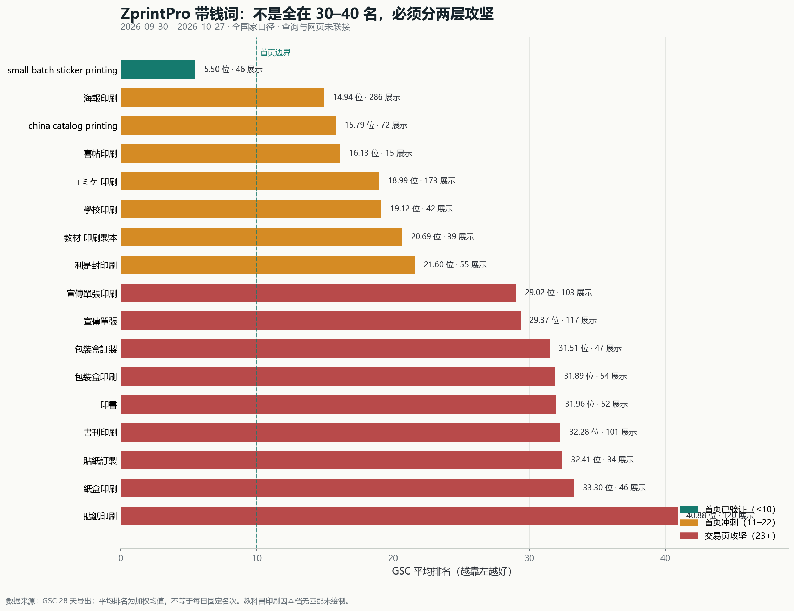

# ZprintPro 三站点带钱大词 SEO／AEO／GEO 全球竞争战略

**日期**：2026-10-31  
**角色**：首席搜索数据分析与战略参谋  
**决策周期**：未来 12 周；每 7／14／28 天复测，不以发文数量作为成功指标  
**适用范围**：zh-hk、en、ja；自然搜索、答案引擎与生成式引擎的可见文本、采购证据和主题权威

## 数据来源

- GSC：`GSC数据/28天三站点汇总数据zprintpro.com-Performance-on-Search-2026-10-30 (2).xlsx`，窗口 2026-09-30 至 2026-10-27，全国家口径；查询、网页、国家为独立维度，不能直接交叉相乘。
- 查询复核：`.hermes/logs/money-keyword-query-evidence-2026-10-31.json`，2026-10-31 从上述 GSC 原始档逐词提取。
- 站内内容：`src/data/category-seo-content.ts`、`src/data/products.ts`、`src/data/blog-data/zh-hk.json`；线上五个主 category 页面。
- 长文盘点：`.hermes/logs/zh-hk-money-blog-inventory-2026-10-31.json`，共 26 个相关条目。
- 竞品与规则：Google Search Central 官方文档，以及本报告逐项列出的香港、美国、日本竞品公开页面；竞品信息只代表其页面当前公开的采购信息，不代表实时 SERP 份额。

---

## 一、执行摘要：要调整任务，但不是简单“多写长 Blog”

**必须调整。** 现有 `ZP-blog-deepfix` 主要承担旧文结构清理，提示词又叠加了多轮历史指令，尚未形成“带钱查询 → 主交易页 → 信息缺口 → 一篇决策长文 → 双向内链 → 7／14／28 天复测”的稳定闭环。

但大词停滞的根因**不是文章不够长**。站内已有 8,000–18,000 字的贴纸、海报、包装长文，仍有主词停在 29–41 名。下一阶段应把资源从“篇幅生产”转向以下四件事：

1. **交易主词由 category／PDP 承接**：Blog 不抢“印刷／订制”主交易意图，而补规格选择、成本构成、文件要求、限制条件和采购风险。
2. **先修主承接页的一致性与词形**：宣传单张、贴纸、书刊、包装的 MOQ／交期等口径冲突，必须先审计；未拍板的商业真值不由自动任务选择。
3. **复写已有长文，而非重复造近义页**：贴纸、海报、书刊、包装均已有可复用资产；首轮只有“宣傳單張采购主指南”存在明确的新文缺口。
4. **用查询×网页联接验证承接**：当前 GSC 档不能证明某查询由哪一页获得，因此“内耗／cannibalization”为高概率假设，不是已证实事实；禁止据此直接 301、canonical 或砍页。

**资源顺序**：zh-hk 宣传单张 → 贴纸 → 书刊／教科书 → 包装 → 海报；en 保持 small-batch、doujin、catalog 的验证与优势；ja 以 C109、教材、クラフトパッケージ为第二梯队。凡属既有 `WAITING_K3` 商业批次，只能测量、列证据和等待拍板，不得借长文任务自动上线商业变更。

---

## 二、真实基线：主词有需求信号，但尚未形成交易点击

### 2.1 三站点总览

| 范围 | 点击 | 展示 | CTR | 平均排名 |
|---|---:|---:|---:|---:|
| 全站（全国家） | 496 | 21,127 | 2.35% | 13.56 |
| 香港 | 360 | 12,229 | 2.94% | 13.39 |
| 日本 | 40 | 2,296 | 1.74% | 16.61 |
| 美国 | 30 | 2,743 | 1.09% | 15.42 |

这些是全国家、国家分表口径，不可把香港表现直接等同于 zh-hk 页面表现，也不可把美国表现直接等同于全部 en 流量。当前数据支持“有曝光、主词点击不足”的判断，不支持收入、询盘或订单增长结论。[GSC 原始档](kimi-cite://text?path=F%3A%5Czprintpro-nextjs%5CGSC%E6%95%B0%E6%8D%AE%5C28%E5%A4%A9%E4%B8%89%E7%AB%99%E7%82%B9%E6%B1%87%E6%80%BB%E6%95%B0%E6%8D%AEzprintpro.com-Performance-on-Search-2026-10-30%20%282%29.xlsx "citation")

### 2.2 带钱查询矩阵

| 市场／词簇 | 精确查询 | 展示／点击 | 平均排名 | 当前主承接 URL | 战略判断 |
|---|---|---:|---:|---|---|
| zh-hk 宣传单张 | 宣傳單張 | 117／0 | 29.37 | `/zh-hk/category/flyers/` | 高展示零点击；先统一词形与商业口径，再补采购主指南 |
| zh-hk 宣传单张 | 宣傳單張印刷 | 103／0 | 29.02 | 同上 | 与上词同簇，不建第二个交易页 |
| zh-hk 贴纸 | 貼紙印刷 | 120／0 | 40.88 | `/zh-hk/category/stickers/` | 主词倒退且页面信号分散；先诊断主 URL 与口径 |
| zh-hk 贴纸 | 貼紙訂製 | 34／0 | 32.41 | 同上 | 复用 sticker-guide，不新增泛贴纸文 |
| zh-hk 书刊 | 書刊印刷 | 101／0 | 32.28 | `/zh-hk/category/books/` | 装订、页数、纸张与打样决策需更精准支撑 |
| zh-hk 书刊 | 印書 | 52／0 | 31.96 | 同上 | 归入书刊簇，不单独造页 |
| zh-hk 海报 | 海報印刷 | 286／1 | 14.94 | `/zh-hk/category/posters/` | 最接近首页冲刺；先确认 guide／PDP／category 的实际查询承接 |
| zh-hk 包装 | 紙盒印刷 | 46／0 | 33.30 | `/zh-hk/category/packaging/` | 盒型、材质、数量、后加工需形成可比条件 |
| zh-hk 包装 | 包裝盒訂製 | 47／0 | 31.51 | 同上 | 与包装批 1 商业真值拍板联动 |
| zh-hk 包装 | 包裝盒印刷 | 54／0 | 31.89 | 同上 | 不再写泛包装趋势文 |
| zh-hk 季节 | 利是封印刷 | 55／1 | 21.60 | 对应 category／PDP，待联接确认 | 季节冲刺候选，不挤占五大主线 |
| zh-hk 婚庆 | 喜帖印刷 | 15／0 | 16.13 | 对应 category／PDP，待联接确认 | 展示较小，做精确采购答案，不铺量 |
| zh-hk 教育 | 學校印刷 | 42／0 | 19.12 | `/zh-hk/category/educational/` 待联接确认 | 与书刊／教材内链协同 |
| en 贴纸 | small batch sticker printing | 46／0 | 5.50 | `/en/category/stickers/` 待联接确认 | 首页可见性已有，优先 CTR 与询盘验证；商业批仍 WAITING_K3 |
| en 书刊 | china catalog printing | 72／0 | 15.79 | `/en/category/books/` 待联接确认 | striking distance；catalog 商业真值未拍板，不自动改 |
| ja 同人 | コミケ 印刷 | 173／0 | 18.99 | `/ja/category/japan-doujin/` 待联接确认 | 高展示；C109 批次未拍板，只做测量与素材缺口盘点 |
| ja 教材 | 教材 印刷製本 | 39／0 | 20.69 | `/ja/category/educational/` 待联接确认 | 以装订／页数／部数采购表支撑 |

`教科書印刷` 在本档没有精确或包含匹配，不能沿用旧报告的排名充当当前基线；列入下一轮补采，不画入本轮图表。[查询证据](kimi-cite://text?path=F%3A%5Czprintpro-nextjs%5C.hermes%5Clogs%5Cmoney-keyword-query-evidence-2026-10-31.json&text=%22window%22%3A%20%222026-09-30..2026-10-27%22 "citation")

---

## 三、根因诊断：事实、假设与待验证事项必须分开

### 3.1 已证实事实

1. **长文数量与篇幅已经存在**。`sticker-guide` 8,844 字、`sticker-material-pvc-vinyl-removable` 13,417 字、`poster-printing-guide` 18,119 字、`poster-size-guide` 15,856 字、`packaging-box-pricing-2026` 17,554 字、`kraft-paper-box-types-comparison-2026` 16,635 字；它们并没有让全部交易主词自动进入首页。[长文盘点](kimi-cite://text?path=F%3A%5Czprintpro-nextjs%5C.hermes%5Clogs%5Czh-hk-money-blog-inventory-2026-10-31.json&text=%22slug%22%3A%20%22poster-printing-guide%22 "citation")
2. **部分长文已链接主 category**。贴纸、海报、包装、教科书主指南均存在对应内链，因此“再加一条 category 链接”本身不是充分方案。
3. **主交易页存在可见商业口径不一致**。宣传单张可见 10／100 张起；贴纸可见 10／100 张、2–3／5–7 天及即日等口径；书刊可见 1／10 本起；包装可见 100／500 个及拼版条件。它们可能分别对应不同 SKU、工艺或场景，但当前页面若没有清楚限定条件，会削弱采购答案的可核验性。
4. **宣传单张的词形承接不齐**。GSC 精确查询是“宣傳單張／宣傳單張印刷”，主 category 的可见正文主要使用“傳單”；这不要求机械堆词，而要求 H1、首段、规格表与 FAQ 对用户词形有一致、自然的承接。
5. **海报不是同一难度层级**。主词已 14.94，guide 与 PDP 也各有较强页面级展示，优先做承接归因与首页冲刺，而非重建全部内容。[品类内容](kimi-cite://text?path=F%3A%5Czprintpro-nextjs%5Csrc%5Cdata%5Ccategory-seo-content.ts "citation")

### 3.2 高概率假设（尚未被 query×page 数据证明）

- **主词承接信号分散**：category、PDP、guide 同时覆盖相邻意图，可能让搜索引擎难以稳定选择主 URL。贴纸与海报尤其需要验证。
- **采购信息不够“可比较”**：竞品直接展示数量梯度、纸张、交期、文件要求或装订价格例；本站虽有长内容，但主词用户未必能在首屏和规格区迅速获得统一答案。
- **内容权威未充分转化为交易页权威**：已有长文提供主题覆盖，但若文章答案、category 规格和 PDP 商业口径不一致，内链不能代替实体与事实一致性。
- **零点击与排名共同限制 CTR**：29–41 名本身就缺乏首屏曝光；不能仅凭零点击断言标题失败，也不能仅靠标题改写期待跨过 30 名差距。

### 3.3 待验证事项

1. 下一次 GSC 导出必须包含 **query × page × country × date**，至少覆盖上述 17 词及教科書印刷。
2. 逐词记录实际获得展示的 URL、各 URL 展示份额、排名与点击；只有同一查询多页长期分流，才可确认内耗。
3. 对 MOQ、价格、交期、认证、产能、案例和“教育局数量”等商业数字做来源审计；无 K3 拍板或 products.ts 来源的数字不得扩散到新长文。
4. AI 引用没有本轮可比基线，不宣称 GEO 增长；建立固定问题集后再比较引用、引用 URL 与答案一致性。

---

## 四、三市场竞品与搜索规则：竞争焦点是“可核验采购答案”

### 4.1 香港：宣传单张与多品类印刷

香港印刷中心的 A4 宣传单张页直接提供 5–10,000 张数量梯度、128／157gsm、4C、3 个工作日及文件要求；Design Easy 则把纸张、交期、单双面和用途 FAQ 放在同一采购路径。本站要学习的是**条件化信息与购买决策顺序**，不是照抄价格、MOQ 或交期。[香港印刷中心](kimi-cite://web?url=https%3A%2F%2Fwww.hk-printing.com.hk%2Fproduct%2Fa4%25E5%25AE%25A3%25E5%2582%25B3%25E5%2596%25AE%25E5%25BC%25B5%2F "citation"), [Design Easy](kimi-cite://web?url=https%3A%2F%2Fwww.design-easy.com%2Fleaflets-offset-leaflets.html "citation")

### 4.2 美国／英语：小批量与明确履约步骤

Jukebox 当前公开页以 50 张 US$25、在线 proof、制作与配送承诺降低小批量决策成本。ZprintPro 的 `small batch sticker printing` 已有 5.50 的平均排名，下一阶段应优先验证实际落地页、摘要 CTR、proof／规格信息与询盘路径，而不是再开一批同义小批量文章；任何价格、MOQ 或交期变化仍须走既有商业真值拍板。[Jukebox](kimi-cite://web?url=https%3A%2F%2Fwww.jukeboxprint.com%2F50-custom-stickers-for-25 "citation")

### 4.3 日本：按用途给装订与部数答案

ブックホン按教材、小册子等用途组织装订、尺寸、页数、部数和价格例，与“教材 印刷製本”“コミケ 印刷”的任务型搜索高度一致。ja 站应复用这种决策结构，但 C109 的日期、截稿、特急与商业承诺未拍板前不得由自动任务生成。[ブックホン](kimi-cite://web?url=http%3A%2F%2Fwww.book-hon.com%2F "citation"), [无线装订示例](kimi-cite://web?url=https%3A%2F%2Fwww.book-hon.com%2Fmusentoji%2F "citation")

### 4.4 Google 与 AI 搜索的可执行约束

- Google 明确没有偏好字数；有用内容强调原创信息、第一手经验、来源、Who／How／Why。故长文验收不设“越长越好”，而设信息增益与证据门禁。[Google 有用内容指南](kimi-cite://web?url=https%3A%2F%2Fdevelopers.google.com%2Fsearch%2Fdocs%2Ffundamentals%2Fcreating-helpful-content "citation")
- scaled content abuse 的关键是大量缺乏原创价值、主要用于操纵排名，与是否 AI 生成无关；相近 doorway 页面也有风险。因此每轮最多一篇、同簇复写优先、近重复即停。[Google 垃圾内容政策](kimi-cite://web?url=https%3A%2F%2Fdevelopers.google.com%2Fsearch%2Fdocs%2Fessentials%2Fspam-policies%23scaled-content "citation")
- AI Overviews／AI Mode 没有专用 schema 或额外技术门槛；页面须可索引、可显示 snippet，重要采购答案须是可见文本。FAQ 结构化只是解析与呈现手段，不等于 AI 引用保证。[Google AI 功能指南](kimi-cite://web?url=https%3A%2F%2Fdevelopers.google.com%2Fsearch%2Fdocs%2Fappearance%2Fai-features "citation")

---

## 五、下一阶段全球竞争战略

### 5.1 市场分工

| 站点 | 首要目标 | 内容角色 | 暂不做什么 |
|---|---|---|---|
| zh-hk | 突破宣传单张、贴纸、书刊、包装的 23+ 排名区；海报冲刺首页 | 统一交易页采购证据，以少量高增益长文建立五大主题权威 | 不全面铺量、不建同义交易页、不用 Blog 抢主词 |
| en | 保住 small-batch 首页信号，验证 catalog 与 doujin 的转化路径 | 小批量、打样、文件与国际履约决策支持 | en sticker／catalog 商业批未拍板前不自动改商业真值 |
| ja | 提升 C109、教材、クラフトパッケージ的任务型承接 | 截止日期、装订、页数、部数、包装用途的结构化答案 | C109 未拍板前不自动生成活动承诺；不机械翻译 zh-hk |

### 5.2 zh-hk 五大主线

#### A. 宣传单张：首轮唯一明确的新增长文

- **主 URL**：`/zh-hk/category/flyers/`。
- **先修承接**：确认“宣傳單張／宣傳單張印刷／傳單”的自然词形分工；审计 10／100 张起等条件，未拍板前只报告，不自行选值。
- **新文建议**：`flyer-printing-buying-guide`，主题为尺寸、纸张、单双面、数量、文件、使用场景与报价条件的采购主指南。
- **内链**：文章在规格决策处自然链接 category 与相关 A4 PDP；category 的采购指南区回链文章。避免全站重复相同锚文本。

#### B. 贴纸：复写主指南，不再开泛主题

- **主 URL**：`/zh-hk/category/stickers/`。
- **复用资产**：`sticker-guide` 为主，`sticker-material-pvc-vinyl-removable` 为材质支撑。
- **信息缺口**：按表面、防水、防油、可移除、模切、室内外与打样条件做选择表；核验 MOQ／交期等多口径，不能把不同 SKU 条件混成单一承诺。
- **验证重点**：主词究竟由 category、PDP 还是 guide 获得展示；确认前禁止合并或重定向。

#### C. 书刊／教科书：从“印刷介绍”转向“装订与成本条件”

- **主 URL**：`/zh-hk/category/books/`；学校场景链接 `/zh-hk/category/educational/`。
- **复用资产**：`textbook-printing-guide`。
- **信息缺口**：骑马钉、无线胶装、精装等适用页数；内文／封面纸张；彩色／黑白；打样与文件；学校复购和分批交付的限制条件。
- **商业门禁**：1／10／100 本等口径须按 SKU 和拍板来源核对；未核实的机构数量不进入新内容。

#### D. 包装：先统一盒型条件，再复写价格／盒型指南

- **主 URL**：`/zh-hk/category/packaging/`。
- **复用资产**：`packaging-box-pricing-2026` 与 `kraft-paper-box-types-comparison-2026`。
- **信息缺口**：坑盒、彩盒、礼盒、牛皮纸盒的用途、结构、材质、数量梯度、后加工和打样条件；成本必须解释构成，不补未经拍板报价。
- **商业门禁**：包装批 1 仍 WAITING_K3；长文车道只能做审计或已拍板内容，不能自动完成商业上线。

#### E. 海报：小步首页冲刺，不重建内容体系

- **主 URL**：`/zh-hk/category/posters/`。
- **复用资产**：`poster-printing-guide`、`poster-size-guide`、`poster-printing-price-guide`。
- **信息缺口**：查询承接归因、A2／A1 场景、纸张与文件预检、摘要对“海報印刷”的准确响应。
- **商业门禁**：海报商业批仍 WAITING_K3；禁止盲目 301、canonical、标题刷新或价格改写。

### 5.3 次级机会

利是封印刷 21.60、喜帖印刷 16.13、學校印刷 19.12 已处于首页冲刺带，应按季节和实际询盘价值插入复测；它们可在对应主指南中形成场景段与内链，但不挤占五大主线，也不为每个词单独造新站页。印书并入书刊簇。

---

## 六、词—URL—内容—内链—复测执行表

| 词簇 | 唯一主交易 URL | 信息缺口 | 支撑长文动作 | 双向内链 | 首次复测 |
|---|---|---|---|---|---|
| 宣傳單張／宣傳單張印刷 | `/zh-hk/category/flyers/` | 词形、尺寸纸张、数量与文件条件 | 新建 `flyer-printing-buying-guide`，仅 1 篇 | 新文 ↔ flyers；相关段落 → A4 PDP | 发布后 7／14／28 天 |
| 貼紙印刷／貼紙訂製 | `/zh-hk/category/stickers/` | 材质选择、使用限制、MOQ／交期口径 | 审核并复写 `sticker-guide` | 主指南 ↔ stickers；材质文互链 | 变更后 7／14／28 天 |
| 書刊印刷／印書／教科書印刷 | `/zh-hk/category/books/` | 装订、页数、纸张、打样与学校条件 | 复写 `textbook-printing-guide` | 主指南 ↔ books／educational | 变更后 7／14／28 天 |
| 紙盒／包裝盒印刷／訂製 | `/zh-hk/category/packaging/` | 盒型比较、成本构成、数量与打样条件 | 复写价格或盒型指南，二选一 | 主指南 ↔ packaging | 商业拍板及变更后 7／14／28 天 |
| 海報印刷 | `/zh-hk/category/posters/` | query×page 归因、规格与文件预检 | 审核 `poster-printing-guide`，小改优先 | guide ↔ posters／A2 PDP | 变更后 7／14／28 天 |
| small batch sticker printing | `/en/category/stickers/` 待联接 | 实际落地页、proof、CTR 与询盘 | 暂不新写；先测量 | 保留现有自然内链 | 下个 28 天窗 |
| china catalog printing | `/en/category/books/` 待联接 | 装订与国际采购信息 | WAITING_K3，不自动写商业承诺 | 待拍板 | 下个 28 天窗 |
| コミケ 印刷／教材 印刷製本 | japan-doujin／educational 待联接 | 截止、装订、页数、部数 | C109 仅盘点；教材可准备非商业证据 | 按用途互链 | 下个 28 天窗 |

---

## 七、12 周路线与停止规则

### 第 1–2 周：修测量与事实底座

- 补 query×page×country 导出，给 17 词建立主 URL 展示份额基线。
- 完成五大 category 商业真值审计；冲突项保持 WAITING_K3。
- 上线新队列驱动的 blog-deepfix：只读上轮结果，每轮最多 1 篇，先复写后新写。
- 宣传单张新文只有在数字与商业口径可核验时才进入生成；否则交付审计报告而非硬写。

### 第 3–4 周：完成第一轮高增益资产

- 宣传单张采购指南或阻断报告。
- 贴纸主指南差距审核；无新增信息增益则 NO_OP，不为“每周有产出”重写。
- 海报、en sticker、en catalog、ja C109 仅做测量，等待各自商业拍板。

### 第 5–8 周：书刊、包装与第一轮复测

- 书刊主指南按装订与学校采购条件复写。
- 包装仅在商业真值拍板后复写价格／盒型指南。
- 对首批资产执行 7／14／28 天比较；把失败模式写回队列下轮约束。

### 第 9–12 周：按证据扩大或停止

- 仅对主 URL 展示份额稳定、排名改善且有点击／询盘信号的词簇扩展下一条决策内容。
- en／ja 只扩展已证明存在需求与信息缺口的主题，不自动三语翻译。
- 形成 12 周复盘：保留有效结构、停止无效动作、重排下一批队列。

### 停止规则

1. 与同 locale 现有文章或 SKU 正文近重复、没有新增采购价值：停止新建，返回 NO_OP。
2. MOQ、价格、交期、认证、产能、案例等缺少来源：停止该段，标记 BLOCKED／WAITING_K3。
3. 同一查询的主 URL 在 28 天内持续轮换：先修承接与内链，不继续加文。
4. 连续两个 28 天窗展示下降且查询意图不匹配：停止该主题，重新做 SERP 与意图诊断。
5. 仅排名上升但主 URL 展示份额下降、非品牌点击或询盘无改善：不判定为商业成功。
6. 标题冻结、贺卡资产、middleware 301、名片展示层与本任务无关，禁止顺手修改。

---

## 八、KPI 与验收口径

| 层级 | 核心指标 | 判定方式 |
|---|---|---|
| 承接 | 目标查询的主 URL 展示份额、URL 轮换次数 | query×page 联接；先稳定承接，再谈合并 |
| 排名 | 23+ → 11–22 → ≤10 的区间迁移 | 看 7／14／28 天趋势，不看单日波动 |
| 点击 | 非品牌点击、CTR、零点击高展示词数量 | 与同口径基线比较，区分排名与摘要影响 |
| AEO | 规格／限制问题是否有可独立引用的正确答案 | 固定问题集人工验收；FAQ 可解析不等于排名保证 |
| GEO | 固定 AI 探针的引用率、引用 URL、答案一致性 | 先建基线，再比较；没有基线不得写增长 |
| 商业 | 有效询盘、报价请求、订单与收入 | 只能由实际业务系统校准，GSC 不替代 |

**不承诺“30 天进首页”**。本阶段可承诺的是：每轮基于真实数据选择一个最高价值缺口、交付最多一个可复核资产、留下可复测结果，并在证据不足时停止生产。

---

## 九、自动任务升级决策

保留现有 `ZP-blog-deepfix`（每周六 23:47，Asia/Shanghai），不新增第八条 cron、不改触发时间、不增加构建次数。升级内容如下：

1. 新增机器队列 `.hermes/cron-prompts/blog-money-keyword-queue.json`，记录词簇、主 URL、信息缺口、目标 slug、状态、上次交付和复测日期。
2. 提示词收敛为“结果总线＋带钱词决策资产生产规范”，删除历史恢复模式和过期禁令叠加。
3. 每轮最多 1 篇；纯 12 段门禁清理不能冒充长文交付，已有资产优先复写。
4. 每轮读取上轮结果与最新 GSC；交付后更新队列状态和复测日期；失败模式进入下轮约束。
5. 7／14／28 天复测由同一任务完成，周／月汇总沿用现有复盘车道，不另建调度实体。

这使任务具备**受约束的学习与自进化**：它能继承结果、避免重复、根据复测调整优先级和约束，但不能自行创造商业真值、扩大站点范围或绕过拍板。
