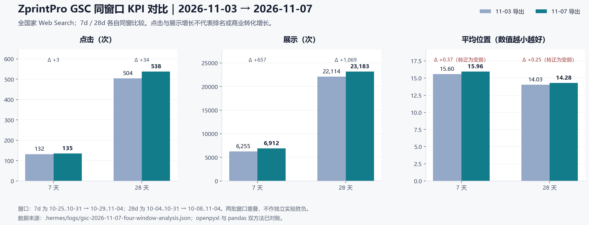
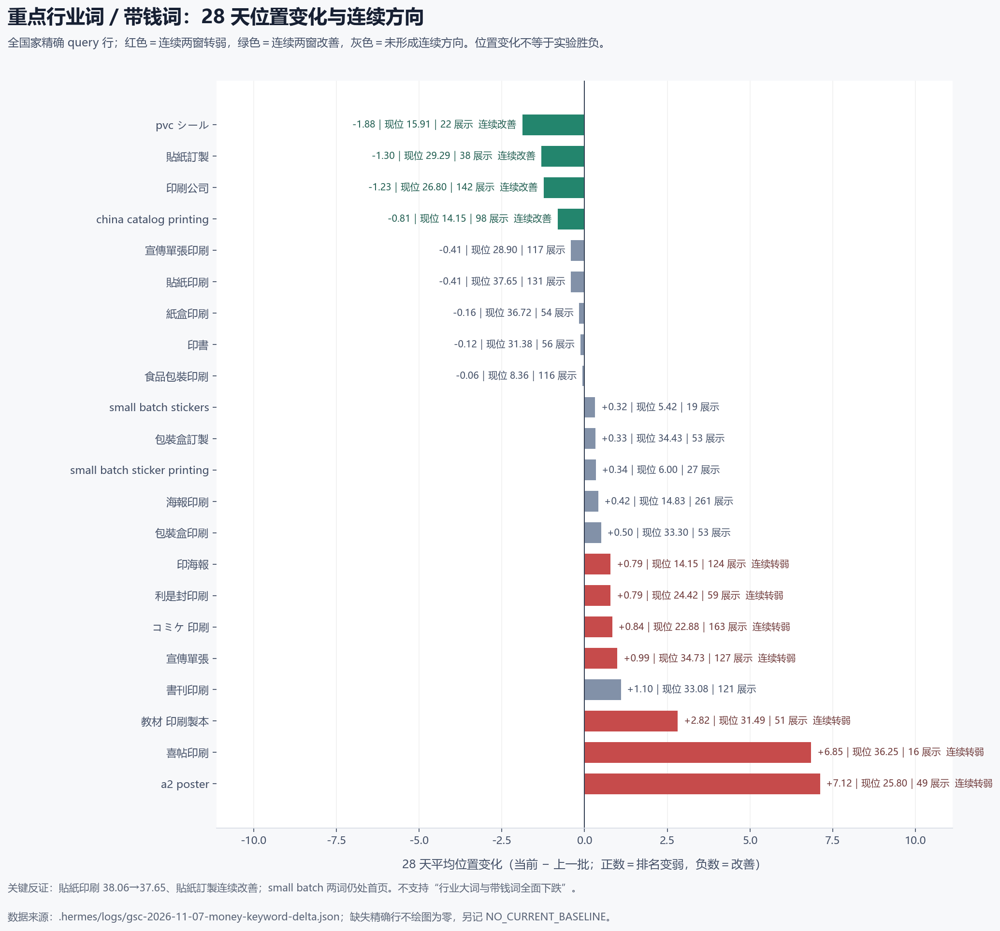

# ZprintPro 三站点 SEO／AEO／GEO 全面盘点与首页提升飞轮

> 日期：2026-11-07（Asia/Shanghai）  
> 角色：ZprintPro 首席搜索数据分析与战略参谋  
> 范围：`/zh-hk/...`、`/en/...`、`/ja/...` 三个语言路径；不是三个子域。  
> 性质：测量、战略与既有 Harness 执行方案；本报告不代表生产页面已修改，不承诺首页时限。

## 0. 决策摘要

**全站并未普遍下跌，但海报、喜帖、教材、`a2 poster` 等具体词簇确实转弱。**

- 11-03 → 11-07 的同窗口比较中，7d 点击 132 → 135、展示 6,255 → 6,912；28d 点击 504 → 538、展示 22,114 → 23,183。两个窗口平均位置分别变弱 0.3674 与 0.2530，准确表述是“量增、位微退”，不是流量或排名全面崩塌。
- 38 个重点监测词中，28d 首页词由 6 个增至 8 个，7 个首页词零点击；没有重点词跌出首页。`doujinshi printing` 新进首页；`large envelopes` 也进入首页，但只有 1 次展示，不能作为扩量证据。
- 连续两个 28d 窗转弱的 7 词：`印海報`、`宣傳單張`、`喜帖印刷`、`利是封印刷`、`教材 印刷製本`、`a2 poster`、`コミケ 印刷`。
- 连续两个 28d 窗改善的 4 词：`china catalog printing`、`pvc シール`、`貼紙訂製`、`印刷公司`。`貼紙印刷` 也从 38.06 微升至 37.65，不能归入“全面下跌”。
- 下一阶段不靠全面铺长文。首页零点击先查 SERP 特徵与真实 title／snippet；深位词先查索引、意图、query×page 承接、页面变更与商业真值；只有仍存在真实采购信息缺口，Blog 每轮才最多复写一篇。
- GEO 目前只有 S1 部分 citation URL，S2 计划在 11-20..24；没有可比完整答案与引用 URL 前，不宣称 AI 引用增长。

## 1. 数据来源、复算与边界

### 1.1 原始数据与复算

主数据：

- `GSC数据/` 内 2026-10-30、2026-11-03、2026-11-07 的 24h／7d／28d 导出；2026-11-03 的 3mo 导出。
- `.hermes/tmp/analyze_gsc_20261107.py`：openpyxl 与 pandas 两种独立归一化方法。
- `.hermes/logs/gsc-2026-11-07-four-window-analysis.json`：四窗、三个月背景、国家与页面独立聚合、双方法对账。
- `.hermes/logs/gsc-2026-11-07-money-keyword-delta.json`：38 个重点词的精确匹配、同窗口位置差分。
- `docs/assets/2026-11-07/gsc-focus-query-delta-28d.csv`：重点词可审计明细。

所有对账项均为 `match=true`。位置采用展示加权均值；位置差值 = 当前 − 上一批，**正数代表变弱，负数代表改善**。

### 1.2 不可越过的解释边界

1. 今日只有 24h／7d／28d 新档，**没有 11-07 三个月新档**；三个月只能沿用 11-03。
2. 7d 与 28d 相邻导出高度重叠，移动窗口不是独立 SEO 实验，不能据此判定某次内容修改胜负。
3. query sheet 的 28d／3mo 档上限 1,000 行。缺精确行记 `NO_CURRENT_BASELINE`，不等于零需求，也不沿用旧位置冒充当前值。
4. query、page、country 是独立聚合表，不能直接拼成“某语言站的 query×page×country KPI”。国家是搜索者位置，不是语言站业绩。
5. `教科書印刷` 的语言提示为 `ambiguous_zh_ja`，当前无精确行；不硬分市场、不派内容任务。
6. 未接入 GA4／008／订单落地页覆盖，本报告不作询盘、订单、收入或 ROI 结论。“带钱词”是采购意图工作分类，不是已证收入。
7. 最新 GSC index 有他人未提交改动；本轮 `node scripts/rebuild-gsc-index.mjs` 仅 dry-run，识别 259 个文件与 11-07 三个新档，**未写回 index**。

## 2. 四窗与三个月背景

| 窗口 | 11-03 | 11-07 | 同窗口判断 |
|---|---|---|---|
| 24h | 23 点击／977 展示／CTR 2.3541%／pos 15.9332 | 12／803／1.4944%／12.5218 | 单日量降、位升；星期不同，只作健康信号 |
| 7d | 132／6,255／2.1103%／15.5953 | 135／6,912／1.9531%／15.9627 | 点击与展示升，CTR 降 0.1572pp，位置弱 0.3674 |
| 28d | 504／22,114／2.2791%／14.0266 | 538／23,183／2.3207%／14.2796 | 量与 CTR 微升，位置弱 0.2530 |
| 3mo | 11-03：1,279／65,252／1.9601%／17.355 | 无新档 | 仅背景，不写成今日数据 |

当前 7d 实际窗口为 2026-10-29..11-04，28d 为 2026-10-08..11-04。

三个月日序列拆月仅作背景：8 月 321 点击／19,031 展示／pos 25.1262；9 月 413／22,162／14.2209；10 月 545／24,059／14.0948。它说明长期位置与流量结构发生变化，**不能证明 9 月某批 SEO 动作造成结果**。

28d 国家独立聚合：香港 358／12,931／13.61 → 382／13,651／13.61；日本 45／2,466／19.52 → 47／2,720／21.28；美国 33／2,747／15.25 → 33／2,658／15.45。日本是“更多深位曝光”的风险线索，但不能直接等同于 `/ja/` 站整体退化。

## 3. 什么是行业大词与真正的带钱词

### 3.1 工作定义

- **行业大词**：品类、供应商或服务总称，如 `印刷`、`印刷公司`、`印刷服務`、`printing company`。需求范围大，但意图混杂，不能只因展示高就优先扩页。
- **带钱词**：包含明确产品、定制、采购、数量、场景或交期意图，如 `貼紙訂製`、`包裝盒印刷`、`small batch sticker printing`、`教材 印刷製本`、`コミケ 印刷`。是否真正“带钱”还取决于可履约产品、真实报价路径和后续询盘证据。
- **季节带钱词**：`利是封印刷`、`月曆印刷`、`コミケ 印刷` 等要按活动窗判断，不把季节波动直接当永久退化。

### 3.2 当前优先级不是“词越大越优先”

优先级依次看：可履约与商业真值 → 采购意图 → 当前展示与位置 → 连续方向 → 承接页与摘要证据 → 可执行审批门。

当前首页 8 词为 `食品包裝印刷`、`即日印刷`、`small batch sticker printing`、`small batch stickers`、`saddle stitch booklet printing`、`doujinshi printing`、`large envelopes`、`卒アル販売`。其中 7 个零点击，说明“进首页”与“获得采购访问”之间还有摘要和意图匹配环节。

### 3.3 重点风险与反证

| 类型 | 词与当前 28d 证据 | 判断 |
|---|---|---|
| 高展示风险 | `海報印刷` 261 imp／1 clk／14.83；7d 15.92 → 21.29 | 海报簇重点诊断；28d 非连续恶化，不能只凭 7d 派单 |
| 连续转弱 | `印海報` 12.79 → 13.36 → 14.15 | 与海报同意图合并诊断，不建独立近义页 |
| 连续转弱 | `宣傳單張` 29.37 → 33.74 → 34.73，当前 127 imp | 交易页已有较高承接份额，先查摘要、内链和页面变化 |
| 连续转弱 | `喜帖印刷` 16.13 → 29.40 → 36.25，当前 16 imp | 样本较小但方向强；先验证是否由感谢卡 PDP 错接请柬意图 |
| 连续转弱 | `教材 印刷製本` 20.69 → 28.67 → 31.49，当前 51 imp | ja 第一诊断优先级；先查语言质量、价格真值和承接页 |
| 连续转弱 | `a2 poster` 17.20 → 18.68 → 25.80，当前 49 imp／1 clk | 查 EN PDP 变更、产品摘要与实际 SERP，不新建海报文章 |
| 深位但未全面下跌 | `貼紙印刷` 131 imp／0 clk／37.65 | 28d 40.88 → 38.06 → 37.65，方向改善但仍深位 |
| 连续改善 | `貼紙訂製` 32.41 → 30.59 → 29.29 | 继续复测，不 SCALE |
| 连续改善 | `china catalog printing` 15.79 → 14.96 → 14.15，当前 98 imp | 先复测与承接核验，再决定是否 FIX |
| 连续改善且有点击 | `印刷公司` 29.58 → 28.03 → 26.80，当前 142 imp／2 clk | 反驳“行业大词全跌”；仍不在首页 |
| 首页零点击 | `small batch sticker printing` 27 imp／0 clk／6.00；`small batch stickers` 19／0／5.42 | 先 SERP／snippet，不拿 24h 与旧 28d 错窗比较 |
| 缺当前行 | `教科書印刷` | `NO_CURRENT_BASELINE`，不派单 |

## 4. 三市场采购习惯与竞品信息架构

以下只用于解释页面应怎样帮助采购，不把竞品价格、MOQ、交期、认证或承诺移植到 ZprintPro。

### 4.1 zh-hk：词形、速度、规格与报价路径并存

本站真实 query 同时出现 `海報印刷`／`印海報`、`宣傳單張`／`宣傳單張印刷`、`貼紙印刷`／`貼紙訂製`，说明不能靠单一“标准词形”覆盖所有需求。`即日印刷` 已进首页且有点击，也证明明确服务条件有采购价值。

e-print 与 Print Rainbow 的香港印刷页面以产品分类、规格、纸质、数量和报价路径组织采购；ZprintPro 应借鉴其“先帮助选择，再进入报价”的信息架构，而非复制其商业条件。[e-print](kimi-cite://web?url=https%3A%2F%2Fwww.e-print.com.hk%2F "citation"), [Print Rainbow 海报](kimi-cite://web?url=https%3A%2F%2Fwww.printrainbow.com.hk%2Ftc%2Fprint-03.php%3Fid%3D1 "citation"), [Print Rainbow 单张](kimi-cite://web?url=https%3A%2F%2Fwww.printrainbow.com.hk%2Ftc%2Fprint-01.php%3Fid%3D2 "citation")

### 4.2 en：小批量、打样、材料和国际履约清晰度

`small batch sticker printing` 的既有 query×page 基线曾显示单个 PDP 100% 承接，当前又在首页，因此它首先是“位置已有、点击为零”的摘要问题，而不是缺一篇同义长文。Sticker Mule 将贴纸类型、材料、定制和打样等购买决策前置，值得借鉴其决策顺序；具体时效与价格不得照搬。[Sticker Mule](kimi-cite://web?url=https%3A%2F%2Fwww.stickermule.com%2Fcustom-stickers "citation")

`china catalog printing` 连续改善，说明国际采购词有机会，但仍需确认 catalog PDP、装订／页数／纸张信息与跨境履约真值一致。

### 4.3 ja：装订参数、教材用途与活动节点

book-hon 将书籍规格、装订等采购参数组织为明确流程，并为教材设置独立内容入口；这支持“教材需要专门采购信息”，但不支持在根因未明时继续扩写。[book-hon](kimi-cite://web?url=https%3A%2F%2Fwww.book-hon.com%2F "citation"), [book-hon 教材](kimi-cite://web?url=https%3A%2F%2Fwww.book-hon.com%2Fproduct%2Fteaching-materials%2F "citation")

`コミケ 印刷` 与 C109 具有活动驱动性，但官方活动日期、截稿与特快承诺未核实前不得发明。`教材 印刷製本` 当前连续恶化，应先解决页面语言、价格与意图承接的证据问题。

包装内容可借鉴 Fingerprint 以纸质、结构和工艺知识辅助选择的组织方式；现有 ZprintPro 包装长指南已存在，不能再用“缺泛包装长文”解释 30–40 位。[Fingerprint](kimi-cite://web?url=https%3A%2F%2Fwww.fingerprint.com.hk%2Fcms%2Fresources%2Ftutorial%2Fpaper-packaging "citation")

## 5. SEO／AEO／GEO 同页分工

Google 说明 title link 与 snippet 会依据页面内容和用户查询生成，meta description 不保证逐字采用；所以首页零点击必须先保存真实 SERP，而不是机械重写 title。[Google title link](kimi-cite://web?url=https%3A%2F%2Fdevelopers.google.cn%2Fsearch%2Fdocs%2Fappearance%2Ftitle-link "citation"), [Google snippet](kimi-cite://web?url=https%3A%2F%2Fdevelopers.google.cn%2Fsearch%2Fdocs%2Fappearance%2Fsnippet "citation")

内容应以帮助用户完成为中心，批量生产但不能增加价值的内容不是飞轮；不得用近重复文章、操纵性链接或隐藏真实承诺换取短期排名。[Google helpful content](kimi-cite://web?url=https%3A%2F%2Fdevelopers.google.cn%2Fsearch%2Fdocs%2Ffundamentals%2Fcreating-helpful-content "citation"), [Google spam policies](kimi-cite://web?url=https%3A%2F%2Fdevelopers.google.cn%2Fsearch%2Fdocs%2Fessentials%2Fspam-policies "citation")

- **SEO**：可索引、搜索意图、主交易页承接、采购参数、内链、真实摘要和页面体验。
- **AEO**：在对应页面提供可直接引用的规格选择、条件边界、FAQ 与步骤；答案块必须与可见正文和商业真值一致，不为机器另造承诺。
- **GEO**：AI 功能与常规搜索最佳实践一致，无需靠堆“GEO 原子”替代真实内容；引用效果必须单独用固定引擎探针验证。[Google AI features](kimi-cite://web?url=https%3A%2F%2Fdevelopers.google.cn%2Fsearch%2Fdocs%2Fappearance%2Fai-features "citation")

## 6. 既往战略与千问附件取舍

| 输入 | 保留 | 必须升级 |
|---|---|---|
| 10-26 双引擎战略 | hub-spoke、搜索与答案协同、分阶段验收 | 从“覆盖词簇”改为 query×page 与生产实验闭环 |
| 10-26 包装竞品战略 | 包装采购信息架构、商业真值门 | 已有长指南不再重复；包装三词仍深位，先根因而非继续泛写 |
| 10-26 七簇全球战略 | 分市场、分簇经营 | 不用固定产量和统一打法覆盖不同诊断 |
| 10-28 数据驱动战略 | 小实验、重点词优先 | WAITING_K3 旧清单不能当当前状态；逐项读 queue 与审批证据 |
| 10-31 带钱词与 Blog 方案 | 建立专门 Blog 决策车道、保留冻结基线 | “有 Blog 任务”不等于“每轮必须产文”；先复测、单篇、可 NO_OP |
| 11-03 首席执行报告 | 结果总线、FIX／MEASURE／SCALE、周月反馈 | 增加生产部署与线上核验硬门、陈旧 status 防派单、自然调度与业务成效分离 |
| 千问附件 | 三站点全局视角、首页词与内容／内链／自动化联动 | 不采纳“大词全跌”“长文解决深位”“固定篇数”“保证首页”“GSC 推收入”“普通搜索当 GEO 引用”等未证结论 |

## 7. 两周最强战略：2026-11-07 至 2026-11-20

**总目标不是文章数量，而是形成可审计的“测量 → 诊断 → 审批 → 单变量生产 → 线上核验 → 复测 → 学习／停止”飞轮。**

| owner | baseline | action | approval_gate | production_deploy | online_verify | retest | exit_criteria |
|---|---|---|---|---|---|---|---|
| K3／管理员＋watchdog | 11-07 daily 自然轮 DSH `QUOTA: Insufficient Balance`；k3／monthly 仍有缺口 | 恢复 DeepSeek 可用额度；核对 k3／watchdog wrapper；只观察后续自然轮，不用手动执行冒充恢复 | 管理员处理额度与主机；不得绕开付费或权限 | 无 src；运行配置若变须留审计 | scheduler＋lane-runs＋wrapper＋当日报告四方一致 | 11-07 23:47 blog；11-08 watchdog／k3／daily／gsc；11-13 weekly；11-14 重点词复测 | 连续自然轮可启动且有真实报告；失败有 owner／retry_at；不靠 exit=0 判成功 |
| ZP-gsc-feedback | 海报：`海報印刷` 261／1／14.83；`印海報` 124／0／14.15 | 拉取新 query×page，核对索引、实际排名 URL、SERP、近页变更；海报簇统一 MEASURE | 主 URL 与价格冲突未决不改正文／canonical／301 | 本阶段 NONE | 保存 query×page、SERP 与线上页面证据 | 11-14 | 有根因证据和下一动作；否则继续 HOLD，不新增海报文 |
| ZP-weekly-meta | `small batch sticker printing` 27／0／6.00；复数 19／0／5.42 | 记录 SERP features、真实 title／snippet 与可见采购信息；最多一个 snippet 变量，且与既有 sticker title 修复去重 | K3／既定 title 审批；同页同窗不得双改 | 仅审批后单变量、批量 push | CF 部署完成＋线上 title／snippet source／HTTP＋内容一致 | D1／D2 健康检查；11-14、11-21、12-05 | 完整证据后才判 CTR 实验；无审批则 HOLD |
| ZP-gsc-feedback＋daily | `宣傳單張` 34.73；`書刊印刷` 33.08；`喜帖印刷` 36.25 | 检查索引、意图、承接与页面变更；喜帖重点验证感谢卡 PDP 是否错接请柬意图 | 主 URL 与商业真值裁决前不改页面 | NONE | 新 query×page＋线上候选 URL | 11-14 | 输出 FIX／HOLD；禁止直接 canonical、301、noindex 或新长文 |
| ZP-gsc-feedback＋EN owner | `a2 poster` 25.80；`china catalog printing` 14.15 | a2 查 PDP／产品摘要／页面变更；catalog 先复测 concentrated PDP，再决定是否 snippet FIX | EN 商业真值与审批门 | 诊断阶段 NONE | 实际 SERP、PDP、部署记录 | 11-14 | a2 有根因；catalog 不因窗口改善直接 SCALE |
| ZP-gsc-feedback＋JA owner | `教材 印刷製本` 31.49；`コミケ 印刷` 22.88 | 教材先查语言质量、价格与承接；C109 查索引、活动意图与履约真值，官方日期未核实不写 | K3 价格／交期／活动承诺审批 | NONE | JA 页面与固定 query×page 证据 | 11-14 | 教材形成有证据的 FIX／STOP；C109 不造日期、不扩新页 |
| ZP-blog-deepfix | flyers／stickers／books 三项已追加 11-07 观察，原冻结基线不变 | 先复测；只有确认真实采购信息缺口才复写既有文章，每轮最多一篇；无增益 NO_OP | 五项 blocked_waiting_k3 不翻转；商业真值先批 | 只有审批与门童全过后才可部署 | 线上 URL、正文、schema、内链与部署一致 | 11-14；之后 14／28d | 有完整实验才学习；缺信息增益或证据则 MEASURE／NO_OP |
| GEO owner | S1 仅部分 citation URL | 11-20..24 执行 S2，固定引擎、固定问题、完整答案与 citation URL；不重跑 S1 | 探针口径先冻结 | 不因 AI 缺席自动产文 | 保存原始答案与完整 URL | S2 同窗对比 | 有可比引用才判变化；普通 WebSearch 不算 GEO 探针 |

## 8. 飞轮验收与学习门槛

每项实验必须同时具备：

`baseline + change + approval_gate + production_deploy + online_verify + retest`

- **FIX**：根因足够清晰、变量单一、审批与回滚明确。
- **MEASURE**：索引、意图、承接、商业真值或复测证据不足。
- **SCALE**：上述五项之外另有 `scale_evidence`；单窗改善、手动执行、报告完成均不够。
- **STOP／NO_OP**：重复低效、无意图、无信息增益、审批未决或基础设施阻断。停止投入不等于删页。

这才是可学习、可自进化的自动化：系统学习的是“已部署且线上验证的实验结果”，不是学习自己写了多少报告或文章。

## 9. 数据来源汇总

- GSC 原始 xlsx：10-30、11-03、11-07 四窗文件，以四窗 JSON 的逐文件路径为准。
- 复算与词级证据：`.hermes/logs/gsc-2026-11-07-four-window-analysis.json`、`.hermes/logs/gsc-2026-11-07-money-keyword-delta.json`。
- 执行证据：`.hermes/logs/lane-runs.jsonl`、11-01..11-07 各 lane 报告、`.hermes/logs/periodic-review-weekly-2026-11-07.json`。
- 执行与自动化升级的专项验收见 `.hermes/logs/2026-11-07-eight-day-execution-evaluation-and-harness-flywheel-upgrade.md`。

**最终判断：当前最值得投入的不是再铺一批深度 Blog，而是把首页零点击、连续恶化词、商业真值与自然调度交付链分别打通。**
