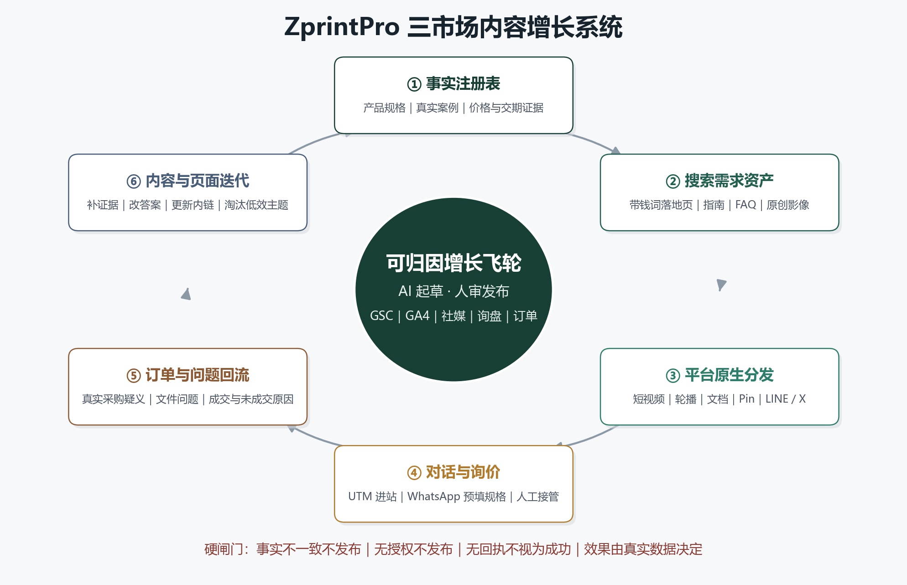

# ZprintPro 三语言站点社媒 × SEO／AEO／GEO × AI 内容自动化战略执行方案

**角色**：ZprintPro 首席 SEO／AEO／GEO 数据战略分析师  
**决策日期**：2026-11-14  
**覆盖范围**：`zh-hk` 香港繁中站、`en` 英语站、`ja` 日本站；站内搜索资产、社媒分发、WhatsApp 询价承接、AI 内容生产与自动化治理  
**执行分工**：Kimi 负责战略、优先级、实验裁决与复盘；DeepSeek Harness 负责受约束的资料整理、草稿、校验、平台适配与流程执行；涉及事实、报价、交期、版权与公开发布的最终责任仍由人承担  
**本报告性质**：战略与实施设计，不代表已经改站、注册账号、启用外部发布或创建定时任务

## 数据来源与研究边界

**数据来源**：项目规则与两份用户附件；zprintpro.com 三语首页及海报、A2 海报、小批量贴纸、目录、书刊、同人誌、包装、月历、利是封等公开页面的本轮正文读取；Google Search Central、Google Business Profile、TikTok、LinkedIn、YouTube、Pinterest、n8n、IndexNow 官方文档；DataReportal《Digital 2026》香港、日本、美国报告。市场数字多数为**广告可触达量或注册会员数**，不是月活用户，也不能直接换算为 ZprintPro 的潜在客户数。

本轮直接请求 12 个 URL 的原始 HTML `<head>` 时被 Cloudflare 以 403 拦截，因此 **canonical、hreflang、原始 title、meta description、JSON-LD 与 robots 状态尚未完成技术验收**；正文可读不等于 `<head>` 合规。本轮亦未取得可核验的 GSC、GA4、Bing Webmaster Tools、订单、毛利或社媒后台数据，所以下文不会声称某个关键词已有排名、某平台已经带来订单，也不会编造曝光、转化率或增长百分比。英文与日文关键词是基于产品意图提出的**待验证词包**，不是已证实搜索量清单。Meta／Instagram／WhatsApp 的部分政策接口与 LINE、Pinterest 个别页面本轮未能完整读取，涉及消息窗口、模板、权限、费用和审批的细则均列为上线前复核项。

---

# 一、执行摘要：先把“事实可信”做成系统，再把“内容分发”做成飞轮

## 1.1 核心战略判断

ZprintPro 不缺可以生成的文字，缺的是**可以被搜索引擎、AI 答案系统、社媒用户和采购人员共同验证的产品事实**。本轮实测已经看到三语首页客户数、评分、主体地点、联系方式不一致，部分产品页同时存在不同起订量、价格与交期。若此时直接启动全自动生成与发布，AI 不会解决这些问题，只会把冲突复制到更多页面和平台。因此第一阶段必须把“事实注册表＋发布阻断＋人工审批”放在自动化之前；任何没有来源的客户数、评分、交期、认证、环保、价格与市场规模声明，都不得进入公开内容。

社媒也不是一个可以直接按下就提升 Google 排名的按钮。它在本方案中的职责是：**创造需求、展示真实生产经验、让品牌与产品被反复发现、获得真实互动、把高意向用户送进可追踪的询价链路**。SEO 负责捕获已经存在的搜索需求，AEO 负责把问题回答得清楚可提取，GEO 负责让内容具备可引用的事实、作者、证据和实体一致性。三者共享同一份事实与内容资产，但不能把同一篇文章机械翻译成三语、再原样复制到所有平台。

建议采用“**一个真实主题，多次原生表达，一条归因链路**”的经营方式。例如，以一次真实的目录印前文件检查为起点，先形成英文采购指南与可下载检查清单，再拆成 LinkedIn 文档、YouTube 短演示、Instagram 轮播和 Pinterest 检查图；每个平台使用不同开场与画面，但统一回到对应语言的产品页或 WhatsApp 规格询价。用户提出的问题、销售遇到的疑义、成交与未成交原因再回流为 FAQ、案例与页面修订。这个闭环才是可长期运行的飞轮，而不是单纯增加发帖频率。

## 1.2 六项管理层决策

| 决策 | 建议拍板 | 为什么现在必须做 |
|---|---|---|
| 自动化顺序 | **先事实与测量，后半自动发布，最后才扩大自动化** | 防止冲突价格、交期、评分与主体信息被规模化传播 |
| 关键词资源 | **带规格、数量、定制、采购地与产品词的“带钱词”优先于泛行业大词** | “香港印刷”可建立品类入口，“catalog printing china”“包裝盒訂製”更接近采购动作 |
| 市场打法 | 香港重 IG／Facebook／YouTube＋WhatsApp；美国重 YouTube／LinkedIn／Instagram＋Pinterest；日本重 X／LINE／YouTube，再做 Instagram | 平台角色与语言习惯不同，不应全球同帖同 CTA |
| 内容证据 | 每个核心主题至少绑定一个真实规格、文件示例、材料对比、生产过程或授权案例 | 形成非商品化信息，避免批量低价值 AI 内容 |
| 转化入口 | 所有内容使用平台、语言、活动级 UTM；WhatsApp 预填产品、尺寸、数量、材质、交期和来源 | 从“看帖子”升级为可追踪的有效询价与订单归因 |
| 增长纪律 | **不自动私信、不批量评论、不购买互动、不虚构本地地址或客户案例** | 保护账号、品牌与搜索质量，避免以短期噪音换取长期风险 |

## 1.3 飞轮总图



这张图的关键不是六个框，而是四条硬闸门：**事实不一致不发布、素材无授权不发布、平台无回执不视为成功、没有真实数据不扩大投入**。Kimi 每周根据搜索、社媒、询价和订单数据决定“继续、修改、暂停”，DeepSeek Harness 只执行已经通过闸门的任务。这样自动化放大的是经过验证的内容资产，而不是未经核验的文案产量。

---

# 二、三语站点深度盘点：当前应先过“事实闸门”，再谈规模分发

## 2.1 已观察到的 P0 问题

下表只记录本轮公开正文可见的**口径冲突或来源待核验项**，不直接断言相关数字虚假。处理原则是找到原始凭证、确定唯一适用条件并统一页面；如果无法核验，就删除具体承诺，改为“按规格与正式报价确认”。

| 页面／主题 | 本轮可见问题 | 风险 | P0 处理动作 |
|---|---|---|---|
| 三语首页 | 中文出现 `4,820+`、`4.9／5（1,867）`；英文出现 `28,000+`、`4.9／5（2,600+）`；日文出现 `3,000+`、`98.4%`、`4.92（1,246）` | 同一品牌实体与信誉证据互相冲突，AI 摘要和社媒转载会放大矛盾 | 找到统计口径、时间窗、原始订单或评价表；无法证明则撤下，不以另一组数字替换。[中文首页](https://zprintpro.com/zh-hk/)、[英文首页](https://zprintpro.com/en/)、[日文首页](https://zprintpro.com/ja/) |
| 主体与地点 | 页面同时出现香港总部、深圳工厂、香港即日／次日等不同叙述 | 用户无法判断签约主体、生产地、取货地与配送承诺 | 统一真实签约主体“深圳市彩龙印刷包装有限公司”；生产、客服、取货、配送分别写清，不混为“本地门店” |
| 联系邮箱 | 首页可见 `info@zprintpro.com`、`support@zprintpro.com`，与项目口径 `zprintpro@outlook.com` 不一致 | 线索丢失、结构化数据与社媒资料不一致 | 先确认实际可收信邮箱，再统一站内、社媒与报价单；不要只改显示文字而遗漏链接 |
| A2 海报 | 同页有 HK$16×10＝HK$160、HK$2.20 起、即日／明日中午、1–2 天、报价确认等多种表达；另有客户与场所数量待核验 | 价格与交期难以执行，广告或社媒引用后易形成投诉 | 建立“规格—数量—价格—生产时间—截单时间—配送／取货”的单一条件表。[A2 页面](https://zprintpro.com/zh-hk/product/a2-posters/) |
| 小批量贴纸 | 同页出现 10 件与 10 张 A4、10 件 US$0.55 与 US$0.60，并夹杂中文“結算” | 单位不清、价格矛盾、英文站语言混杂 | 明确“件”是单枚、单张还是一张 A4；报价表与 CTA 读取同一数据源。[贴纸页面](https://zprintpro.com/en/product/small-batch-stickers/) |
| 目录印刷 | 同页出现 10 本与表格 100 本起订，并含“约本地一半价格”“所有纸均 FSC”“完全可生物降解”等待证声明 | 高意向落地页无法信任，环保与认证表述有合规风险 | 明确产品变体与 MOQ；认证只覆盖有证书的具体材料与范围，删除笼统绝对化表述。[目录页面](https://zprintpro.com/en/product/catalog-printing/) |
| 书刊／学校印刷 | 同页出现 1 本与 10 本起订，并出现“47 个教育局、平均 5,000 本／单”等待核验数字 | 学校与机构采购最重视资质、案例与可复核条款，冲突会直接阻断询价 | 按装订、印刷方式和产品变体确定 MOQ；机构与客户数据须有原始记录及公开授权 |
| 包装类页面 | 可见原始 `<b>`／`<a>` 标签与“產品鏈接”占位符 | 页面质量与渲染可信度下降，也不适合作为 AI 再生内容源 | 修复渲染与占位符；所有包装正文进入白名单前必须过 HTML、链接与事实扫描 |
| 月历等季节性页面 | 可见旺季比例、涨价幅度、模板数等未核验数字 | 季节性社媒容易把旧数字重复传播 | 将每年价格、截单和产能设为有有效期的字段，过期自动阻断 |
| 品牌口径 | 多页正文使用“智印港（ZprintPro）”双品牌并列 | 违反当前单品牌规则，也削弱实体一致性 | `zh-hk` 只用“智印港”，`en/ja` 只用“ZprintPro”；错字“智印印港”继续禁止 |

这些问题说明，9 月完成的标题、FAQ、内链与深度骨架动作只能解决“页面结构”，不能自动解决“事实可信度”。Google 对以人为本内容的公开建议强调原创信息、第一手经验、准确作者与来源，并提醒避免批量低价值自动化内容；因此，**内容越长、FAQ 越多、发布越频繁，并不天然等于更值得信赖**。[Google 以人为本内容指南](https://developers.google.com/search/docs/fundamentals/creating-helpful-content)

## 2.2 技术审计：本轮哪些已确认，哪些仍不能下结论

已确认的是公开正文存在上述一致性问题；未确认的是 `<head>` 中的实际技术实现。下一轮技术验收应从本地代码、Cloudflare 缓存外的新鲜 HTML 和 Search Console URL 检查三路交叉验证，而不是只依赖第三方抓取。验收对象包括：每个 URL 的状态码与索引指令、canonical 是否自指、三语 hreflang 是否自指且互指、`x-default` 是否清晰、站点地图是否只含可索引规范 URL、结构化数据是否与可见正文一致、社交分享图与标题是否按语言输出。

Google 的多语言文档要求 hreflang 使用完整 URL、相互返回并包含自指，HTML、HTTP 和 Sitemap 三种实现方式等效，不必重复堆叠。[Google 多语言版本指南](https://developers.google.com/search/docs/specialty/international/localized-versions) 对标题与摘要也不应机械追求固定字符数：Google 没有公布统一标题长度上限，可能按设备截断，并可能综合 `<title>`、H1、主视觉标题、`og:title` 和锚文本重写标题；摘要主要来自正文，也可能采用更准确的 meta description。[Google 标题链接指南](https://developers.google.com/search/docs/appearance/title-link)、[Google 摘要指南](https://developers.google.com/search/docs/appearance/snippet) 因此项目内部标题规则仍可作为编辑规范，但不应把字符数本身当成排名保证。

## 2.3 SEO／AEO／GEO 的正确边界

Google 已明确，AI Overviews／AI Mode 沿用基础 SEO 最佳实践，没有额外必须添加的“GEO 专用 schema”或 AI 文本文件；页面需要可索引并符合 snippet 条件，但收录与展示均不被保证。[Google AI 功能指南](https://developers.google.com/search/docs/appearance/ai-features) 2026 年 6 月的文档更新进一步说明，`llms.txt` 对 Google Search 不是必需文件，也不会正面或负面影响排名；FAQ 富媒体结果自 2026 年 5 月 7 日起不再展示，相关文档已于 6 月移除。[Google Search 文档更新](https://developers.google.com/search/updates)

因此，FAQ 仍然值得写，但目的应是回答真实采购问题、减少销售摩擦、提供清晰可提取的答案，**不能再把 FAQ rich result 当作卖点**。同理，GEO 工作的重点不是发明一套神秘标记，而是让产品实体、规格、证据、作者、图像、视频、引用来源与外部资料一致。IndexNow 可用于向参与引擎通知新增、更新和删除，但它不是排名或收录保证，也不能在本方案中被写成“Google 已通过 IndexNow 接收推送”。[IndexNow 官方说明](https://www.bing.com/indexnow)

## 2.4 本地实体与社媒资料纪律

香港、美国、日本都应做本地化内容，但“本地化内容”不等于“虚构本地公司”。Google Business Profile 仅适用于客户可到访的真实地点，或会到客户所在地提供服务的企业；虚拟办公室不合格，跨境发货本身不构成创建当地服务区域档案的资格。[Google Business Profile 资格指南](https://support.google.com/business/answer/3038177?hl=en) 所以不得为了“香港印刷”“Japan printing”或美国本地搜素而伪造地址、门店、电话或评价。

三个语种的社媒简介可以解释服务市场、生产与配送方式，但签约主体、官网、真实联系方式与可服务地区必须一致。香港内容可以用自然粤语讨论本地取货或配送，但只有在实际服务条款支持时才可承诺；英文站突出跨境采购的文件、打样、运输和沟通流程；日文站使用自然商务日语说明仕様、入稿、校了、製造与配送，不把中文页面逐字机翻成日语。

---

# 三、关键词资产：区分“行业大词”“带钱词”和“决策证据词”

## 3.1 分类逻辑与优先级模型

“行业大词”负责建立品类覆盖，例如“香港印刷”“printing services”“印刷”；它们通常语义宽、竞争者多、需求混合，不能单独代表订单价值。“带钱词”包含明确产品、规格、定制、批量、采购地或用途，例如“包裝盒訂製”“catalog printing china”“small batch sticker printing”；这些词更接近询价与采购。“决策证据词”则包括纸张、装订、文件、MOQ、交期、打样、配送等问题，虽然搜索量可能较小，却直接影响采购是否相信并提交规格。

建议以五个维度给每个关键词打分，而不是凭感觉排期：**采购意图、产品匹配、页面证据完备度、可交付性、历史询盘／订单贡献**。其中毛利与历史贡献必须从真实订单表取得；没有数据时保持“待校准”，不得补一个看似合理的数字。优先级可按以下公式排序：`机会分 = 采购意图 × 产品匹配 × 证据完备度 × 可交付性`，历史贡献用于季度校准，不用于伪造当前基线。若某页仍有 MOQ、价格或交期冲突，即使关键词价值很高，也先修页再推广。

## 3.2 香港繁中词包与落地职责

| 关键词组 | 类型与意图 | 首要承接资产 | 社媒与答案内容切入点 |
|---|---|---|---|
| 香港印刷、印刷公司、印刷服務 | 行业大词；品类与品牌入口 | `zh-hk` 首页／品类枢纽，不应让一个产品页垄断全部泛词 | 真实主体、产品与交付范围总览；避免“全港第一”等无证据表述 |
| 即日印刷、急件印刷、即日海報 | 强时间意图；是否带钱取决于真实履约 | 单独的急件条件模块或落地页，写清截单、规格、数量、取货／配送 | “急件先确认哪四项”清单；未核实前不公开承诺即日 |
| 海報印刷、a2印刷 | 产品＋规格，高意向 | 海报主品类与 A2 规格页，避免同义页互抢 | 尺寸、出血、分辨率、纸张与展示场景对比 |
| 宣傳單張、宣传单张、宣傳單張印刷、傳單印刷 | 产品词；简繁与“宣傳／宣传”变体 | 一个规范传单产品页覆盖自然语言变体，不为每个错写或简繁变体建薄页 | 传单纸张、折法、用途和文件检查；粤语短视频 |
| 摺頁印刷、小冊子印刷 | 明确产品与装订／折法意图 | 折页与骑马钉小册子分别承接，内链互连 | 折页展开顺序、跨页图、页数与装订检查 |
| 利是封印刷、喜帖印刷、月曆印刷 | 节庆／婚礼／季节性采购 | 独立产品页＋年度时间规划指南 | 真实样品、材质与工艺细节；旺季内容按当年条款更新 |
| 貼紙印刷、可移貼紙 | 产品＋材料功能意图 | 贴纸主品类与可移材料段／页，按实际产品架构确定唯一 canonical | 残胶、表面、室内外、防水等必须有测试条件；材料对比轮播 |
| 包裝盒訂製、包裝盒印刷、紙盒印刷、紙盒訂製、禮盒訂製 | 高定制、高询价意图 | 包装枢纽＋纸盒／礼盒能力页，避免多页同文竞争 | 刀模、结构、打样、材质、装配与运输；真实样品视频 |
| 印書、書刊印刷、書籍印刷、學校印刷、證書印刷 | 产品或机构用途，高决策深度 | 书刊产品页、学校采购指南、证书产品页 | 页数、装订、色彩、文件与隐私；机构案例须授权 |
| 易拉架印刷 | 展示器材＋画面采购意图 | 易拉架产品页，画面规格与硬件规格同页一致 | 安装、替换画面、运输与文件尺寸演示 |

“即日印刷”可以带来极强行动意图，但也是当前最危险的词之一：如果页面、报价和实际产能不一致，推广越成功，售后风险越大。建议把它设为**条件型带钱词**，只有在 SKU、数量、文件校了时间、生产日、取货／配送区域和例外条款全部明确后才投放内容。月历、利是封和喜帖则应建立“年度内容版本”和过期日期，防止去年旺季价格或截单时间被 AI 继续引用。

## 3.3 英文站词包：优先跨境采购与清晰规格

| 英文关键词／词群 | 对应产品与意图 | 建议落地与内容职责 |
|---|---|---|
| catalog printing china、catalogs printing china、china catalog printing | 同一采购意图的语序变体；明确产品＋生产地 | 由一个高质量 catalog 产品页自然覆盖，不为三种语序建三个近重复页；重点回答 MOQ、装订、打样、文件、包装、运输与沟通 |
| book printing china、booklet printing china、school booklet printing | 书刊、小册子与学校采购 | 书刊页＋采购指南；按真实能力区分单本打样与批量生产 |
| small batch sticker printing、custom sticker printing、removable sticker printing | 小批量与材料功能 | 贴纸页必须先统一“piece／sheet”单位与价格；用真实材料测试与模切过程支撑 |
| custom packaging boxes、printed paper boxes、custom gift boxes | 高定制包装采购 | 包装枢纽＋结构、打样、材料和报价清单；LinkedIn 文档与 Pinterest 灵感图共同承接 |
| poster printing、A2 poster printing、flyer printing、folded leaflet printing | 标准化程度较高的产品采购 | 对应产品页；用尺寸、纸张、折法和印前检查获得长尾流量 |
| calendar printing、red packet printing、wedding invitation printing、certificate printing | 季节性／场景型采购 | 英文内容应解释国际运输、文件与时间缓冲，不把香港即日条件复制到海外订单 |
| roll up banner printing | 展示采购 | 产品页与安装／文件视频；明确硬件和画面是否同时供应 |

英文站不应只围绕“cheap printing China”做文章。低价如果没有可执行报价与完整成本条件，会吸引大量低质量询盘，并削弱企业对质量、文件和交付的信任。更有效的定位是“**让跨境印刷规格可确认、文件可检查、进度可沟通、报价可复核**”。`catalog printing china` 及其语序变体可共用一个页面，但页面要提供独有证据，例如真实装订样本、印前检查表、常见错误与包装出货照片，而不是不断重复关键词。

## 3.4 日本站词包：先作为待验证假设，再用 GSC 与真实询盘校准

| 日文词包 | 中文／英文对应 | 内容注意事项 |
|---|---|---|
| ポスター印刷、A2 ポスター 印刷 | 海報印刷、A2 poster printing | 使用日本常见尺寸、紙種、入稿与データ检查用语 |
| チラシ印刷、折りパンフレット印刷、パンフレット印刷 | 宣傳單張印刷、摺頁印刷、小冊子印刷 | 区分チラシ、折りパンフレット、中綴じ冊子，不把所有产品塞入同一页 |
| カタログ印刷 中国、海外 カタログ印刷 | catalog printing china | 自然日语中是否常用该组合须以 GSC、广告词库或销售对话验证，不声称已有搜索量 |
| 書籍印刷、冊子印刷、同人誌印刷、学校 教材 印刷 | 印書、書刊、学校印刷 | 日本同人誌已有独立页面基础，可围绕表紙、本文、綴じ方、入稿形成专题群 |
| オリジナル ステッカー 小ロット、再剥離シール 印刷 | small batch sticker printing、可移貼紙 | “再剥離”是功能意图；性能表述必须绑定测试条件，不笼统保证所有表面 |
| パッケージ印刷、化粧箱 オーダーメイド、ギフトボックス 製作 | 包裝盒訂製、紙盒訂製、禮盒訂製 | 强调型抜き、寸法、素材、サンプル与数量；保留真实打样流程 |
| カレンダー印刷、ポチ袋 印刷、結婚式 招待状 印刷 | 月曆、利是封、喜帖印刷 | “ポチ袋”与香港利是封的文化用途不同，内容不可直译同一套节庆话术 |
| ロールアップバナー 印刷、証明書 印刷、当日 印刷 | 易拉架、證書、即日印刷 | “当日”只可在真实可履约条件下使用；跨境页面应优先解释配送而非承诺当日到手 |

日文站的核心不是把英文关键词换成日语，而是让采购者能按日本印刷文件的表达方式完成任务。每篇内容应由懂日语与印刷的人复核术语、敬语和视觉示例；AI 可以生成初稿和检查遗漏，但不能自行决定“当日”“無料”“保証”等承诺。日文关键词表的下一步是接入 GSC 查询与页面数据，观察实际展示词、点击词和询盘词，再决定扩展、合并或停止。

## 3.5 关键词到页面、社媒和订单的统一映射

每个重点词群必须只有一位“负责人”：一个规范落地页、一组支持内容、一组社媒主题和一个询价动作。泛词进入品类枢纽，高意向词进入产品页，问题词进入指南或 FAQ，品牌词进入公司／法律／联系信息。社媒不为每个关键词单独发帖，而是围绕采购任务组织内容；一篇“目录印刷文件检查”可以同时服务 catalog 产品页、LinkedIn 文档、YouTube 演示与 WhatsApp 文件预审，但所有版本都应指向同一规范产品 URL。

建议建立 `keyword_map` 数据表，至少包含：`market`、`locale`、`query`、`intent`、`funnel_stage`、`primary_url`、`supporting_urls`、`product_id`、`evidence_status`、`conversion_event`、`last_validated_at`。其中 `evidence_status=blocked` 的词可以保留研究记录，但不能进入自动发布队列；一个查询只能有一个 `primary_url`，若多个页面竞争同一意图，应先决定合并、重定向或重新分工。

---

# 四、三市场社媒组合：不是“全平台同发”，而是按采购任务分工

## 4.1 渠道优先级与数据限定

DataReportal 的 2026 年报告主要使用截至 2025 年 10 月的数据；其中 YouTube、Facebook、Instagram、TikTok、X 等多为广告工具显示的可触达量，LinkedIn 为注册会员数，LINE 日本数据则按报告标为月活用户。下表只用于判断渠道相对优先级，**不能据此推算 ZprintPro 可获得多少流量或订单**。

| 市场 | 可参考的平台规模信号 | 战略解释 |
|---|---|---|
| 香港 | YouTube 6.24M、Facebook 4.70M、Instagram 4.05M 广告可触达；LinkedIn 4.20M 注册会员；Threads 1.55M | 以 IG／Facebook 做本地视觉与社群发现，YouTube 做可搜索演示，LinkedIn 做企业采购，WhatsApp 做询价；Threads 只做轻量测试。[DataReportal 香港](https://datareportal.com/reports/digital-2026-hong-kong) |
| 日本 | LINE 99.0M MAU；YouTube 78.5M、X 71.2M、Instagram 63.2M 广告可触达；TikTok 39.2M 成年广告受众；Pinterest 9.19M；LinkedIn 5.40M 注册会员 | X／LINE 承担日常触达与关系维护，YouTube 承担演示与搜索，Instagram 做作品视觉，LinkedIn 仅为机构采购补充。[DataReportal 日本](https://datareportal.com/reports/digital-2026-japan) |
| 美国 | YouTube 254M、Facebook 198M、Instagram 182M 广告可触达；TikTok 153M 成年广告受众；LinkedIn 270M 注册会员；Pinterest 96.9M、X 99M | YouTube／LinkedIn／Instagram 为主，Pinterest 承接包装、婚礼、设计灵感的长期发现，TikTok 用于测试短视频题材。[DataReportal 美国](https://datareportal.com/reports/digital-2026-united-states-of-america) |

香港的 TikTok 与 X 数据在报告中存在明显异常或大幅修订，不应用作本轮优先级依据。美国市场虽大，也不意味着一开始就覆盖全美所有行业；建议先以目录、小批量贴纸、包装三类较容易展示真实证据的产品做试点，再根据有效询价扩展。日本则先围绕同人誌、冊子、贴纸与包装积累日语原生内容，避免把香港节庆产品直接移植。

## 4.2 平台角色、格式与转化动作

| 平台 | 最适合的任务 | 推荐原生格式 | 不应做什么 | 主要转化动作 |
|---|---|---|---|---|
| Instagram | 样品、材质、工艺、前后对比与品牌发现 | Reels、轮播、Stories；首图只传达一个采购价值 | 同一海报机械跨市场发布；用未核实数字做封面 | 查看对应产品指南；进入带规格的 WhatsApp／表单 |
| Facebook | 香港本地社群、活动与较长说明 | 原生图文、短视频、活动／季节性主题 | 群发无关社团、重复贴链接、购买互动 | 留言后由人回应；公开评论中不索取敏感文件 |
| YouTube | 可搜索教程、文件检查、装订与安装演示 | Shorts＋较长教程；章节、字幕、真实画面 | 只有 AI 旁白和素材库拼接、无独有经验的视频 | 描述区指向对应语言指南与产品页 |
| LinkedIn | 企业采购、机构与跨境供应能力 | 文档帖、案例拆解、采购清单、员工／作者专业观点 | 自动私信、批量评论、夸大客户名单；自然帖假装轮播广告 | 下载清单、查看采购指南、提交 RFQ |
| TikTok | 生产过程、材料实验、文件错误等短演示 | 原生竖屏视频／照片，真实现场与明确主题 | 未经审核即假设 API 可公开发布；搬运带水印视频 | 进入主页对应落地页，不在评论承诺价格 |
| Pinterest | 包装、婚礼、日历、设计与规格灵感的长期发现 | 高质量 Pin、步骤图、材料板、检查清单 | 重复 Pin、无关标签、无来源图片 | 指向具体指南或产品页，而非首页 |
| X | 日本市场的短提示、工艺观察、内容更新与互动 | 日文短帖、单图、短视频、主题串 | 逐字翻译英文帖、无上下文堆标签 | 进入日语指南；由人回答专业问题 |
| LINE | 日本熟客、订阅读者与询价后的服务触达 | 官方账号消息、图文、清单、人工咨询 | 未经同意频繁推送；把报价机器人当全自动销售 | 进入规格收集与人工客服 |
| WhatsApp | 香港及跨境高意向询价、文件与订单沟通 | 网站预填消息、规格清单、人工跟进 | 自动爬取号码、未经许可群发、把敏感设计文件开放给无关人员 | 有效询价、文件检查、正式报价与订单跟进 |
| Threads | 香港轻量话题与品牌人格测试 | 简短观察、单图、生产小知识 | 在主平台尚未跑通前投入大量定制产能 | 回到 IG 或站内主题页 |

LinkedIn 官方 Posts API 支持企业页面在具备相应权限和页面角色时发布文字、图片、视频、文档、文章、多图和投票；原生轮播并不等同于自然帖能力，赞助内容另有格式。[LinkedIn Posts API](https://learn.microsoft.com/en-us/linkedin/marketing/community-management/shares/posts-api) 因此方案中的 LinkedIn 轮播应优先制作为**文档帖**，不要用一个不存在的自然轮播接口阻塞流程。LinkedIn 社区政策要求真实身份与机构信息，禁止虚假误导、垃圾信息和人为制造互动，故本方案排除自动私信与批量互动。[LinkedIn 社区政策](https://www.linkedin.com/legal/professional-community-policies)

TikTok 官方 Content Posting API 支持视频与照片 Direct Post，但需要注册应用、`video.publish` 审批和用户授权；未审核应用的公开发布能力受限制。[TikTok Content Posting API](https://developers.tiktok.com/doc/content-posting-api-get-started/) YouTube 上传可在 OAuth 后设置标题、说明、隐私状态和 `publishAt`；Shorts 对方形或竖屏视频的支持时长应按当前官方规则复核，超过一分钟且存在有效版权主张的内容可能被全球屏蔽。[YouTube 上传 API](https://developers.google.com/youtube/v3/docs/videos/insert)、[YouTube Shorts 规则](https://support.google.com/youtube/answer/15424877?hl=en) 这些接口都只解决“发布动作”，不解决内容质量与订单转化。

## 4.3 三市场的定位与内容语言

**香港站与社媒**：使用自然繁中与适度粤语，重点是“看得懂规格、找得到人、报价有条件、文件有人检查”。内容场景可覆盖活动海报、学校小册子、社团传单、利是封、喜帖、易拉架与贴纸，但即日、取货、配送、价格与旺季截单必须逐条核验。CTA 应让用户提供尺寸、数量、材质和需要日期，而不是只写“PM 有价”。

**英文站与社媒**：面向美国及其他英语采购者时，应突出跨境采购的确定性，而不是空泛“全球领先”。LinkedIn 面向采购、市场、出版与机构人员，YouTube 展示真实过程，Pinterest 连接包装和婚礼等视觉灵感，Instagram／TikTok 展示材料和生产细节。所有价格需说明规格、数量、币种、是否含运和有效期；不能用“half the local price”作为无来源通用卖点。

**日本站与社媒**：以自然商务日语和清晰仕様为中心，X 提供短而具体的印前知识，YouTube 展示綴じ方与データ检查，LINE 用于许可后的服务触达，Instagram 展示真实样品。内容需由日语审校者确认术语与语气；中文的“即日”“旺季涨价”或英文的“cheap”都不能直接翻译。日文内容的首要转化是让用户理解入稿与询价步骤，再进入人工确认。

---

# 五、内容操作系统：一个真实主题，拆成一组平台原生资产

## 5.1 六大内容支柱

| 内容支柱 | 必须包含的独有证据 | 适合的搜索资产 | 适合的社媒表达 | 对转化的作用 |
|---|---|---|---|---|
| 印前与文件 | 可公开的错误示例、正确示例、检查清单 | 出血、分辨率、色彩、字体、跨页与折法指南 | 15–45 秒纠错视频、轮播、LinkedIn 检查表 | 降低文件沟通成本，吸引已有项目的人 |
| 材料与工艺 | 真实纸样、材料名称、测试条件、近景照片 | 纸张、覆膜、可移胶、装订、工艺对比 | 触感近景、弯折／贴合演示、材料对比图 | 帮助采购选择规格，减少只问最低价 |
| 产品与规格 | 统一 MOQ、尺寸、数量单位、价格条件、交期定义 | 带钱词产品页与规格 FAQ | 尺寸演示、包装结构、安装和折页顺序 | 把内容观看转成完整 RFQ |
| 真实生产与质控 | 自有或获授权的现场影像、流程记录、检查点 | 生产流程、打样、质控与包装指南 | 工厂短片、员工讲解、过程照片 | 建立跨境信任，证明不是通用 AI 文案 |
| 用途与授权案例 | 客户许可、项目背景、规格、挑战、处理过程、结果证据 | 学校、活动、出版、包装、婚礼案例 | 案例轮播、LinkedIn 文档、Pinterest 项目板 | 让同类采购者看到可复制路径 |
| 采购与交付 | 真实报价字段、校了节点、运输与责任边界 | RFQ 指南、打样与配送说明、旺季规划 | 清单、时间规划、常见疑义回答 | 减少无效询盘，提高销售跟进质量 |

环保、认证与“可持续”不是独立流量装饰，只能作为有证据的材料属性出现。例如“某款纸具有某认证”必须能对应证书范围与具体 SKU，不能扩写为“所有纸张均获认证”或“完全可生物降解”。客户案例也必须区分“真实生产但不可公开客户名”“获授权公开客户名”“仅为示意设计”；AI 不得把示意设计写成真实客户订单。

## 5.2 一次主题生产的复用矩阵

以“**目录印刷前的跨页图与装订检查**”为例，前提是使用自有示例或获授权文件：

| 资产 | 语言／平台 | 原生改写重点 | 目标 URL／动作 |
|---|---|---|---|
| 完整采购指南 | 英文站 | 装订方式、页数、跨页、出血、打样、RFQ 字段与真实图例 | 英文 catalog 指南页，内链至 catalog 产品页 |
| 可下载检查清单 | 英文站／LinkedIn | 一页 PDF；作者、版本、适用范围清晰 | 下载事件＋产品页，不强制留资才能查看基础答案 |
| LinkedIn 文档帖 | 美国英语 | 采购者最常见的文件返工点，以文档页呈现 | 指向完整指南，邀请提交规格而非自动私信 |
| YouTube 演示 | 英文 | 屏幕或实物演示正确／错误跨页，含字幕与章节 | 描述区指向指南和产品页 |
| Instagram 轮播 | 香港繁中 | 用本地常见小册子语境讲“跨页图点样避免走位” | 指向 `zh-hk` 小册子页或 WhatsApp 规格消息 |
| X 主题串 | 日文 | 分解为綴じ方、ノド、塗り足し、ページ構成等日语提示 | 指向日语对应指南 |
| Pinterest 检查图 | 英文 | 可保存的视觉清单，不塞满关键词 | 指向指南的对应章节 |
| WhatsApp 跟进卡 | 按客户语言 | 报价前请客户确认页数、装订与跨页文件 | 人工发送；记录是否解决疑义 |

这套复用不是“一文多发”。站内指南负责完整与可索引，LinkedIn 负责采购语境，YouTube 负责演示，IG 负责视觉理解，X 负责日语短提示，Pinterest 负责可保存图形，WhatsApp 负责具体项目。各版本共享事实，不共享一模一样的标题、开场、尺寸和 CTA。

## 5.3 建议执行节奏，而非效果承诺

试点期建议香港每周 3 个核心社媒单元、美国 3 个、日本 3 个；每个“单元”是一项真实主题，可包含一条主内容与少量原生改编，而不是每天批量生成几十条文字。站内每周优先完善 1–2 个高意向页面或指南，YouTube 以可持续的真实素材供给为准，Pinterest 从已有高质量图像改编。若真实素材不足，宁可减少发布，也不用无来源图库和虚构案例补齐频率。

建议节奏只是人力资源的起始配置，不应被写成“发多少次就获得多少询盘”。每四周检查内容合格率、有效询价、销售反馈和搜索数据，再决定加减频率。没有通过事实与语言审核的内容不计入完成量；平台发布失败但已生成草稿也不计为已发布。

---

# 六、可直接进入人工审校的九条样例帖

以下均为**流程型草稿**，不含未核实的客户数、评分、价格、交期、认证或环保承诺。发布前仍需绑定真实图片／视频、目标 URL、活动 ID 和语言审校；括号中的素材要求是制作说明，不应原样发到平台。

## 6.1 香港：Instagram 轮播——海报文件检查

**首图**：海報入稿前，先睇呢 4 個位  
**内页要点**：成品尺寸同裁切位有冇分清楚？圖片解像度是否足夠？重要文字有冇太貼近成品邊？黑色與色彩模式有冇按印刷要求處理？  
**尾图文案**：每款紙、尺寸同數量都有唔同做法。將尺寸、數量、紙材同需要日期一次過提供，我哋可以先幫你整理規格，再按正式報價確認。  
**CTA**：由海報指南進入規格查詢。  
**素材要求**：使用自有海報文件與局部截圖，遮住客户资料；不展示未经同意的品牌设计。

## 6.2 香港：Facebook／WhatsApp 素材——利是封规格清单

**文案**：整利是封，唔係淨係揀紅色同燙金咁簡單。尺寸、紙材、封口、加工位置同數量，都會影響打樣同報價。我哋整理咗一份規格清單，方便你同設計師對齊檔案，再決定邊種做法適合今次項目。  
**CTA**：需要規格建議，請提供尺寸、數量、材質／工藝想法同需要日期；實際安排以檔案檢查及正式報價為準。  
**素材要求**：真实纸样与工艺近景；不得沿用旧年度价格或截单日。

## 6.3 香港：LinkedIn 文档帖——学校小册子采购

**开场**：學校刊物印刷最怕未必係「揀邊隻紙」，而係頁數、裝訂、跨頁圖同校對版本未對齊。  
**文档结构**：頁數與裝訂關係；相片與學生資料授權；跨頁與文字安全位；校了版本命名；报价所需规格。  
**CTA**：下載檢查清單，或帶同頁數、尺寸、數量與需要日期提交規格。  
**素材要求**：只使用虚构但明确标注的“教学示意文件”或获授权案例；不得把示意文件写成学校客户。

## 6.4 美国：LinkedIn 文档帖——Catalog RFQ

**Hook**：A catalog quote is only comparable when the specifications are comparable.  
**正文**：Before requesting a China catalog printing quote, align the trim size, page count, cover and interior stocks, binding, quantity, proofing expectations, delivery destination, and required date. A lower number without those conditions is not yet a usable comparison.  
**CTA**：Use the RFQ checklist to prepare your specification, then request a formal quote based on your actual files and delivery requirements.  
**素材要求**：链接至已修复 MOQ 与价格冲突的 catalog 页面；不使用“half the local price”。

## 6.5 美国：Instagram／TikTok——Small-batch sticker units

**Hook**：Ten stickers, or ten sheets? Your quote needs to know the difference.  
**画面**：展示单枚贴纸、含多枚的成品张、模切线与最终数量字段；用字幕解释 piece、sheet、design 的区别。  
**正文**：When requesting a small-batch sticker quote, specify the size of each design, the number of designs, whether quantity means individual pieces or sheets, the material, and the intended surface.  
**CTA**：Send those details for a specification review and formal quote.  
**素材要求**：真实模切与材料画面；性能声明须有测试条件。

## 6.6 美国：Pinterest——Packaging brief board

**Pin 标题**：Custom Box Brief: Structure, Material, Artwork, Quantity  
**说明**：A practical starting board for preparing a custom packaging inquiry: box structure, product dimensions, material direction, artwork status, quantity, sample needs, and delivery destination. Save the checklist and use it to prepare a complete brief.  
**CTA**：Open the full packaging brief on ZprintPro.  
**素材要求**：自有或授权包装图；每张 Pin 指向最相关指南而非首页；不展示虚构客户 Logo。

## 6.7 日本：X——冊子の入稿チェック

**投稿文案**：冊子印刷の入稿前に、①ページ数と綴じ方、②表紙・本文の用紙、③塗り足し、④ノド側に近い文字や写真、⑤最終校了データの版、をそろえて確認。仕様がそろうと、見積もりの比較やデータ確認が進めやすくなります。  
**CTA**：チェックリストと仕様相談の入口は、対象ガイドへ。  
**素材要求**：由日语审校确认“ノド”“校了”等是否符合实际页面用语；链接到日语冊子指南。

## 6.8 日本：LINE——仕様相談カード

**标题**：印刷仕様の相談前に  
**正文**：サイズ、部数、用紙、綴じ方・加工、希望納期、配送先をご用意ください。データが未確定の場合は、その旨をお知らせください。内容を確認したうえで、仕様の整理と正式なお見積もりにつなげます。  
**CTA**：仕様を入力する／担当者に相談する。  
**素材要求**：只向已同意接收的用户发送；提供退订与人工咨询入口，不高频群发。

## 6.9 日本：YouTube Shorts——綴じ方の実物比較

**开场字幕**：冊子の仕様、実物で確認  
**镜头**：中綴じ、無線綴じ等实际可供应的装订样本逐项展示；镜头只解释看得见的结构与适用文件差异。  
**口播草稿**：同じ冊子でも、綴じ方によってページ構成やデータの確認ポイントが変わります。実物の違いと入稿前の確認項目を、ガイドでもまとめています。  
**CTA**：概要欄の冊子印刷ガイドから仕様を確認。  
**素材要求**：只拍摄实际可供应工艺；不使用没有权利的音乐或客户封面。

---

# 七、WhatsApp 询价承接：自动收集规格，人工决定承诺

## 7.1 从帖子到正式报价的最短链路

建议链路为：**社媒内容／搜索页面 → 带 UTM 的对应产品或指南页 → 点击 WhatsApp → 自动带入语言、产品、来源与规格模板 → 用户补充信息 → 人工或规则分类 → 文件检查 → 正式报价 → 跟进与结果记录**。网站不应把所有用户先送到首页，再让对方重新寻找产品；也不应在社媒公开评论里索取客户设计文件、电话或地址。

预填消息可以采用以下结构，不同语言分别维护：

```text
你好，我想查询印刷规格。
来源活动：{campaign_id}
产品：{product}
成品尺寸：{size}
数量：{quantity_and_unit}
材质／工艺：{material_or_finish}
文件状态：{no_file / draft / print_ready}
需要日期：{required_date}
配送／取货地区：{destination}
```

用户点击预填消息只代表愿意开始沟通，不等于同意接收所有营销消息。系统需要记录同意来源、用途和时间，提供明确退订与人工入口，设置频控，并对敏感文件实行最小权限、限定保存期限和访问日志。WhatsApp Cloud API 的客服消息窗口、模板、收费和权限规则在本轮未完整核验，**上线前必须重新阅读当期官方文档并由负责人验收**；在此之前先使用网站预填、平台原生能力和人工服务，不让未确认的规则进入生产自动化。

## 7.2 对话路由与人机边界

| 对话类型 | 可自动执行 | 必须人工处理 | 结果字段 |
|---|---|---|---|
| 新询价 | 发送规格清单、识别语言与产品、检查必填项 | 特殊规格、承诺交期、最终价格与是否接单 | `qualified_inquiry`、缺项、产品、市场 |
| 文件预审 | 接收文件链接、提醒常见检查项、建立任务 | 实际印前判断、客户修改建议与校了确认 | 文件状态、问题类型、校了版本 |
| 报价后跟进 | 在许可范围内提醒一次、提供FAQ与人工入口 | 议价、变更数量／规格、取消与投诉 | 跟进状态、未成交原因 |
| 订单服务 | 提供已记录节点、收据或公开指南链接 | 生产异常、配送异常、赔偿与承诺变更 | 订单状态、异常类型、负责人 |
| 营销订阅 | 管理同意、退订、语言和偏好 | 模糊同意、敏感行业内容与名单导入 | `opt_in / opt_out`、来源、时间 |

“有效询价”必须有最低定义，例如产品明确、数量与单位明确、联系方式可回应，并至少有尺寸或用途等足以继续报价的信息。只有点击 WhatsApp、发送“hi”或下载清单不能直接计为有效询价。销售应在同一记录中标记报价、成交、未成交与原因，以便后续判断哪些关键词和社媒主题带来真实业务，而非只带来聊天数量。

---

# 八、AI 内容自动化：Kimi 决策，DeepSeek Harness 执行，官方接口发布

## 8.1 系统架构与责任边界

推荐架构为：**事实注册表与关键词地图 → 内容简报 → DeepSeek 草稿与平台适配 → 自动校验 → 人工审批 → 官方 API 或平台原生排程 → 发布回执 → UTM／询价／订单归因 → Kimi 周复盘**。n8n 可承担流程编排、状态变更和错误队列；其 Community 版可自托管，生产部署可参考官方 Docker Compose 路径。[n8n 自托管文档](https://docs.n8n.io/hosting/) 模型、工作流和发布接口都应可替换，不把某个模型价格或临时接口写死为战略依赖。

Kimi 的输入是事实冲突、GSC／GA4、平台数据、有效询价和订单结果，输出是优先级、继续／暂停决策与下一轮实验。DeepSeek Harness 的输入只能是白名单事实、明确简报与已授权素材，输出是可审校草稿、结构化记录和执行回执。DeepSeek 不得自行批准公开发布、修改事实源、创造客户证言、承诺交期或绕过失败队列。人负责业务事实、授权、敏感内容与最终发布，尤其在试点期保留逐条审批。

## 8.2 最小数据模型

| 表／对象 | 必备字段 | 作用 |
|---|---|---|
| `fact_registry` | `fact_id`、`locale`、`product_id`、`claim`、`value`、`unit`、`conditions`、`source_uri`、`owner`、`valid_from`、`valid_until`、`status` | 所有价格、MOQ、交期、材料、主体与认证声明的唯一事实来源 |
| `asset_registry` | `asset_id`、`file_uri`、`asset_type`、`copyright_owner`、`usage_scope`、`consent`、`expires_at` | 防止未授权客户设计、音乐、照片进入公开内容 |
| `keyword_map` | 查询、意图、市场、规范 URL、支持 URL、证据状态、转化事件、验证日期 | 避免关键词互相抢页，连接搜索与社媒 |
| `content_brief` | `brief_id`、目标读者、采购任务、事实 ID、素材 ID、目标 URL、禁用声明、CTA | 给模型的受约束输入，不让模型从全站随意摘抄 |
| `content_item` | `content_id`、`brief_id`、`locale`、`platform`、`body`、`reviewer`、`state`、`version` | 管理草稿、审校与版本，不把不同语言当同一条文本 |
| `publication` | `publication_id`、`content_id`、`idempotency_key`、`scheduled_at`、`platform_post_id`、`receipt`、`attempts`、`error` | 防重复发布，保存平台真实回执与失败原因 |
| `lead_order` | `lead_id`、UTM、产品、规格完整度、报价、订单、未成交原因、负责人 | 将内容表现与真实业务结果连接 |
| `experiment` | 假设、变量、市场、内容组、开始／结束、指标、决策、证据链接 | 让 Kimi 的每周决策可复核，避免凭印象扩量 |

事实状态建议为 `verified / conditional / expired / blocked`。例如某交期只有在特定 SKU、数量、文件校了和生产日条件下成立，就必须以 `conditional` 保存完整条件；超过有效期后自动转为 `expired`，所有引用该事实的草稿进入阻断。社媒与站内页面都应读取同一事实 ID，避免一个部门改价格而另一个平台继续发旧文案。

## 8.3 状态机、幂等与错误处理

内容状态建议使用：`draft → fact_blocked / ready → approved → scheduled → published / failed`。只有人工审批可把 `ready` 改为 `approved`；只有平台成功回执可把 `scheduled` 改为 `published`；接口超时不能盲目重发，而应先以 `idempotency_key` 和平台查询确认是否已产生内容。`failed` 进入可检查的错误队列，按错误类型进行指数退避、修改载荷、请求人工或终止，不无限重试。

建议幂等键为 `sha256(platform + account_id + content_id + version + scheduled_window)`；平台 post ID、发布 URL、时间和原始回执必须保存。密钥放入受控的密钥管理或环境变量，不写入 Git、报告、提示词或内容表。工作流按平台、账号和内容设置最小权限，OAuth token 的更新与撤销要有负责人；离职或机构变更时可立即停用连接器而不删除历史证据。

## 8.4 自动化闸门

| 闸门 | 自动检查内容 | 不通过时的动作 |
|---|---|---|
| 事实闸门 | 所有数字、价格、交期、认证、环保、客户与评价声明能否映射到有效事实 ID | 标记 `fact_blocked`，禁止进入审批 |
| 品牌闸门 | `zh-hk` 仅用“智印港”，`en/ja` 仅用“ZprintPro”；禁错字、竞品与双品牌并列 | 自动退回到草稿，不直接全局替换正文 |
| 语言闸门 | 是否混入无关语言；数量单位、敬语、术语是否符合市场 | 交语言审校，不靠模型自我确认 |
| 版权闸门 | 图片、视频、音乐、字体、客户设计与证言是否有使用范围 | 换用自有素材或等待授权 |
| 页面闸门 | 目标 URL 是否可访问、语言一致、无占位符、规格不冲突、CTA 可用 | 暂停该主题发布，先修落地页 |
| 平台闸门 | 账号权限、格式、长度、媒体、审批状态、用户授权与排程是否有效 | 转原生人工发布或修复连接器 |
| 发布闸门 | 是否有 `approved` 状态与审批人；是否已有相同幂等键 | 无审批不发布，重复任务不发布 |
| 质量复盘闸门 | 发布后是否有点击、有效询价、销售反馈与问题回流 | 无数据只观察，不自动扩量 |

还需要一道“衍生内容溯源”闸门：从网站正文生成社媒内容前，先确认该页面在白名单内。本轮发现包装页存在原始标签和占位符，说明全站正文不能直接成为生成语料。白名单应按页面逐项授予，而不是按目录一次性开放。

## 8.5 分阶段自动化程度

| 阶段 | 自动执行 | 保留人工 | 启用条件 |
|---|---|---|---|
| A：内部辅助 | 资料汇总、关键词聚类、内容简报、草稿、事实冲突扫描、UTM 生成 | 所有公开发布与回复 | 数据表与字段完成，事实责任人明确 |
| B：半自动排程 | 已审批内容通过官方 API 或原生排程发布；保存回执；失败入队 | 逐条审批、报价、交期、评论与私信 | 白名单页面、授权素材、平台测试账号或低风险试点通过 |
| C：受控扩展 | 对稳定格式批量适配、定期报告、到期事实阻断、内容更新提醒 | 新模板首次发布、异常、敏感主题、规则变更 | 至少一个完整复盘周期无重大事实或权限事故，并有有效询价证据 |
| D：持续运营 | 数据驱动选题、预算与频率建议、跨平台复盘 | Kimi 战略裁决与业务负责人最终责任 | 归因链完整、结果可复现、退出机制有效 |

不要在第一阶段追求“无人值守全流程”。最划算的早期自动化是**规格收集、事实校验、内容改编、排程回执和报告汇总**；最不应早期自动化的是价格承诺、交期承诺、公开评论、私信和投诉处理。

## 8.6 平台连接器的现实落地

Pinterest 官方入门资料要求商业账号、应用注册、试用访问审核和 OAuth，回调 URL 需精确匹配。[Pinterest API 入门](https://developers.pinterest.com/docs/getting-started/introduction/) YouTube、TikTok、LinkedIn 均有官方发布路径，但权限、审批与格式不同。Meta／Instagram／WhatsApp 的当前具体权限与政策本轮未完整读取，因此应先以平台原生排程和人工发布完成业务验证，待官方文档与测试通过后再接入。任何连接器都必须有“禁用自动发布”总开关，且不影响数据导出与已发布记录查询。

第一阶段不必为了“自动化完整”而一次性开发全部 API。香港可先验证 IG／Facebook 原生排程＋WhatsApp 归因，美国先验证 LinkedIn 文档＋YouTube＋Pinterest 的站内回流，日本先验证 X／LINE 人工发布＋日语指南。只有当人工流程已经证明内容值得发、落地页能承接、销售愿意跟进时，API 自动化才有实际收益。

---

# 九、站内 SEO／AEO／GEO 模板：让每页成为可引用的采购证据

## 9.1 高意向产品页的标准结构

每个重点产品页应先给清晰答案，再展开选择条件，最后提供可执行 CTA。推荐结构为：产品是什么与适用场景；可供应规格与单位；数量与 MOQ；价格如何计算及不包含什么；生产时间的起算点与例外；配送／取货；文件要求；材料与工艺；打样与校了；真实图例或授权案例；常见采购问题；相关指南与相邻产品；规格询价入口。不同产品应有不同证据，不要把同一套营销段落替换产品名后批量铺开。

标题、H1、正文、图片 alt、结构化数据与社媒分享字段必须表达同一产品事实。`Product`、`Offer`、`Organization`、`BreadcrumbList`、`VideoObject` 等标记只在内容真实可见且符合资格时使用；价格、评分、认证与库存不得出现“正文没有、schema 却有”的隐藏承诺。AI 生成摘要、FAQ 或 JSON-LD 都要经过同一事实闸门，不能另建一套无人维护的 GEO 文案。

## 9.2 答案引擎友好的内容单元

AEO 的最小单元不是堆很多问答，而是“**问题—直接答案—适用条件—证据—下一步**”。例如“目录印刷需要哪些报价规格？”应先列出尺寸、页数、纸张、装订、数量、打样、目的地和需要日期，再解释每项为何影响报价，并提供可下载 RFQ 清单。对于可移贴纸，不应只说“无残胶”，而要说明测试表面、时长、环境与材料限制；对于即日印刷，应先给资格条件，再给流程，而不是把“即日”放在所有市场首页做无条件承诺。

GEO 的可引用性来自可验证内容：明确作者或审核者、发布日期与更新日期、事实来源、原始照片／视频、术语一致的公司实体、具体规格和边界条件。AI 搜索表现仍需通过真实搜索与推荐流量观察，不能用“被 AI 引用次数”作为没有工具与查询集支撑的虚数。可建立固定问题集，定期在主要答案系统手工记录是否出现品牌、引用 URL、答案是否准确；这只是观察样本，不代表整个市场份额。

## 9.3 内链、视频与社媒回流

内链应按采购任务连接：品类枢纽 → 产品页 → 规格／文件指南 → 授权案例 → 询价；相邻产品可以互链，但不要每页都重复几十个相同锚文本。社媒帖子进入的具体指南应与帖子承诺一致，指南再连接产品页，避免所有流量都落首页。YouTube 视频可嵌入对应教程并添加真实字幕、封面与说明；原始视频、作者与页面文字共同构成独有内容，而不是只嵌入第三方素材。

新增或更新页面后，可通过站点地图、内部链接与搜索引擎站长工具正常发现；IndexNow 仅向参与引擎发送变更通知。不要频繁推送未变化 URL，也不要把推送回执当收录回执。对三语页面，内容更新应同步检查 hreflang 伙伴与事实版本，但不必为了字面一致而同日发布完全一样的文章。

---

# 十、测量与归因：从曝光仪表盘转向“有效询价与订单证据”

## 10.1 指标树与公式

| 层级 | 指标与公式 | 数据源 | 决策用途 |
|---|---|---|---|
| 事实质量 | `事实完备率 = 已有有效来源的公开事实数 ÷ 抽检公开事实总数` | 事实注册表＋页面抽检 | 未达内部验收线前，不扩大自动发布 |
| 搜索发现 | 按查询、页面、国家与设备观察展示、点击、CTR、平均位置；平均位置只作辅助 | GSC | 判断带钱词是否被发现，以及标题／内容是否需改 |
| 搜索承接 | `搜索有效询价率 = 自然搜索有效询价 ÷ 自然搜索落地会话` | GA4＋询价表 | 区分有流量无采购与真实商业承接 |
| 社媒内容 | 原生播放、保存、完播、文档阅读、出站点击等，各平台分别看，不强行合成一个“互动分” | 平台后台 | 决定题材与格式，不用点赞代替订单 |
| 社媒承接 | `社媒有效询价率 = 社媒有效询价 ÷ 社媒带 UTM 落地会话` | GA4＋UTM＋询价表 | 判断平台是否值得持续投入 |
| 询价质量 | `规格完整率 = 达到有效询价定义的会话 ÷ 新询价会话` | WhatsApp／表单／CRM | 优化预填字段与内容教育 |
| 销售结果 | `报价率 = 已报价有效询价 ÷ 有效询价`；`成交率 = 成交订单 ÷ 已报价有效询价` | 报价与订单表 | 识别销售跟进和产品适配问题 |
| 内容效率 | `每有效询价内容成本 = 可归因内容人力与工具成本 ÷ 有效询价数` | 工时／工具记录＋询价表 | 决定自动化是否真正节省成本 |
| GEO 观察 | 固定问题集中的品牌出现、引用 URL、答案准确性与后续推荐流量 | 手工观察表＋GA4 | 发现错误引用与内容缺口，不宣称市场份额 |

以上公式只在分母定义一致、时间窗一致时使用。当前没有可核验基线，因此本报告不设“提升 30%”“三个月翻倍”等目标。首个周期应建立基线，随后以自身历史、同市场同平台和同产品比较；跨平台绝对数受定义差异影响，不宜简单相加。

## 10.2 UTM 与内容身份规范

建议统一使用小写、稳定、可读的参数：`utm_source=instagram|linkedin|youtube|pinterest|x|line|facebook`，`utm_medium=organic_social`，`utm_campaign=market_product_theme_quarter`，`utm_content=format_hook_version`。示例：`utm_campaign=us_catalog_preflight_2027q1`、`utm_content=linkedin_document_v1`。WhatsApp 预填消息同时保存 `campaign_id` 与 `content_id`，以免用户后续直接发消息时丢失来源。

一次内容可以有多个平台发布记录，但只能有一个稳定的 `content_id`；同一平台不同素材版本用 `version` 区分。订单归因至少保留首次触点、最后触点和销售确认来源，不把“最后点了搜索广告”误当成社媒没有贡献，也不把所有后续订单都归给第一次社媒点击。若数据不足，报告应明确“仅最后非直接点击”或其他实际口径。

## 10.3 周复盘与月决策

每周由 DeepSeek Harness 生成数据包：发布成功／失败、事实阻断、各平台内容表现、落地页会话、有效询价、报价与订单、销售问题清单、GSC 查询与页面变化。Kimi 只做四类裁决：**加码**（证据充分且出现高质量询价）、**修改**（有点击但规格不完整或页面冲突）、**观察**（样本不足）、**停止**（重复低质、无业务适配或事实风险）。每月再决定关键词合并、页面重构、平台增减和自动化扩围。

复盘必须保留反证。例如某视频播放高但没有出站点击，不应写成成功带来品牌增长；某指南流量低却产生完整 RFQ，也不应因流量低而删除。没有订单不代表内容毫无价值，但需要观察搜索发现、保存、出站点击和销售使用等中间证据；同样，互动高也不能被用来掩盖零有效询价。

---

# 十一、90 天实施路线图

## 11.1 第 0–14 天：修事实、修承接、建测量

| 工作 | 负责人 | 交付物 | 完成判据 |
|---|---|---|---|
| 建立事实注册表，优先首页、A2、贴纸、目录、书刊、包装、月历 | 业务负责人＋DeepSeek 整理＋Kimi 复核 | 带条件、来源、有效期的事实记录 | 抽检公开声明均可追溯；无法核验的声明不进入发布白名单 |
| 统一主体、品牌、邮箱、电话与 WhatsApp | 业务负责人＋站点维护者 | 三语实体信息表 | 站内、社媒简介、报价单和法律页口径一致 |
| 清理 MOQ、数量单位、价格与交期冲突 | 产品／生产／销售 | 重点 SKU 条件表 | 页面与正式报价使用同一条件；社媒不得引用旧值 |
| 完成技术 `<head>` 验收 | 站点维护者＋DeepSeek 测试 | canonical、hreflang、robots、sitemap、schema 报告 | 不再以“Cloudflare 403”为理由跳过；用本地与站长工具交叉验证 |
| 建立 UTM、有效询价和订单字段 | 销售＋数据分析 | 归因字典与记录表 | 一次测试会话能从内容 ID 追踪到询价结果 |
| 建立授权素材库 | 内容＋业务 | 图片、视频、案例与授权范围 | 公开素材均有 `asset_id`，客户资料默认不公开 |

此阶段不应追求发满日历。社媒可以继续少量人工发布已有可信内容，但不启动新的批量生成和自动群发。若 P0 事实尚未解决，相关产品的推广暂停，而文件检查、通用印前知识等低风险内容可先做内部草稿。

## 11.2 第 15–30 天：三市场小规模试点

香港选择一个标准产品和一个季节产品，例如海报＋利是封；美国选择目录＋小批量贴纸；日本选择冊子／同人誌＋贴纸或包装。每个市场只跑 2–3 个主平台，使用本报告的平台角色分配和九条样例帖的方向制作真实素材。DeepSeek 负责平台适配与检查，人工负责语言、事实、版权与发布。

试点必须包含完整链路：帖子带 UTM，落地页与帖子同语言同主题，WhatsApp／表单预填产品规格，销售记录有效询价和未成交原因。此阶段的主要产出不是曝光，而是发现“用户问什么、缺什么规格、哪个页面阻碍报价、哪个平台带来适合的人”。

## 11.3 第 31–60 天：内容复用与官方接口半自动化

对试点中事实稳定、语言合格、销售愿意跟进的内容建立模板，将同一主题扩展为站内指南、短视频、轮播、文档和检查图。只给稳定格式接入官方 API；TikTok、Pinterest 等先完成应用与权限审批，Meta／WhatsApp 等先完成当期政策复核。所有发布保存回执，失败进入队列，人工审批仍是必要条件。

同步完善高意向产品页的作者／审核者、真实图片、RFQ 清单、FAQ 与内链。根据第一轮 GSC 数据调整关键词映射：同义查询合并到一个规范页，已有展示但无点击的主题检查标题与摘要，已有询盘但无展示的主题优先补内链与搜索资产。不要因某个词在词库里看起来重要就新建大量近重复页面。

## 11.4 第 61–90 天：按真实结果扩量或停止

Kimi 根据六周左右的累计证据做第二轮组合决策：扩大有完整 RFQ、报价或订单支持的主题；修改有点击但询价质量差的 CTA 与页面；停止高制作成本、低业务适配且无中间证据的格式。社媒频率、API 接入数量与模型使用量都可以调整，但事实与版权闸门不放宽。

第 90 天的交付应是一套可运行的运营系统，而不是一份“发帖完成率”报告：重点词—页面映射、事实与素材注册表、三市场内容模板、平台发布回执、UTM 与询价归因、失败队列、周复盘记录、下一轮继续／停止清单。若某一市场没有足够日语审校或真实素材，应缩小该市场范围，不以自动生成量掩盖资源缺口。

---

# 十二、P0／P1／P2 执行清单与最终拍板建议

## 12.1 优先级清单

| 优先级 | 行动 | 依赖 | 不做会怎样 |
|---|---|---|---|
| P0 | 清理三语首页与重点产品页的客户数、评分、MOQ、价格、交期、主体与邮箱冲突 | 业务凭证与负责人拍板 | 所有 SEO／社媒／AI 放大都会传播不一致信息 |
| P0 | 建立事实注册表、素材授权表、发布白名单与阻断状态 | 业务＋内容＋执行层 | 无法安全自动起草，更无法自动发布 |
| P0 | 定义有效询价、UTM、WhatsApp 规格预填与订单回流 | 销售配合 | 只能看流量和互动，无法判断带钱词与平台价值 |
| P0 | 完成 canonical、hreflang、robots、sitemap 与 schema 技术验收 | 可访问新鲜 HTML／代码／GSC | 三语页面可能出现索引与实体信号分裂 |
| P1 | 建立香港、美国、日本的关键词—规范页—支持内容地图 | P0 事实与技术基础 | 近重复页面、关键词互抢和社媒落点混乱 |
| P1 | 按九条样例方向制作真实素材并跑三市场小试点 | 语言审校与素材 | 自动化没有可验证模板 |
| P1 | 上线内容简报、审批、排程、回执、失败队列 | 平台账号与权限 | 容易重复发布、失败无记录或未经审批发布 |
| P1 | 每周联动 GSC、GA4、社媒、询价和订单复盘 | 数据访问 | 无法形成真正飞轮，只能批量生产内容 |
| P2 | 扩展 Pinterest、TikTok、Threads 或更多平台 | 主平台试点有证据 | 过早分散制作与维护资源 |
| P2 | 考虑更深度的 CRM、推荐与自动预算建议 | 订单量、数据质量和权限成熟 | 数据不足时复杂系统只会增加维护成本 |

## 12.2 最终战略建议

建议立即批准的不是“全平台自动发帖”，而是**事实治理＋三市场小规模可归因试点＋受控半自动化**。香港以本地高意向产品与 WhatsApp 承接验证最短成交链，美国以目录、贴纸和包装的采购内容验证跨境信任，日本以自然日语的入稿与装订内容验证长期关系。三站共用事实、素材和测量标准，但保留独立语言、平台格式和 CTA。

判断这套战略是否成功的标准，应是更多**规格完整、产品匹配、可报价、可成交**的询盘，以及更少事实冲突、文件返工和无效沟通。发文数、页面数、关键词数、视频数与模型生成量都只是投入或产出数量，不是最终结果。只有当内容被真实用户保存、点击、询问、报价和复购，并且这些问题再次改善站内答案时，SEO／AEO／GEO 与社媒才形成增长飞轮。

**本轮建议的第一项具体执行**：先建立 `fact_registry` 与重点页面白名单，集中清理首页、A2 海报、小批量贴纸、目录、书刊和包装的 P0 冲突；完成后再启动三市场内容试点与官方接口排程。
