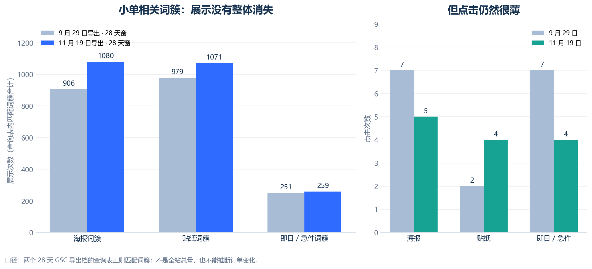
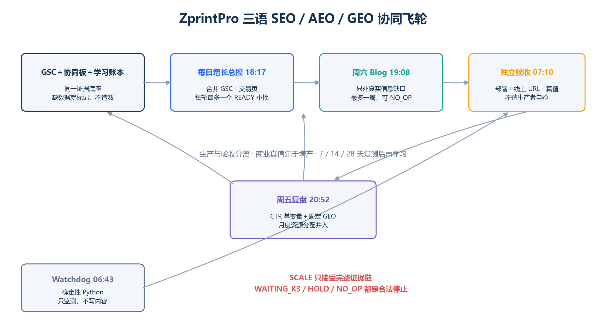

# ZprintPro 三语站点：手工精简调度与两周 SEO／AEO／GEO 协同飞轮

> 角色：ZprintPro 首席 SEO／AEO／GEO 数据战略参谋  
> 决策日期：2026-11-20  
> 执行边界：本报告是战略与手工配置副本；**尚未创建、删除或启动任何系统任务，尚未应用 Harness 配置，未修改 `src/`，未 commit／push**。  
> 核心判断：**下一阶段不是再扩一套内容生产线，而是先修交易页商业真值与报价承接，再用 4 个 Harness 模型入口＋1 个确定性 watchdog 形成同一团队闭环。**

## 执行摘要

老板的实际接单观察是：9 月海报、贴纸、即日急件等小单相对较多，10–11 月减少，11 月尤其少。本报告保留这一业务事实，但**不把它改写成 GSC 已证明订单下降，也不把变化归因于某一个 Google 更新、某次标题调整或某篇文章**。GSC 能证明的是搜索可见度、排名和点击；实际询价与订单仍须以 WhatsApp 和收款记录为准。

两个 28 天 GSC 导出档的同词复算显示，小单相关搜索信号**没有整体消失**：海报词簇展示由 906 增至 1,080，贴纸由 979 增至 1,071，即日／急件由 251 微增至 259；对应点击分别只有 5、4、4。`a2 印刷 即日` 展示由 10 增至 26，但位置由 2.90 降至 5.92、点击由 3 降为 0；`海報印刷一張` 已到 3.71 位仍零点击；`small batch sticker printing` 展示由 66 降至 13。当前更像“**有曝光但承接与点击不足，且部分词排名回落**”，不能概括为“这些小单词都没需求”。[同词复算结果](kimi-cite://text?path=F%3A%5Czprintpro-nextjs%5Cdocs%5Cassets%5C2026-11-20%5Cgsc-small-order-term-comparison.json&text=%22clusters%22 "citation")

线上抽样还发现比“Blog 不够多”更优先的问题：A2 海报页同时出现 1 张、10 张、50 张起印和多套价格／交期；即日传单页同时出现 4 小时、明天 12 点、3–5 天和 5–7 天；英文贴纸同时出现 10 件与 50 件 MOQ；日文小批量页混入中文、未替换 `{PRODUCT_NAME}` 和多套免邮条件。它们同时削弱用户信任、报价效率和 AEO 答案一致性，必须排在新增长文之前。[A2 线上页](kimi-cite://web?url=https%3A%2F%2Fzprintpro.com%2Fzh-hk%2Fproduct%2Fa2-posters%2F "citation"), [即日传单线上页](kimi-cite://web?url=https%3A%2F%2Fzprintpro.com%2Fzh-hk%2Fproduct%2Fsame-day-flyers%2F "citation"), [日文小批量贴纸线上页](kimi-cite://web?url=https%3A%2F%2Fzprintpro.com%2Fja%2Fproduct%2Fsmall-batch-stickers%2F "citation")

调度上，不再原样重建 7 条 Windows 模型任务。建议保留 4 个 Harness 入口：**每日增长总控、独立验收、周／月复盘、Blog 单篇补缺**，外加每天 06:43 的确定性 Windows watchdog。GSC 并入 daily，monthly 并入每月第一个周五的 weekly；Blog 从“只读验收”恢复为“有信息增益才生产一篇”。这四个入口必须消费同一协同板、学习账本和任务队列，不能各自选词、各自验收、各自宣称成功。



## 1. 数据来源、窗口与不可推断边界

### 1.1 本次实际使用的数据

| 证据层 | 本次读取内容 | 校准状态 |
|---|---|---|
| GSC 最新档 | 2026-11-19 的 24h／7d／28d 三站点汇总；没有 11-20 新导出 | 已按工作簿复算；28d 实际窗口为 10-20—11-16 |
| 历史对照 | 2026-09-29 与 2026-11-19 的 28d 查询表 | 同词、同窗口类型对照；词簇为正则匹配子集，不是全站总量 |
| 页面维度 | 2026-11-19 的独立网页 sheet | 不与查询 sheet 拼接；没有逐词逐页就不确认蚕食 |
| 调度证据 | Task Scheduler 查询、任务 XML、wrapper、lane-runs、近三日车道报告 | 手动运行、自然触发、模型结果和线上部署分账 |
| 线上 UX | zh-hk A2／A1／即日传单／可移贴纸，en 贴纸类目与 small-batch，ja small-batch | 2026-11-20 实际抓取；只代表所抽样 URL |
| 外部市场样本 | Google 官方搜索文档与 5 个竞品页面 | 只借鉴信息架构；竞品价格、MOQ、认证与产能不移植 |

**数据来源：**`GSC数据/28天三站点汇总数据zprintpro.com-Performance-on-Search-2026-09-29.xlsx`、`GSC数据/28天三站点汇总数据zprintpro.com-Performance-on-Search-2026-11-19.xlsx`、`.hermes/logs/lane-runs.jsonl`、`.hermes/logs/2026-11-20-wrapper-log-excerpts.txt`、本报告所列线上 URL、K3 11-20 实际接单观察。  
**校准状态：**GSC 已校准至 11-19 导出档；订单与收入未接入，不作 ROI 结论；11-18 之后部署不能由当前 28d 窗评价成效。  
**外部研究限制：**通用搜索接口本轮不可用，因此未获得可验证的全市场搜索量；竞品为直接读取的页面样本，不代表完整市场份额或所有用户偏好。

### 1.2 最新搜索盘面

| 窗口 | 11-16 导出 | 11-19 导出 | 正确解释 |
|---|---:|---:|---|
| 24h 点击 | 12 | 21 | 只作健康信号，不作趋势 |
| 24h 展示 | 805 | 1,138 | 短窗波动，不派大批内容 |
| 7d 点击 | 144 | 130 | 点击回落 |
| 7d 展示 | 8,103 | 8,283 | 展示小增 |
| 7d CTR | 1.7771% | 1.5695% | 点击承接转弱 |
| 7d 平均位置 | 14.3437 | 15.5229 | 平均位置回落 |
| 28d 点击 | 544 | 554 | 小幅增加 |
| 28d 展示 | 26,350 | 27,879 | 展示增加 |
| 28d CTR | 2.0645% | 1.9872% | CTR 回落 |
| 28d 平均位置 | 14.6801 | 14.9511 | 基本稳定略弱 |

因此，“全站排名全面崩掉”与“展示增长就说明策略成功”都不准确。接下来应把**首页高展示零点击、10–20 位冲刺、深位行业大词、季节词**分开处理，避免所有问题都被翻译成“再写一篇 Blog”。

## 2. 小单为何“搜索还在、询价感觉变少”

### 2.1 9 月与 11 月同词对照

| 查询 | 9-29：展示／点击／位置 | 11-19：展示／点击／位置 | 战略含义 |
|---|---:|---:|---|
| 海報印刷 | 161／2／19.42 | 186／1／20.37 | 大词仍在第二页附近，不能只靠 CTR 修饰 |
| 海報印刷即日 | 2／1／14.50 | 32／1／9.53 | 展示和位置改善，是强带钱长尾 |
| 海報印刷一張 | 7／0／10.29 | 24／0／3.71 | 首页零点击，先查真实 SERP 与首屏小单口径 |
| a1 印刷 即日 | 22／0／7.05 | 27／0／5.19 | 有排名无点击，优先修承接 |
| a2 印刷 即日 | 10／3／2.90 | 26／0／5.92 | 展示增、排名与点击降，需根因诊断 |
| 即日印刷 | 55／2／8.73 | 55／2／8.58 | 相对稳定，应保护而非大改 |
| 貼紙印刷 | 190／0／24.72 | 179／0／29.94 | 大词转弱，不能伪装成小单长尾已解决 |
| 可移貼紙 | 42／0／15.21 | 71／0／12.62 | 展示与位置改善，接近冲刺区 |
| small batch sticker printing | 66／0／6.41 | 13／0／8.92 | 展示明显收缩且仍零点击，先复测不叠变量 |
| 透明貼紙印刷 | NO_CURRENT_BASELINE | 18／0／6.78 | 当前首页机会；缺旧行不等于旧需求为零 |
| 戶外可移貼紙 | NO_CURRENT_BASELINE | 23／0／10.04 | 首页下沿机会，先修材质与用途答案 |

海报、贴纸、即日词簇合计展示没有下降，但点击仍很薄。这支持“**恢复小单的第一动作是交易页可信度和报价路径**”，而不是再复制一批“印刷指南”。同时，`貼紙印刷`、`海報印刷`、`宣傳單張` 等行业大词仍在深位或转弱，不能用几个首页长尾的进步来掩盖大词地基问题。

### 2.2 线上交易页的具体阻力

| 抽样页 | 实际观察到的冲突 | 对用户与 AEO 的影响 | 处理级别 |
|---|---|---|---|
| zh-hk A2 海报 | MOQ 1／10／50；首段 HK$12.9、摘要 HK$2.20、阶梯 HK$16；交期 1–2／3–5／5–7 天；局部原始 Markdown | 用户不知道哪一句才是正式条件；答案引擎可能抽取互相矛盾的答案 | P0 商业真值 |
| zh-hk 即日传单 | 4 小时、今天下单明天 12 点、3–5／5–7 天并存；100／200 张数量档重复且价格不同 | “即日生产、即日交付、次日送达”混为一谈；价格可信度受损 | P0 商业真值 |
| en 贴纸类目／small-batch | 10 pcs 与 50 pcs MOQ；按片与按 A4 版两套口径；生产与运输时段混杂 | `small batch` 的核心采购答案不稳定 | P0＋复测窗管理 |
| ja small-batch | 中文段落、`{PRODUCT_NAME}`、多套免邮条件、LINE／WhatsApp 入口混杂 | 日文专业感与报价可执行性下降，易造成错误本地化承诺 | P0 本地化真值 |
| zh-hk 可移贴纸 | 首屏 10 张与“可低至 50 张”等表述并存；即日生产与交付边界需统一 | `可移貼紙` 已接近首页，承接不一致会浪费冲刺机会 | P1 冲刺前修复 |
| zh-hk A1 海报 | 部分口径已条件化，但抽样页页脚仍出现香港地址文案，与真实深圳主体口径需复核 | 实体与法律信息一致性风险，不应由 Blog 顺手改 | P0 独立实体核查 |

这些不是“文字风格小问题”。Google 对产品结构化数据的要求是标记与页面可见内容一致；标题和摘要也可能被 Google 根据页面正文重写。只改 meta、保留正文冲突，不能形成稳定的 CTR 或 AEO 改善。[Google Product 结构化数据](kimi-cite://web?url=https%3A%2F%2Fdevelopers.google.com%2Fsearch%2Fdocs%2Fappearance%2Fstructured-data%2Fproduct "citation"), [Google 标题链接说明](kimi-cite://web?url=https%3A%2F%2Fdevelopers.google.com%2Fsearch%2Fdocs%2Fappearance%2Ftitle-link "citation"), [Google 摘要说明](kimi-cite://web?url=https%3A%2F%2Fdevelopers.google.com%2Fsearch%2Fdocs%2Fappearance%2Fsnippet "citation")

### 2.3 竞品样本带来的采购信息启示

| 市场样本 | 页面可见采购模块 | ZprintPro 可借鉴的结构，不复制商业值 |
|---|---|---|
| AnyPrint 海报 | 尺寸×数量价格表、起货期、加工加时、截稿与文件说明 | 把数量、尺寸、加工和截稿条件放在同一决策区；页面价格更新日期很旧，不能当现行市场报价。[AnyPrint](kimi-cite://web?url=http%3A%2F%2Fanyprint.hk%2FW5%2Fpricelist.php%3Fppid%3D1227 "citation") |
| 印刷易海报 | 少量与急件、尺寸纸质、WhatsApp 传档、报价—看稿—生产—交货、场景 FAQ | 香港用户需要“马上传档并确认今天能否做”，不是泛行业介绍。[印刷易](kimi-cite://web?url=https%3A%2F%2Fwww.servicecorps.hk%2Fpublication%2Fposter%2F "citation") |
| TIPTOP 传单／海报 | 1 张海报、100 张传单、即日限制、尺寸材质、WhatsApp CTA | 小单 MOQ 与急件条件要首屏直答，并写“视乎当天印件情况”类边界。[TIPTOP](kimi-cite://web?url=https%3A%2F%2Fhk-print1010.com%2Fproduct-leaflet.html "citation") |
| Raksul 日本贴纸 | 1 枚试做、数量阶梯、材质、单价比较、样品 | 日文站要降低试做决策成本，以枚数与规格比较替代直译中文卖点。[Raksul](kimi-cite://web?url=https%3A%2F%2Fraksul.com%2Fmagazine%2Fcolumn%2Fsticker-small-lot%2F "citation") |
| 英文中国印刷采购页 | MOQ、生产与运输、打样、验厂、报价输入、QC、合同与沟通 | en 需要“跨境采购风险控制清单”；其自报数字和认证未独立核实，不能引用为本站事实。[样本页](kimi-cite://web?url=https%3A%2F%2Fwww.jinguanprinting.com%2Farticle%2Fchina-custom-printing-service-manufacturer-guide-2026.html "citation") |

结论是三语不应共用一套“便宜、快、质量好”的模板。zh-hk 首屏回答**几张起、今天能否做、何时截单、如何 WhatsApp 传档**；en 回答**MOQ、打样、生产＋国际运输、文件、QC 与报价输入**；ja 回答**小ロット枚数、素材、单价梯、校正、納期与日本语报价路径**。所有商业值仍须来自 ZprintPro 已批准真值。

## 3. 三语“行业大词／带钱词／强带钱长尾”分层

### 3.1 不以字面大小判断价值

**行业大词**负责品类资格与长期主题权威，例如海報印刷、貼紙印刷、宣傳單張、書刊印刷、包裝盒印刷、poster printing、sticker printing、パッケージ印刷。它们展示可观，但当前不少在 20–60 位，不能以两周首页为承诺。

**真正的带钱词**带有明确采购对象和定制动作，例如包裝盒訂製、紙盒訂製、禮盒訂製、學校印刷、利是封印刷、catalog printing china、custom packaging boxes、教材 印刷 製本、クラフト紙 パッケージ印刷。它们通常需要交易页完整规格与报价输入，而不是单纯知识文。

**强带钱长尾**同时含数量、尺寸、材质、地区或时效，例如海報印刷一張、海報印刷即日、a1／a2 印刷即日、透明貼紙印刷、戶外可移貼紙、small batch sticker printing、ステッカー 小ロット、ラベル 印刷 小ロット。它们总量可能较小，却更接近即时询价，是两周内最值得优先修复承接的组。

### 3.2 当前词盘与动作队列

| 优先级       | 市场与词簇                                                                         | 11-19 GSC 证据                  | 主承接与下一动作                                     |
| ---       | ---                                                                           | ---                           | ---                                          |
| G1 首页零点击  | 食品包裝印刷                                                                        | 125 展示／0 点击／7.93              | 先保存真实 SERP、query×page 与首屏，weekly 最多一个 CTR 提案 |
| G1 小单海报   | 海報印刷一張、a1／a2 印刷即日、海報印刷即日                                                      | 3.71／5.19／5.92／9.53           | A1／A2 交易页统一 MOQ、价格、截单和交付；不做泛新文               |
| G1 小单贴纸   | 透明貼紙印刷、戶外可移貼紙、small batch sticker printing                                    | 6.78／10.04／8.92，均零点击          | 材质用途表＋统一小批量单位＋报价预填；small-batch 先遵守复测窗        |
| G1 日文小量   | ステッカー 小ロット、ステッカー印刷 小ロット、ラベル 印刷 小ロット                                           | 7.16／10.75／7.43               | 日文 small-batch 清理模板与真值，强化素材×枚数×校正×納期         |
| G2 近首页    | 可移貼紙、china catalog printing、doujinshi printing                                | 71／12.62；101／14.99；59／11.22   | 可移贴纸 PDP；catalog 先测词页承接；doujinshi 核当前活动与采购意图 |
| G2 香港服务   | 香港印刷、學校印刷、摺頁印刷、小冊子印刷、證書印刷                                                     | 12.18／16.89／18.66／17.93／12.22 | 各自交易页补报价规格与场景，不建“香港印刷”泛 doorway 页            |
| G2 英文 B2B | catalogue printing china、catalog printing china、school exercise book printing | 14.00／15.57／11.47             | catalog 主 PDP 与采购指南分工；学校印刷补装订、数量、文件与打样       |
| G2 日文包装   | クラフト紙 パッケージ 印刷、クラフト紙 パッケージ印刷、防水ステッカー                                          | 15.23／12.74／11.71             | 既有 PDP 规格和用途差异化，清除近重复模板                      |
| G3 行业大词   | 海報印刷、貼紙印刷、宣傳單張、書刊印刷、包裝盒印刷                                                     | 20.37／29.94／39.39／35.45／30.29 | 中期主交易页权威、差异化与内链；不承诺两周首页                      |
| G3 高定制品   | 紙盒訂製、包裝盒訂製、禮盒訂製、喜帖印刷、易拉架印刷                                                    | 33.37／33.71／47.86／44.78／41.63 | 先核页面是否存在、索引与意图，再决定增强，不批量铺文                   |
| 季节窗       | 2027利是封、個人化利是封、gold foil red packets                                          | 7.09／13.40／19.62              | 11-20—12-03 提高优先级；真实截单、烫金、数量和文件条件前置          |
| 季节窗       | 月曆印刷、月曆訂製、月歷印刷                                                                | 20.40／25.97／24.25             | 以 2027 晚季采购和真实交付能力为主，不再建第四篇月曆泛文              |
| 时间敏感      | c109、c109 日期、doujinshi printing                                               | 9.85／9.54／11.22               | 先核活动日期与当前意图；过期则转常青同人印刷，不追过期热点                |
|           |                                                                               |                               |                                              |

以上数值均来自 11-19 的 28d 查询表。[带钱词复算资产](kimi-cite://text?path=F%3A%5Czprintpro-nextjs%5Cdocs%5Cassets%5C2026-11-20%5Cgsc-money-queries-and-pages.json&text=%22zh_core_money%22 "citation")

### 3.3 catalog 是不能靠猜处理的典型

独立网页 sheet 显示，`/en/product/catalog-printing/` 有 312 展示、1 点击、20.30 位，`/en/blog/catalog-printing-china-supplier-guide/` 有 156 展示、1 点击、18.78 位。它们说明至少两个英文 URL 都获得 catalog 相关搜索可见度，但**独立 query 与 page 表不能证明同一个查询被两个页面分流**。下一动作是导出同窗口 query×page，确定主 URL 展示份额，再决定内链与内容分工；不得直接 301、canonical 或砍页。[网页维度复算](kimi-cite://text?path=F%3A%5Czprintpro-nextjs%5Cdocs%5Cassets%5C2026-11-20%5Cgsc-money-queries-and-pages.json&text=%22catalog-printing%22 "citation")

## 4. 调度故障与 Blog 停产的真正原因

### 4.1 当前不是单一故障

| 故障层 | 已观察证据 | 不应误判为 |
|---|---|---|
| Windows 登录方式 | 多个任务仍为 Interactive，`0x800710E0／2147946720`；StartWhenAvailable=false | “任务列表显示 Ready 就会跑” |
| 修复脚本 XML | 第二次应用报 `(47,28):Interval:00:10:00`、`0x80041318` | “10 分钟本身不合法” |
| DeepSeek 凭据 | 11-19 GSC wrapper 明确 `QUOTA: Insufficient Balance`、`dsh exit=1` | “GSC 分析已完成” |
| Harness 任务职责 | 周六 Blog 已变成只读验收 | “还在自动产长文” |
| daily 队列 | 11-20 内容层 NO_OP，READY=0，无新 GSC | “daily 应该替 Blog 写文” |
| 收尾 guard | 11-18 GSC 有真实 PARTIAL，但 production 文件被 pre-commit guard 拒绝，总线 FAILED | “有报告就等于已上线” |

`00:10:00` 是 .NET `TimeSpan` 文本，不是任务 XML 需要的 XSD duration；应为 `PT10M`。原备份 XML 的 `PT5M` 本身有效。修复脚本已做静态修改并通过语法／文本检查，但**没有再次应用，生产任务未验证修复**。为避免再踩同类问题，手工 watchdog 不配置 RestartOnFailure。[watchdog 原始 XML](kimi-cite://text?path=F%3A%5Czprintpro-nextjs%5C.hermes%5Cbackups%5Cwatchdog-canary-retry-20261119%5CZP-cron-watchdog.xml&text=PT5M "citation")

### 4.2 Blog 专项生产入口长期无新文

`ZP-blog-deepfix` 在结果总线中的最后专项记录为 11-07，报告明确 `0 articles written`，产物是复测 JSON、报告和图；此后 Windows 自然轮未成功，Harness 周六又只读验收。最近可见的 `blog-data` 实际写入是 11-03 daily 的 `c0552853`，10-31 也曾有 flyers／stickers／books 实质交付。因此准确说法是：**Blog 专项生产入口长期未产生新文章，而不是 10-31 后全站完全没有 Blog 数据写入。**

恢复方式不是把 daily 变成第二个 Blog 车道，而是让周六入口重新拥有“每轮最多一篇”的生产职责，并保留信息增益、真值、锁、12 段质量门和 NO_OP。这样既能恢复真正长文，也不会重走批量近重复内容的老路。

## 5. 建议手工创建的 4＋1 任务体系



### 5.1 任务名称、周期、内容与依赖

| 任务 | 周期（Asia/Shanghai） | 执行位置与 prompt 绝对路径 | 完整职责 | 依赖与退出 |
|---|---|---|---|---|
| **ZP-daily-content｜每日增长总控** | 每天 18:17 | Harness；`F:\zprintpro-nextjs\.hermes\cron-prompts\harness-daily-growth-20261120.md` | 合并原 daily＋GSC；先消费最新 GSC、协同板和复测，再执行最多一个已批准交易页 bounded task；回写部署与复测字段 | READY 缺失即 NO_OP；不替 Blog 写文，不替 weekly 自批 snippet，不改未决真值 |
| **ZP-k3-review｜独立验收与次日指令** | 每天 07:10 | Harness；`F:\zprintpro-nextjs\.hermes\cron-prompts\harness-independent-review-20261120.md` | 核查自然运行、Cloudflare、线上 URL、正文／FAQ／schema、WhatsApp 路径；形成次日 1–3 个 bounded 指令 | 不写 src，不替 daily 自验；无待验收项即 NO_OP |
| **ZP-weekly-meta｜周／月复盘与 GEO** | 每周五 20:52；每月第一个周五追加月度 | Harness；`F:\zprintpro-nextjs\.hermes\cron-prompts\harness-weekly-monthly-review-20261120.md` | 周四栏复盘、最多一个 CTR 单变量提案、固定 GEO 问题集；月度做资源再分配和 STOP／HOLD／FIX | 不另建 monthly；缺 SERP／AI 原文就不可测； READY 后交 daily 执行 |
| **ZP-blog-deepfix｜Blog 单篇补缺** | 每周六 19:08 | Harness；`F:\zprintpro-nextjs\.hermes\cron-prompts\harness-blog-single-fix-20261120.md` | 真正生产：每轮最多复写／新写一篇确有信息增益的文章；优先既有海报、贴纸、catalog 与队列指定文章 | 无信息增益即 NO_OP；实际写深度文章才执行现行 12 段交付门 |
| **ZP-cron-watchdog** | 每天 06:43 | Windows Task Scheduler；`cmd.exe /c "F:\zprintpro-nextjs\.hermes\cron-run\ZP-cron-watchdog.cmd"` | 只运行确定性 Python，汇总调度、总线、wrapper、当日报告与公开 URL 探测 | 不调用 DeepSeek、不写内容；手动成功不替代自然轮验收 |

**推荐操作方式：**在 Harness 中编辑现有 4 个同名入口并替换为上述 prompt，比新建一套 ID 更容易保留 run-context 和结果总线。`ZP-gsc-feedback` 与 `ZP-monthly-matrix` 不再单独运行。若界面只能新建，沿用表中名称；不要同时保留旧入口造成双重执行。

### 5.2 旧七条逐项取舍

| 旧任务 | 决策 | 迁移到哪里 |
|---|---|---|
| ZP-daily-content | **保留迁移** | 每日增长总控，时间改 18:17，职责加入 GSC 证据消费 |
| ZP-gsc-feedback | **合并，不重建** | daily 的证据输入与复测段；weekly 仍消费 CTR 候选 |
| ZP-k3-review | **保留迁移** | 独立线上验收与次日指令 |
| ZP-weekly-meta | **保留迁移** | 周复盘＋CTR 单变量＋固定 GEO |
| ZP-blog-deepfix | **保留但改职责** | 周六 19:08，由只读验收改为单篇补缺生产 |
| ZP-monthly-matrix | **合并，不重建** | 每月第一个周五的 weekly 月度段 |
| ZP-cron-watchdog | **保留为最简 Windows 任务** | 只跑 Python，S4U，自然轮四方验收 |

真正应用精简方案时，还必须同步更新 `.hermes/cron-lanes.json`、watchdog 和 lane-status 的车道清单，否则已取消的旧 GSC／monthly 车道会持续误报 MISSING。本次只提供副本，**尚未修改这些生产配置**。

### 5.3 watchdog 手工创建值

```text
名称：ZP-cron-watchdog
周期：每天 06:43，Asia/Shanghai
程序：cmd.exe
参数：/c "F:\zprintpro-nextjs\.hermes\cron-run\ZP-cron-watchdog.cmd"
起始于：F:\zprintpro-nextjs
权限：Administrator，使用最高权限
登录：不管用户是否登录都运行／不存储密码（S4U）
StartWhenAvailable：启用
RestartOnFailure：不配置
MultipleInstances：IgnoreNew
```

现有 cmd 调用 `C:\Users\Administrator\AppData\Local\Programs\Python\Python312\python.exe F:\zprintpro-nextjs\scripts\cron-watchdog.py`。watchdog 会访问公开 URL，因此 S4U 自然轮必须同时核验网络探测；若公开 URL 因登录身份失败，再评估受控的存储凭据方案，**不要在聊天中提供密码**。

自然轮验收必须同时看到：①调度器当日触发与结果；②wrapper 日志真实退出；③`lane-runs.jsonl` 当日记录；④当日 watchdog 报告／探测产物。不得以手动运行成功代替。

## 6. 自动协同飞轮：同一团队而非四套独立机器人

### 6.1 数据流与职责交接

1. **共同证据底座**：所有入口先读 run-context、lane-status、coordination-board、flywheel-learning-ledger 和 strategy-task-queue；没有新数据就保留最近真实日期。
2. **daily 供给生产变更**：每天只做一个 READY 小批，记录 baseline、唯一变更、审批、部署、线上核验与下次复测。
3. **Blog 供给独特决策资产**：只有交易页与既有文章仍有信息缺口才写一篇，不靠文章数量证明工作。
4. **k3-review 独立把关**：生产者不能自我验收；缺 Cloudflare 或线上 URL 证据就保持 PENDING。
5. **weekly 形成学习**：每周最多一个 CTR 变量，固定 GEO 问题；月度只把完整实验纳入 SCALE／HOLD／FIX／STOP。
6. **watchdog 只报警**：发现 MISSING／FAILED／STALE，不自动改内容、不擅自重试凭据错误、不创建新任务。

### 6.2 每个原子任务的统一字段

```text
TASK_ID / OWNER_LANE / TARGET_QUERY_OR_URL / INPUT_EVIDENCE
BASELINE / UNIQUE_CHANGE / APPROVAL_GATE / WRITE_SCOPE / DO_NOT_TOUCH
PRODUCTION_DEPLOY / ONLINE_VERIFY / RETEST_7D_14D_28D
RETRY_AT / COOLDOWN / EXIT_CRITERIA / CONFOUNDERS
```

只有 `baseline＋change＋approval＋production_deploy＋online_verify＋retest` 齐全才进入学习候选；SCALE 还需 scale_evidence。7 天主要验技术与早期方向，14 天看方向，28 天才允许经营判断。11-18 后的部署不能用 11-19 的 28d 窗评价成效。

## 7. SEO／AEO／GEO 的同一商业真值链

### 7.1 SEO：页面分工和真实点击

交易主词由 category／PDP 承接，Blog 负责采购决策、规格比较、限制和证据。每个重点簇必须先确定一个主交易 URL，再检查内链、正文和实际 SERP；不得为同一个意图造多个近义页。标题遵守现行 50–57 半角当量与冻结窗，摘要写具体页面事实，Google 仍可能重写。

Google 对 AI 功能的官方说明沿用常规 SEO 基础，没有特殊 AI schema 捷径；有帮助、可靠、以用户为先的内容仍是前提。自动化只能加速取证和重复检查，不能代替原创信息增益。[Google AI 功能说明](kimi-cite://web?url=https%3A%2F%2Fdevelopers.google.com%2Fsearch%2Fdocs%2Fappearance%2Fai-features "citation"), [Google 有帮助内容说明](kimi-cite://web?url=https%3A%2F%2Fdevelopers.google.com%2Fsearch%2Fdocs%2Ffundamentals%2Fcreating-helpful-content "citation")

### 7.2 AEO：同一答案在所有位置一致

每个重点交易页建立一条事实链：

```text
已批准真值源
→ title／description／H1
→ 首屏 MOQ／价格／数量档／截单
→ 正文材质／工艺／文件／生产与运输边界
→ 可见 FAQ 直接答案
→ Product／FAQPage 等结构化数据
→ WhatsApp 报价输入
```

“即日生产”不得写成“美国／日本即日送达”；“免费打样”必须区分数码稿与实物样；“起价”必须带尺寸、材质、数量和报价条件；无来源认证、客户数、成功率、满意度和市场统计应删除或阻断，不得为了答案更吸引而补造。

### 7.3 GEO：固定问题、固定引擎、保存完整答案

weekly 使用 12 个固定问题，覆盖香港急件海报、可移／透明／防水贴纸、2027 利是封、宣传单张与折页，英文 small-batch／catalog／red packets，日文小ロット、同人装订、クラフト包装和 A1／A2 海报。完整问题已写入 `harness-weekly-monthly-review-20261120.md`。

每轮保存完整答案、引用域名和 citation URL，观察是否提及实体、是否引用本站、引用是否落到预期主交易页或决策资产。普通 WebSearch 不得冒充 GEO；没有可比原文就写 `NO_COMPARABLE_BASELINE`；AI 未引用也不能直接派成长文。

## 8. 2026-11-20—12-03 两周执行日程

> 以下是**建议资源顺序**，不是自动放行。每项仍须由协同板满足 READY、真值、锁和 write_scope；未获批准就做诊断或 NO_OP。

| 日期 | 主任务 | 明确交付与验收 | 不做 |
|---|---|---|---|
| 11-20 | 手工精简 4＋1；确认 DeepSeek 可用；冻结本报告基线 | 任务配置副本、watchdog 自然轮待验清单、P0 冲突表 | 不再运行旧修复脚本，不同时保留重复入口 |
| 11-21 | SMALLBATCH 7d 复测；周六 Blog 恢复单篇补缺 | 追加 measurement_history；海报既有文复写或有依据 NO_OP | 不用移动窗口判胜，不新建同义文 |
| 11-22 | 独立核查 A2／即日传单／small-batch 线上真值 | URL 断言、正文／FAQ／schema、WhatsApp 路径报告 | 生产者不自我关闭 PENDING |
| 11-23 | 貼紙第七窗评估 | 按既定阈值讨论是否提案；保存同口径基线 | 不自动微调 title，不叠加第二变量 |
| 11-24 | 固定 GEO 第 4 轮；catalog query×page 取证 | 完整 AI 答案与引用；en catalog 主 URL 展示份额或不可测标记 | 不用普通搜索替代 GEO，不直接 canonical |
| 11-25 | 11-18 变更 7d 复测；小单交易页 READY 小批 | 复测记录；A2 或即日传单最多一个真值批次 | 不把 28d 背景窗当部署效果 |
| 11-26 | 11-18 变更复测续；独立线上验收 | 实际部署与线上断言；失败保持 PARTIAL | 不用 commit／push 当线上成功 |
| 11-27 | 周五复盘；2027 利是封季节优先级；一个 CTR 提案 | 周四栏、季节交易页建议、GEO 对照、下周围 bounded 队列 | 不批量改季节 title，不复制竞品价格 |
| 11-28 | Blog 单篇；small-batch 到期复测 | 优先贴纸采购决策资产或 NO_OP；追加复测 | 不为“每周一篇”硬写，不提前 SCALE |
| 11-29 | 测量日 | 检查索引、线上一致性、异常 recurrence | 无 READY 不生产 |
| 11-30 | 日文小ロット或 en catalog 一个 READY 小批 | 日文真值清理或 catalog 主承接增强，二选一 | 不自动三语翻译，不同时改两簇 |
| 12-01 | daily 正常运行；原 monthly **不再单独触发** | 真值／复测交接完整；周五月度输入开始汇总 | 不伪造月度缺失，不重建 monthly |
| 12-02 | 独立验收与早期 7／14d 复测 | 首页长尾的展示、位置、CTR 同口径记录 | 不把点击变化直接解释为订单变化 |
| 12-03 | 两周Checkpoint | 已完成／PENDING／FAILED 分账；12-04 周／月复盘输入 | 不承诺首页，不以报告数或文章数报捷 |

12-04 在同一 weekly 入口追加月度资源分配；12-04 也是 SMALLBATCH 28d 决策级窗口的既定观察点，但是否 SCALE 仍取决于真实部署和完整证据。

## 9. 验收指标与停止规则

### 9.1 两周内可以承诺的是过程质量，不是排名结果

| 层 | 验收指标 | 通过条件 |
|---|---|---|
| 调度 | 4 个 Harness＋1 watchdog 自然运行 | 每个入口有自然触发、真实退出、当日报告与交付；watchdog 另核公开 URL |
| 商业真值 | P0 抽样页 MOQ／价格／交期／免邮／打样 | 同一 URL 首屏、正文、FAQ、schema 与报价路径一致；未决值不发布 |
| 用户体验 | 小单首屏与 WhatsApp | 用户能看懂数量单位、适用条件、生产与运输边界，并能提交规格报价 |
| 内容 | Blog 单篇补缺 | 只有真实信息增益才交付；无近重复、无模板残留、FAQ 可解析 |
| SEO | G1／G2 词簇 | 同窗口保存 baseline；7／14／28d 复测展示、位置、CTR 与主 URL 承接 |
| AEO | 可见答案与结构化数据 | 一致、可解析、可独立引用，不声称必得富摘要 |
| GEO | 固定问题与引用 | 可比的完整答案与 citation URL；没有就标不可测 |
| 业务 | WhatsApp 实际询价 | 由老板接单记录单独判断，不由 GSC 推算，不设无来源订单 KPI |

### 9.2 必须停止的情况

- 同一文件有锁、同一页同窗口已有另一变量、商业真值未拍板、query×page 缺失却准备 canonical／301。
- 同一故障连续两次、凭据不足、guard 失败、线上核验失败、报告缺 baseline 或 deploy 字段。
- 文章只是换同义词、加篇幅、重复关键词，或为完成周报而硬写。
- 计划用 7 天移动窗宣布 SCALE，或用 28 天背景窗评价刚部署两天的变更。
- 需要新建 cron／Automation 才能解决既有问题；应先合并职责和修复输入，不增加机器人数量。

## 10. 老板现在只需按顺序做的五件事

1. **在 Harness 编辑 4 个现有入口**，粘贴本报告第 5.1 节的 prompt；停用重复 GSC 与 monthly 入口，不新建第二套。
2. **手工重建最简 watchdog**，严格使用第 5.3 节值，不配置 RestartOnFailure；等自然轮做四方验收。
3. **恢复 DeepSeek 有效额度或合法凭据**，凭据错误期间不自动重试、不写 AUTO-FILL 成功。
4. **只拍板真正未决的商业真值**，尤其是 A2／即日传单／贴纸单位、交期、免邮和打样；已批准 D1–D6 不重复裁决。
5. **补最新 GSC 及同窗口 query×page 导出**，优先 catalog、海报、贴纸、即日和 C109；没有联接数据就不做内耗终裁。

---

## SOP-10 五问自检

1. **架构差异：**已读取现有 XML、wrapper、结果总线、四个现行职责块与 Harness 报告；4＋1 是在既有总线上合并职责，不是另起一套系统。
2. **约束适用范围：**未触碰名片展示层、贺卡资产、middleware 301、冻结 title 和生产任务；商业真值只引用已批准值或标 WAITING_K3。
3. **原数据／拍板来源：**所有搜索数字来自上述 GSC 原始档；接单变化只来自老板观察；未把竞品自报数字转成本站事实。
4. **字段值策略：**未自行选择冲突 MOQ、价格、交期、认证、退款或免邮；无法核实的字段保留冲突证据与审批门。
5. **Markdown 渲染：**已把线上原始 `**`、`\|` 和 `{PRODUCT_NAME}` 列为 UX 缺陷；后续 user-facing 链接／正文必须经现行渲染与线上断言，不能用 `<p>{text}</p>` 直接输出 Markdown。

**最终战略结论：**ZprintPro 当前最需要的不是更多彼此独立的自动化，而是一个可停止、可复测、生产与验收分离的团队。先用真实报价信息赢回海报／贴纸／即日小单的点击与信任，再用既有深度文章补独特采购资产；行业大词按中期地基推进，季节词抓住 2027 利是封与月曆窗口，三语各自满足真实采购习惯。两周内承诺的是把飞轮正确跑起来并拿到可比证据，不承诺任何词必进首页。
