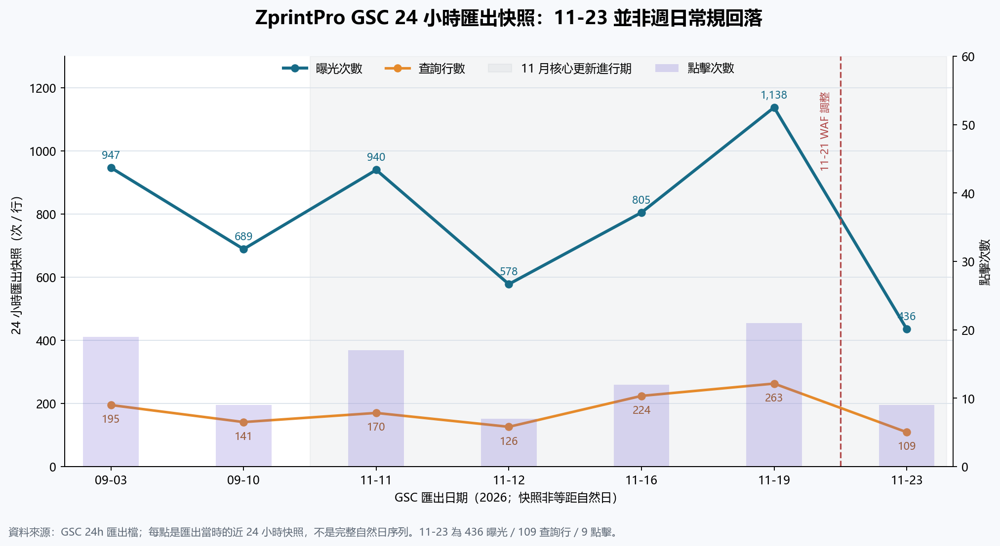
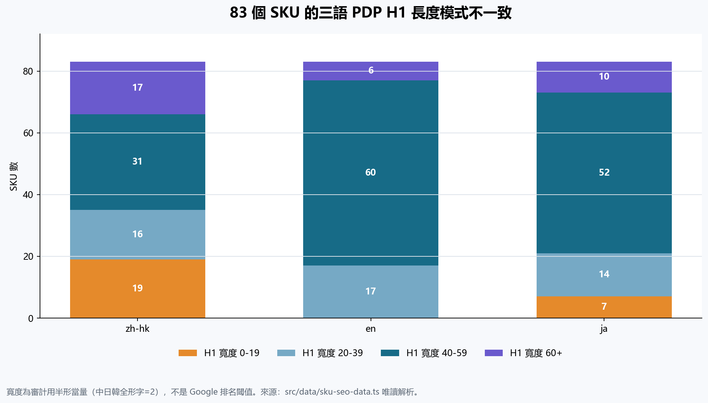
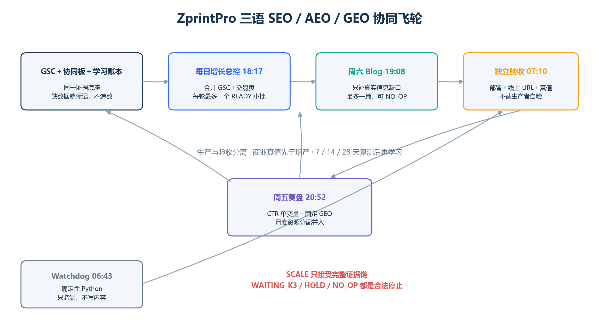

# ZprintPro GSC 急跌、PDP 標題與調度綜合診斷暨兩週協調飛輪

> 角色：ZprintPro 首席 SEO／AEO／GEO 數據戰略分析師  
> 診斷時間：2026-11-23 10:30（Asia/Shanghai）  
> 執行邊界：本輪完成唯讀數據復算、線上抽驗、代碼渲染鏈核查、83 SKU H1 盤點與任務設計；**未修改 `src/`、未改 CSV、未改 WAF、未建立或啟用新任務、未 commit／push**。  
> 核心判斷：**11-23 的 24 小時下跌是真實異常訊號，但不是全站被移除；目前最像「11 月核心更新的排名重分配」與「11-21 WAF 改動待排除」時間重疊。PDP 長短標題則是兩個獨立數據欄位的既有設計，不是前端漏字，也沒有證據證明它造成本次急跌。**

## 執行摘要：今天應做什麼、不做什麼

今天最高優先級不是再寫十篇文章，也不是把 249 個三語 H1 一次改齊，而是完成兩項定案驗證：第一，在 GSC 對流失頁做「網址審查 → 即時測試」，確認真正的 Googlebot 能否取回正文；第二，在 Cloudflare Security Events 查近 72 小時是否有真 Googlebot 被 challenge／block。普通瀏覽器抽到 HTTP 200 只能證明一般用戶可讀，不能代替這兩項驗證。若兩者都正常，WAF 共因的嫌疑才下降；若發現攔截，只對已驗證搜尋爬蟲做最小修復，不再全關 WAF。

搜尋策略上，應把「最新 24 小時急跌」與「7／28 天曝光仍增、CTR 與位置轉弱」同時保留。Google 官方 Dashboard 顯示 November 2026 core update 於 **2026-11-10 10:06 PST** 開始，截至 **2026-11-22 18:26 PST 仍為 Active**，影響產品是 Ranking。官方核心更新指引要求先確認 rollout 完成，最好再等完整一週，再與更新前的一週比較，並避免快速大修。因此，現在可以做技術止血、錯字與混語修正、數據補齊和任務準備；不應在 rollout 中大批改 title、H1、內鏈與 Blog，事後卻無法分辨是哪個變量有效。[Google Search Status Dashboard](kimi-cite://web?url=https%3A%2F%2Fstatus.search.google.com%2F "citation"), [Google 核心更新指引](kimi-cite://web?url=https%3A%2F%2Fdevelopers.google.com%2Fsearch%2Fupdates%2Fcore-updates "citation")

**今日四個明確決策：**

1. **GSC：P0 技術排除，不宣布單一根因。** 核心更新是首要候選，WAF 是必須排除的技術共因，24h 初步資料特性只能解釋小幅修訂，不能獨立解釋整個窗口逐小時偏低。
2. **PDP：保留長 meta title，規範頁內 H1。** H1 不需要複製 title；統一為「核心品類詞＋主要規格／差異」，不把品牌、價格、MOQ、品質保證與交期全部塞入。
3. **調度：仍未恢復。** 11-23 09:24 四條每日任務與 watchdog 的 LastTaskResult 仍是 `2147946720／0x800710E0`；不得以 Ready、手動成功或 wrapper exit 0 冒充自然輪健康。
4. **兩週飛輪：維持 4＋1 團隊架構。** Kimi 負責優先級與拍板，Harness 只執行 bounded task；daily、獨立驗收、周／月復盤、Blog 單篇補缺與确定性 watchdog 共享同一份數據、隊列、部署與復測賬本。

## 1. 數據來源、時間窗與不可推斷邊界

本次 GSC 結論直接由 11-23 與 11-19 的 24h／7d／28d 工作簿「图表、查询数、网页」分表復算，沒有把查詢與頁面兩個獨立聚合表硬 join，也沒有用曝光推估詢盤或收入。11-23 的 24h 實際覆蓋 **11-22 06:00 至 11-23 05:00**，7d 覆蓋 **11-14 至 11-20**，28d 覆蓋 **10-24 至 11-20**。因此，11-21 之後的 WAF 或部署變化不可能已完整反映在目前 7d／28d 中，最新 24h 也不能代表一個完整自然日趨勢。

標題結論來自實際代碼與線上頁面，而不是從截圖猜測。唯讀解析 `src/data/sku-seo-data.ts` 得到 **83 個 SKU、249 個三語 H1**；H1 寬度只是把中日韓全形字計 2、其他字計 1 的內部審計尺度，**不是 Google 排名閾值**。調度結論來自 Task Scheduler 即時查詢、`lane-runs.jsonl`、wrapper／車道報告與 `lane-status.md`，並把自然觸發、手動執行、模型產出、commit、push、部署分開記賬。

**數據來源：**

- `GSC数据/24小时三站点汇总数据zprintpro.com-Performance-on-Search-2026-11-23.xlsx` 及同日的 7d／28d 檔。
- `GSC数据/24小时三站点汇总数据zprintpro.com-Performance-on-Search-2026-11-19.xlsx` 及同日的 7d／28d 檔；09-03、09-10、11-11、11-12、11-16 的同型 24h 檔作背景比較。
- `src/app/[locale]/product/[slug]/page.tsx`、`v9/ProductPageV9.tsx`、`src/data/sku-seo-data.ts`、`src/data/products.ts`、`src/data/title-window-freeze.ts`。
- `.hermes/tmp/pdp-h1-audit-20261123.json`、`.hermes/tmp/pdp-h1-language-audit-20261123.json`、`.hermes/tmp/gsc-window-summary-20261123.json`，均由本輪唯讀腳本生成。
- `.hermes/logs/lane-runs.jsonl`、`.hermes/logs/lane-status.md`、11-20／11-21 車道報告，以及 11-23 09:24 的 Task Scheduler 查詢。
- Google Search Status Dashboard 與 Search Central 官方文檔；既有競品研究只借鑑信息架構，不移植其價格、MOQ、認證或產能承諾。

**校準狀態：**GSC 已校準至 11-23 匯出檔；WhatsApp 詢盤、報價與收款沒有接入本輪數據，所以不把排名變化寫成訂單因果。Google 核心更新與 WAF 的相對貢獻目前**未定案**；hkprint58 抄襲與本次下跌也沒有已證明的因果關係。

## 2. GSC：真正腰斬集中在 24h，長窗不是「曝光全面消失」

### 2.1 三個窗口必須一起讀

| 窗口與指標 | 11-19 匯出 | 11-23 匯出 | 變化與正確含義 |
|---|---:|---:|---|
| 24h 點擊 | 21 | **9** | **-57.1%**；跟隨曝光下跌 |
| 24h 曝光 | 1,138 | **436** | **-61.7%**；本次最主要異常 |
| 24h 查詢行 | 263 | **109** | **-58.6%**；可見查詢池明顯收窄 |
| 24h 頁面行 | 244 | **173** | -29.1%；不是全部頁面消失 |
| 24h CTR | 1.8453% | **2.0642%** | +0.2189 個百分點；不支持「純 snippet 突然失去吸引力」 |
| 24h 曝光加權位置 | 14.1649 | **17.2982** | 後移 3.13；支持排名／查詢組合轉弱 |
| 7d 點擊 | 130 | 121 | -6.9% |
| 7d 曝光 | 8,283 | **8,504** | **+2.7%**；與「全站曝光崩掉」不一致 |
| 7d 查詢行 | 761 | 835 | +9.7%；長窗查詢池沒有同步腰斬 |
| 7d CTR | 1.5695% | **1.4229%** | -0.1466 個百分點；承接轉弱 |
| 7d 曝光加權位置 | 15.5229 | **17.5889** | 後移 2.07；排名壓力早已存在 |
| 28d 點擊 | 554 | 541 | -2.3% |
| 28d 曝光 | 27,879 | **29,809** | **+6.9%**；中窗仍在增 |
| 28d CTR | 1.9872% | **1.8149%** | -0.1723 個百分點 |
| 28d 曝光加權位置 | 14.9511 | **15.5583** | 小幅後移 0.61 |

這組數字最重要的訊息是：**短期排名與查詢組合出現急跌，但網站不是整體失去索引或所有市場需求同時消失。** 24h CTR 反而略高，意味點擊減少首先由曝光池收窄解釋；7d／28d 則顯示曝光增加但點擊承接與平均位置轉弱。這兩個問題需要不同動作：前者先查核心更新與爬取，後者才進入 SERP、title／snippet、搜尋意圖與頁面承接分析。

逐小時檢查也不支持「9 點時數據尚未出齊，所以只看起來低」這一單獨解釋。11-23 24h 窗口每小時曝光約 **9–37**，而 11-19 對應檔約 **30–130**，是整段窗口偏低。7d 日序列目前只到 11-20：11-14 至 11-18 曝光由 974 增至 1,292，11-19 為 1,086，11-20 更達 **1,533**；上個週日 11-15 也有 **1,191**，因此「週日自然會跌五至六成」被現有數據否定。Google 雖說明近期 24h 資料可先顯示、後修訂，但它只能作為讀數注意事項，不能抹掉本次異常。[Google 24h 近期資料說明](kimi-cite://web?url=https%3A%2F%2Fdevelopers.google.com%2Fsearch%2Fblog%2F2024%2F12%2Frecent-data-search-console "citation")

### 2.2 根因排序與排除條件

| 候選解釋 | 當前支持證據 | 反證／限制 | 定案動作 |
|---|---|---|---|
| **11 月核心更新造成全站排名與查詢池重分配** | 11-10 開始、目前仍 Active；三語、三地區、多種頁面齊跌；24h 位置後移 | 時間吻合不等於因果；WAF 同期改動 | rollout 完成後等完整 7 天，再與更新前完整週比較；期間不做大批 SEO 變量 |
| **11-21 WAF 誤傷真 Googlebot** | 改動發生在急跌前；新舊反爬規則並存 | 一般瀏覽器與線上抽驗均 200；偽 Googlebot UA 得 403 是預期，不代表真 bot 被擋 | GSC 即時測試＋CF Security Events；只有事件證據才做最小修復 |
| **24h preview 初步資料修訂** | Google 官方說明近期資料可能先顯示後補齊 | 全部 24 小時都低，且地區／帶錢詞齊跌 | 11-24 同時間復取同型檔；不得拿舊 7d 掩蓋新 24h |
| **PDP 長短標題造成本次急跌** | H1 確實不一致，日文有混語與殘句 | 欄位是既有設計；沒有證據顯示 11-22 才上線；三語齊跌不能由單頁解釋 | H1 另開分批 UX／語意任務，不作本次急跌的預設答案 |
| **抄襲站分流導致下跌** | 既有抄襲事實需另行维权 | 本輪沒有排名、canonical、索引或抓取證據把兩者連起來 | DMCA／WAF 證據鏈獨立推進，不借本次波動補因果 |

地區與頁面層的流失形態也更像共同排名／爬取因素，而不是單一產品季節性。香港曝光約 **-59%**、日本 **-77%**、美國 **-54%**；流失頁橫跨 `ja/saddle-stitch-booklets`、`food-boxes`、食品包裝 Blog、書籍分類、摺頁 Blog、首頁、`ja/small-batch-stickers` 與 `a2-posters`。線上 `/zh-hk/product/food-boxes/` 和 `/ja/product/saddle-stitch-booklets/` 在 11-23 均以普通 UA 實測 200 且內容完整，因此「頁面已 404／整頁空白」可排除，但「真 Googlebot 是否被 challenge」仍未排除。

**K3 現在只需做兩個後台動作：**

1. **GSC 網址審查 → 即時測試**：至少測 `https://zprintpro.com/zh-hk/product/food-boxes/`、`https://zprintpro.com/ja/product/saddle-stitch-booklets/`、`https://zprintpro.com/zh-hk/product/a2-posters/`、`https://zprintpro.com/zh-hk/product/double-sided-flyers/`，保存「已建立索引的網址」與「即時測試」兩種結果截圖，尤其留意 robots、noindex、canonical、擷取失敗與實際渲染正文。
2. **Cloudflare → Security → Events**：時間設近 72 小時，查 Googlebot、Google ASN／verified bot 的 challenge、block、JS challenge；匯出事件或截圖。若完全沒有攔截且 GSC 即時測試通過，就先不改 WAF；若有攔截，保留事件 ID，只修 verified search bot 路徑，不開放所有自動流量。

## 3. PDP 長短標題：不是 bug，而是 title 與 H1 兩套欄位

### 3.1 實際渲染鏈與雙面傳單案例

PDP 的 meta title 在 `src/app/[locale]/product/[slug]/page.tsx` 約 L119–127 優先取 `skuSeo.seo[locale].title`；頁內 H1 在約 L177–186 優先取 `skuSeo.seo[locale].h1`，只有空槽或 `TITLE_WINDOW_FROZEN` 才回退到 `h1-builder／productTitle`，最後由 `v9/ProductPageV9.tsx` 約 L442 直接渲染 `{h1}`。`src/data/title-window-freeze.ts` 目前只有 `certificates`、`foil-stickers`，所以雙面傳單不是凍結回退造成。相關產品卡或列表還可能走 `getProductDisplayTitle()`＋`h1-builder`，因此卡片長、PDP H1 短不必然是同一欄位失效。

雙面傳單的真值非常清楚：`src/data/sku-seo-data.ts` L646 的 zh-hk title 是「雙面傳單印刷 摺頁傳單 四色 10張起印 HK$0.40起 | 智印港」，L648 的 h1 則只有「雙面傳單印刷」；英文 H1 是「Double-sided Flyers 100+ | ZprintPro」，日文 H1 是「両面カラー印刷 両面チラシ | 100枚〜翌日発送」。11-23 線上頁也實取到相同結果。這證明截圖中的長搜尋標題與短頁內標題是**數據設計如此**，不是 React 把長標題截短。`products.ts` 的長 name 也不是本頁最終 H1 來源。

**決策：不要把 H1 全部改為 meta title。** meta title 負責搜尋結果的查詢相關性與點擊競爭，H1 負責用戶到頁後確認「我來對了」。H1 可以完全不含品牌，也不必重複所有價格與品質口號；相反，「雙面傳單印刷」雖短但語意正確，「易拉寶」則缺少印刷服務語意，「A5 size」更是在日文站失去產品與語言定位。應修的是**信息模式與本地化正確性**，不是追求所有頁面一樣長。

### 3.2 83 SKU 三語盤點結果

| 語種 | H1 寬度 0–19 | 20–39 | 40–59 | 60+ | 含品牌 | 含 MOQ | 含交期 | 含價格 |
|---|---:|---:|---:|---:|---:|---:|---:|---:|
| zh-hk | **19** | 16 | 31 | **17** | 17 | 16 | 2 | 0 |
| en | 0 | 17 | 60 | 6 | **56** | **47** | 5 | 1 |
| ja | **7** | 14 | 52 | 10 | 7 | **35** | 2 | **15** |

249 個 H1 沒有空槽，也沒有任何一個與自己的 meta title 完全相同，表示目前確實是兩套內容策略；問題是這兩套策略缺少一致原則。zh-hk 一端是「證書印刷／畫冊印刷／易拉寶」式極短詞，另一端是「背膠特點＋適用場景＋智印港＋香港本地＋品質保證＋價格透明」式整段句子。英文站大量重複品牌與 MOQ，日文站除了價格／MOQ，還有 **14 個完全英文 H1**。

| 類型 | 實際例子 | 問題判斷 | 建議模式示例，正式寫入前仍須核真值 |
|---|---|---|---|
| 短但正確 | zh-hk `double-sided-flyers`：雙面傳單印刷 | 不是錯；只是與其他 SKU 模式不一致 | 雙面傳單印刷｜A4/A5・全彩 CMYK |
| 短且意圖不足 | zh-hk `roll-up-banners`：易拉寶 | 未直接覆蓋易拉架／易拉寶印刷服務語意 | 易拉架印刷｜易拉寶・展覽／門市展示 |
| 長句當 H1 | zh-hk `removable-stickers`：整段 144 半形當量 | 品類詞被宣傳句淹沒，掃讀困難 | 可移貼紙印刷｜無殘膠・車窗／玻璃櫥窗適用 |
| 品牌／MOQ 模板 | en `double-sided-flyers`：Double-sided Flyers 100+ \| ZprintPro | MOQ 與其他語種／正文可能不一致，品牌不必重複 | Double-sided Flyer Printing \| A4/A5, Full-Color CMYK |
| 日文混入英文 | ja `a5-flyers`：A5 size；`catalog-printing`：整句英文 | 不是 SEO 長度問題，是本地化與專業感問題 | A5チラシ印刷｜両面フルカラー；カタログ印刷｜製本・部数・納期相談 |
| 明顯殘句 | ja `hardcover-books`：`luxurious ... collector\ ZprintPro ...` | **P0 正確性錯誤**，可不等待核心更新，單獨修 | 上製本・ハードカバー書籍印刷｜部数・製本仕様相談 |
| 舊商業承諾風險 | ja 雙面傳單含 `100枚〜翌日発送` | H1 把未統一真值放到最顯眼位置 | 先核 MOQ、生產與國際配送，不把舊交期複製到新 H1 |

另有一個必須獨立升級的合規項：盤點發現部分既有賀卡 SKU 的 H1 仍有「新年名片／高級名片印刷／Business Cards」殘留。依 §0.0，名片**接單已解禁，但展示層／SEO 層 (a)(b)(c) 尚未拍板**；本任務只登記，不借 H1 一致性之名刪改賀卡資產、名片字樣或 middleware 301。這與普通 H1 優化分開處理。

### 3.3 H1 統一規範與 Harness 執行卡

**PDP H1 新模式：**`核心品類詞｜1–2 個主要規格或可驗證差異`。一頁一個 H1，優先使用目標市場自然語言；zh-hk 可兼容常用同義詞，en 強調產品與採購規格，ja 使用自然日語而不是英文或中文直譯。品牌不是預設元素；價格、MOQ、即日／翌日等只有在該 SKU 已完成商業真值拍板時才可出現。PDP 不寫「完整指南」式 H1，指南留給 Blog；本規範不改 50–57 半形當量的凍結 meta title 規則。

| 任務欄位 | 內容 |
|---|---|
| 任務 ID | `PDP-H1-CONSISTENCY-20261123` |
| 狀態 | **DRAFT／等待核心更新完成後的 SEO 執行窗**；語言殘句另開 P0 correctness 小單，不混作排名實驗 |
| 首批建議 | `double-sided-flyers`、`roll-up-banners`、`removable-stickers`、`small-batch-stickers`、`catalog-printing`、`saddle-stitch-booklets`，最多 6 SKU × 3 語＝18 個 H1 |
| 排除 | `certificates`、`foil-stickers` 凍結窗；名片展示層未拍板項；所有 title、description、body、FAQ、schema、價格與交期欄位 |
| 唯一源頭 | 修改 `zprintpro-sku-seo-data.csv`，再跑 `node scripts/csv-to-sku-seo.mjs --apply`；**不得手搓 `src/data/sku-seo-data.ts`** |
| 執行前置 | 每頁保存現值／建議值／真值依據；核 MOQ、價格、交期殘留；確認核心更新已完成且進入可比較窗口 |
| 驗收 | generated diff 只含預定 H1；guards 全過；線上 H1 與 title 各自正確；三語無混語、無新商業承諾；記錄部署與 7／14 天復測 |
| 回滾 | 單頁出現渲染異常、真值衝突或意外欄位變更即整批不提交；不在線上邊改邊看 |

## 4. 三語行業大詞與真正帶錢詞：不要用同一套翻譯與同一種頁面承接

行業大詞的作用是建立品類資格與主題權威，真正的帶錢詞則帶有訂製、數量、材質、尺寸、地區、時效或採購風險控制。大詞不代表沒有價值，小詞也不代表一定帶錢；例如「a2印刷」需要海報交易頁承接口徑，「catalog printing china」需要跨境打樣、QC、生產＋運輸與報價輸入，「即日印刷」則必須直答 18:00 截稿、適用品類、附加費與「生產不等於送達」。用一篇通用 Blog 同時追所有詞，只會讓答案與交易頁都失去焦點。

以下分層沿用 11-19 28d 基線與既有市場研究，**不是本輪新取得的搜尋量，也不是首页保證**。11-23 急跌後，首先要恢復可抓取與穩定數據，再按 query×page 判斷主承接 URL。尤其是 catalog，PDP 與英文 Blog 都有曝光，但獨立查詢表和頁面表不能證明同一查詢發生蠶食；未取得 query×page 前，不做 301、canonical 或砍頁。

| 市場 | 行業大詞／品類資格 | 真正帶錢詞與強帶錢長尾 | 主承接與內容支援 |
|---|---|---|---|
| zh-hk 傳單／海報／急件 | 香港印刷、海報印刷、宣傳單張、傳單印刷 | 即日印刷、即日急件、宣傳單張印刷、a2印刷、海報印刷一張、a1／a2 印刷即日 | A1／A2、雙面／即日傳單 PDP；Blog 補尺寸×材質×18:00 截稿×生產／交付差異 |
| zh-hk 貼紙 | 貼紙印刷、貼紙訂製 | 可移貼紙、透明貼紙印刷、戶外可移貼紙、小批量貼紙 | 各材質 PDP 直答膠性、耐候、表面、單位、MOQ；不再寫泛「貼紙是什麼」 |
| zh-hk 書刊／學校 | 書刊印刷、印書、小冊子印刷 | 書籍印刷、學校印刷、證書印刷、教材印刷、騎馬釘小冊子 | 書刊／教材／證書 PDP；補頁數、裝訂、打樣、文件、數量與交期決策 |
| zh-hk 包裝／季節 | 包裝盒印刷、紙盒印刷、禮盒訂製 | 包裝盒訂製、紙盒訂製、利是封印刷、月曆印刷、喜帖印刷、易拉架印刷 | 定制 PDP＋2027 季節窗；真實刀模、材質、數量、加工與截單，不建 doorway 頁 |
| en 跨境採購 | poster printing、flyer printing、sticker printing、booklet printing、packaging printing | catalog printing china、catalogs printing china、china catalog printing、small batch sticker printing、custom packaging boxes、school exercise book printing | catalog／small-batch／packaging PDP 主答 MOQ、proof、QC、文件、production＋international delivery、quote inputs |
| ja 小ロット與製本 | チラシ印刷、ポスター印刷、ステッカー印刷、冊子印刷、パッケージ印刷 | ステッカー 小ロット、再剥離シール、A2ポスター印刷、教材 印刷製本、小冊子印刷、カタログ印刷 | 日文 PDP 直答枚数／部数、素材、製本、校正、納期；不從 zh／en 逐字翻譯 |
| ja 定制與季節 | 化粧箱印刷、ギフトボックス印刷、カレンダー印刷 | クラフト紙 パッケージ印刷、祝儀袋／ポチ袋印刷、結婚式 招待状 印刷、ロールアップバナー | 日文自然查詢詞需由 GSC 驗證；利是封不能錯譯為年賀状，急件也不能承諾日本即日送達 |

**未來兩週詞級優先級：**P1 是已有首頁或近首頁訊號的強帶錢長尾與交易頁，包括海報一張／a1／a2 即日、透明與可移貼紙、small batch sticker printing、china catalog printing、可移與小ロット貼紙、食品包裝零點擊候選；P2 是可移貼紙、香港印刷、學校印刷、小冊子印刷、證書印刷、doujinshi printing 等近首頁詞；P3 才是海報印刷、貼紙印刷、宣傳單張、書刊印刷、包裝盒印刷等深位大詞的中期權威建設。2027 利是封與月曆屬季節插隊，但必須使用真實截單與交付能力。

## 5. SEO／AEO／GEO 的實際短板與增強順序

SEO 層目前不是單純缺文章，而是交易頁商業真值、H1／title 分工、日文本地化、主 URL 分工和內鏈復測沒有形成同一套可驗收系統。AEO 層最大的風險是同一頁對 MOQ、價格、截稿、生產與交付給出多個答案；如果頁面可見內容互相矛盾，FAQ 或 schema 寫得再整齊也不能形成可靠答案。GEO 層則需要穩定實體、可引用的規格表、真實流程與一致聯絡路徑，不能把 AI 爬蟲到訪量當作排名或推薦已改善。

因此，每個重點 PDP 應先形成一個「答案真值塊」：**產品是什麼、幾張／幾本起、主要材質與尺寸、18:00 急件是否適用、附加費如何確認、生產與送達如何分別計算、WhatsApp 傳檔需要哪些欄位**。這個真值塊再同步到首屏、規格表、FAQ、結構化數據、Blog 引用與三語內鏈，但各語種只表達其實際可交付範圍。英文站增加跨境採購風險控制，日文站增加小ロット、製本、校正與自然日語報價路徑，香港站突出即日急件與本地 WhatsApp 決策效率。

| 層級 | 現有短板 | 下一個可驗收改善 | 不應做的事情 |
|---|---|---|---|
| SEO | 大詞深位、部分近首頁零點擊、H1 模式亂、catalog 主承接未定 | query×page 定主 URL；交易頁先修承接；H1 小批單變量 | 全站 title／H1 同時改；沒有 query×page 就合併頁 |
| AEO | MOQ、價格、截稿與交期多答案並存 | 每頁一個真值塊，FAQ／schema 與可見內容一致 | 用 FAQ 掩蓋正文矛盾；把「即日生產」寫成「即日送達」 |
| GEO | 實體與商用證據需一致，日文有殘句／英文 | 可引用的規格、流程、實體與聯絡答案；固定問題集復測 AI 原文 | 只追求 AI bot 到訪；编造認證、評審、產能或客戶數字 |
| UX／CTR | 有曝光但點擊薄，頁內決策信息分散 | SERP 截圖＋首屏對照；WhatsApp 預填品類、尺寸、數量、材質、截稿時間 | 一次改 title、H1、首屏、價格與 Blog 後再猜哪個有效 |
| 本地化 | ja 14 個全英文 H1、殘句與舊交期 | P0 修正確性，再按日本採購語言補規格 | 把英文或香港承諾直接翻成日文 |

## 6. 調度四方對賬：協議存在，執行層仍半瘫

11-23 即時 Task Scheduler 查詢顯示，`ZP-daily-content`、`ZP-gsc-feedback`、`ZP-k3-review`、`ZP-cron-watchdog` 的 LastRunTime 都是 **09:24:24**，LastTaskResult 全部為 **2147946720（0x800710E0）**，LogonType 仍是 Interactive；`ZP-blog-deepfix` 與 `ZP-monthly-matrix` 也保留同一錯誤。`ZP-weekly-meta` 的 LastTaskResult=0 不能單獨證明內容已交付，仍須看總線、報告與部署。11-23 尚無當日車道報告或新的 `lane-runs.jsonl` 自然輪記錄，因此不能宣稱今天已恢復。

近三日的結果也一致指向「有協調文件、無穩定自然執行」：daily 11-20 PARTIAL、11-21 MISSING；GSC 11-21 出現約 20 小時 dsh 僵屍，後由 host finalize，不能算自然調度健康；weekly 11-20 因 pre-commit guard 攔 9 個 production files 記 FAILED，雖後續證明與 K3 真值批撞車且工作未遺失，也不能改寫歷史；Blog 最後 OK 仍是 **11-07**，長文停產與此直接相關。watchdog 的角色應是四方對賬，不是再用文件 mtime 或 wrapper exit 0 報假 PASS。

| 車道 | 最新實際證據 | 判斷與下一步 |
|---|---|---|
| ZP-daily-content | 11-20 PARTIAL；11-23 09:24 仍 0x800710E0 | 保留為每日總控，但先修自然觸發；未恢復前不增加新內容任務 |
| ZP-gsc-feedback | 11-21 僵尸後 host finalize；11-23 仍 0x800710E0 | **合併入 daily**，不再獨立重建；GSC 無新檔要明確 NO_CURRENT_BATCH |
| ZP-k3-review | 11-18 至 11-22 連續 MISSING；11-23 仍 0x800710E0 | 保留為獨立驗收，不能替 daily 自驗或寫 src |
| ZP-weekly-meta | 11-20 guard FAILED；LastTaskResult=0 不是內容成功證明 | 保留周／月復盤；最多一個 CTR 單變量提案，交 daily 執行 |
| ZP-blog-deepfix | 最後 OK 11-07；下一舊排程 11-28 23:47；目前 0x800710E0 | 保留但改為周六 19:08「最多一篇補缺」；無信息增益即 NO_OP |
| ZP-monthly-matrix | 11-01 後無健康自然輪；0x800710E0 | **合併入每月第一個周五 weekly**，不另建模型入口 |
| ZP-cron-watchdog | 11-23 09:24 仍 0x800710E0 | 每天 06:43 确定性 Python；先修一條 canary，再驗證其他任務 |
| AI 爬蟲 72h 復核 | 已註冊 11-24 13:37，但 LogonType 也是 Interactive，LastResult=267011 | **只算已註冊，不算保證執行**；到時必須看自然輪與指定報告 |

## 7. 4＋1 協調飛輪：Kimi 決策、Harness 執行、同一賬本驗收

下一階段不再讓七條任務各自選詞、各自寫文、各自宣布成功。Kimi 的職責是把 GSC、SERP、線上 UX、WhatsApp 商業訊號與真值拍板轉成少數明確優先級；Harness 的職責是按 bounded task 執行、跑 guards、產生限定 diff、留下部署與復測證據。每日總控不能替 Blog 寫文，weekly 不能自批自改，watchdog 不能调用模型，獨立驗收不能修改 src。這樣才是同一團隊，而不是多條互不相干的自動化。

| 入口 | 建議周期（Asia/Shanghai） | 唯一職責 | 共享依賴與退出條件 |
|---|---|---|---|
| **ZP-daily-content** | 每日 18:17 | 合併 daily＋GSC；消費最新數據，執行最多一個 READY bounded task | 讀 run-context、lane-status、任務隊列與復測賬本；READY=0 即 NO_OP |
| **ZP-k3-review** | 每日 07:10 | 獨立驗收自然輪、Cloudflare、線上 URL、正文／FAQ／schema、WhatsApp 路徑 | 只產次日 1–3 條指令；不寫 src；無待驗收項即 NO_OP |
| **ZP-weekly-meta** | 周五 20:52；每月首周五加月度 | 周四欄復盤、最多一個 CTR 提案、固定 GEO 問題集、資源再分配 | 必須保存 SERP／AI 原文；不另建 monthly；提案交 daily |
| **ZP-blog-deepfix** | 周六 19:08 | 每輪最多新寫／重寫一篇有信息增益的長文 | 優先既有承接缺口；12 段質量門、真值、鎖與內鏈驗收；無增益即 NO_OP |
| **ZP-cron-watchdog** | 每日 06:43 | 调度器＋總線＋wrapper＋當日報告四方對賬，加公開 URL 探测 | 确定性 Python；不调用 DeepSeek；手動成功不替代自然輪 |

Blog 恢復後的首批選題應直接支撐帶錢交易頁，而不是重建內容工廠：**A2／A1 海報尺寸×材質×急件截稿、即日傳單 18:00 通道與生產／交付差異、小批量／可移貼紙材質與計價單位、catalog China 跨境打樣／QC／運輸採購清單**。日文選題必須基於日本查詢與採購習慣重新設計，不把中文長文機翻。每篇只接一個主 PDP 與明確查詢簇，保存舊文盤點與信息增益理由，避免第四篇月曆泛文或重複貼紙指南。

## 8. 2026-11-23 至 12-06 兩週執行路線圖

這兩週的目標是**恢復可測量性、修復正確性、集中高意圖交易頁、重建自然調度**，不是承諾任何大詞必然首页。核心更新若尚未完成，所有 SEO 模式優化都保持 READY，不為了趕日程強行上線；P0 技術故障、混語殘句、商業真值錯誤與合規風險則可獨立修，因為它們不是排名實驗。

| 時間 | 戰略重點 | Harness／人工交付 | 驗收門 |
|---|---|---|---|
| **11-23 今天** | 技術止血與保存基線 | K3 做 GSC 即時測試、CF Events；保存同窗口 query×page；Harness 唯讀整理事件與差異 | 4 個流失 URL 有即時測試證據；Googlebot 是否有攔截有答案；不再盲改 WAF |
| **11-24** | 調度 canary 與 24h 複取 | 先修 watchdog／一條每日自然輪；同時間復取 24h；執行已註冊 AI 爬蟲 72h 復核並驗證自然觸發 | 不是手動 OK；有當日報告、總線行、wrapper exit 與線上檢查 |
| **11-25 至 11-26** | 正確性與數據補齊 | 日文殘句／混語 P0 小單；H1 首批 6 SKU 建議值與真值審核；catalog query×page 分工 | 不改凍結 title；generated diff 限定；無新 MOQ／價格／交期承諾 |
| **11-27 周五** | 周復盤與單變量決策 | weekly 比較更新前後可查數據；最多一個 snippet／CTR READY 提案；月度資源取捨 | 核心更新未完成則只讀；保存 SERP 與版本，不把曝光增當 CTR 成功 |
| **11-28 周六** | Blog 單篇恢復 | 從海報、即日傳單、貼紙、catalog 擇一，最多一篇；否則 NO_OP | 信息增益、12 段質量、真值、主 PDP 內鏈、三語不機翻 |
| **11-29 至 12-03** | 有條件執行首批 H1 | 僅在核心更新完成且進入官方建議比較窗後，執行首批最多 6 SKU × 3 語 H1 | title／body／FAQ／schema 零連動；guards、diff、線上三語驗收 |
| **12-04 至 12-06** | 完整週評估與下一輪資源分配 | 核心更新完成後完整 7 天對更新前完整週；按地區、查詢、頁面、搜尋類型拆分 | 分清恢復、持續下跌與 CTR 問題；輸出 STOP／HOLD／FIX，不追每日噪音 |

**過程 KPI：**真 Googlebot 攔截為 0、重點 URL 即時測試可取回、watchdog 與每日總控至少連續兩個自然輪有完整四方證據、Blog 每輪不超過一篇、首批 H1 diff 不超過預定 18 個欄位。**結果 KPI：**以 7d 同窗口觀察曝光、CTR、曝光加權位置、首頁高曝光零點擊詞、重點 URL 的查詢份額與 WhatsApp 預填詢盤，不設無來源的訂單百分比，也不把首页寫成保證。

## 9. 最終拍板建議

**建議 A（採用）：先診斷、後分批。** 今天只做 GSC＋CF 定案驗證、query×page 補數據、調度 canary 和 P0 正確性任務；H1 SEO 首批保持 DRAFT，核心更新完成後再跑。這能保留實驗可解釋性，也不耽誤真正的技術與本地化錯誤。

**不建議 B：立即全站 H1=title、批量長文、再關一輪 bot。** 這會同時改變搜尋標題、頁內語意、內容供給與爬取條件，在核心更新仍在 rollout 時製造更多 confounders；一旦曝光繼續波動，無法知道是修復、更新還是新改動造成。ZprintPro 下一階段的競爭力不是「任務數量」，而是**一個真值、一個主 URL、一個執行入口、一份可復測證據**。

---

## 10. 2026-11-23 瀏覽器實測證據（Kimi 借用已登入分頁完成，未改任何設定）

### 10.1 GSC 四個重點 URL 即時測試（11:22–11:27 GMT+8，全部通過）

| URL | 索引狀態 | 即時測試 | 結果 |
|---|---|---|---|
| /zh-hk/product/food-boxes/ | 已收錄 | 11:22 | 可編入索引；網頁可編入索引（產品摘要 2 項、商家信息 2 項、圖像元數據 10 項） |
| /ja/product/saddle-stitch-booklets/ | 已收錄 | 11:23 | 可編入索引（產品摘要 2、商家信息 2、圖像 8） |
| /zh-hk/product/a2-posters/ | 已收錄 | 11:25 | 可編入索引（產品摘要 2、商家信息 2、圖像 8） |
| /zh-hk/product/double-sided-flyers/ | 已收錄 | 11:27 | 可編入索引（產品摘要 2、商家信息 2、圖像 8） |

截圖：`docs/assets/2026-11-23/gsc-live-test-food-boxes.png` / `gsc-live-test-ja-saddle-stitch-booklets.png` / `gsc-live-test-a2-posters.png` / `gsc-live-test-double-sided-flyers.png`

含義：四頁目前可被 Google 即時取回並可索引，noindex／robots／404 阻擋對這四頁已基本排除。不能外推全站所有 URL 與歷史抓取。

### 10.2 Cloudflare Security Events 近 72 小時（11-20 11:32 → 11-23 11:32 GMT+8）

查核路徑：dash.cloudflare.com → zprintpro.com zone → Security → Analytics → Events，篩 `User agent contains Googlebot`。

- **Block：0 筆**（「No firewall events found matching your filters」）→ `cloudflare-security-events-googlebot-block-72h-zero.png`
- **Challenge：0 筆；JS Challenge：0 筆**
- **Managed Challenge：僅 1 筆**，2026-11-21 13:20:27 GMT+8，來源中國 IPv6 `2409:8a55:349e:6a90:2570:1aa7:d0e:8500`（中國移動段，非 Google ASN），UA 冒充 Googlebot → 屬假冒爬蟲被自訂規則攔截，**非真 Googlebot**。→ `cloudflare-security-events-googlebot-managed-challenge-72h.png`
- 抽樣日誌 25 筆真 Googlebot（66.249.66.x／66.249.67.x，US，Google ASN 15169）動作全部為 **Skip**（自訂規則放行／略過），無任何阻斷。→ `cloudflare-security-events-googlebot-72h.png`

### 10.3 對 11-23 急跌的定案影響

四方證據（GSC 即時測試 × CF WAF × Google 官方狀態頁 × 同窗口 GSC 數據）齊備後：

- 真 Googlebot 近 72h **被 WAF 攔截：0 筆已證實**；四個重點 URL 即時抓取正常。
- 本次曝光急跌（24h 曝光對 11-19 約 -61.7%、查詢行約 -58.6%）**技術阻擋假說基本排除**，首要候選維持 **November 2026 core update（11-10 起仍 Active）的排名重分配**；長窗（7d +2.7%、28d +6.9%）曝光未消失，下跌集中在短窗 CTR／位置轉弱。
- 仍不宣稱「100% 核心更新」：建議等官方標記完成後用完整 7 天同窗口比較定案。

**本次操作邊界：**未改 WAF、未改 robots、未改 src／CSV、未 push、未動排程；僅唯讀查核與截圖存證。
